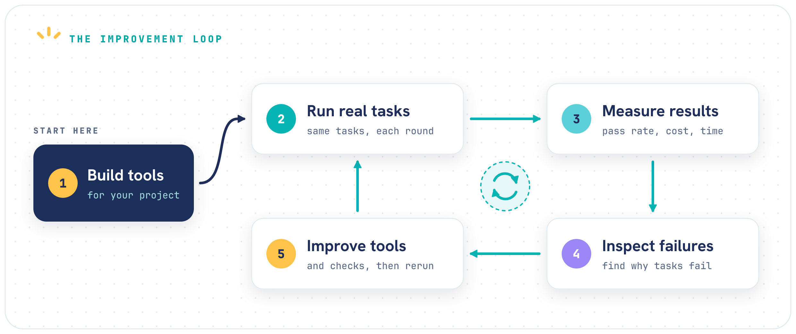
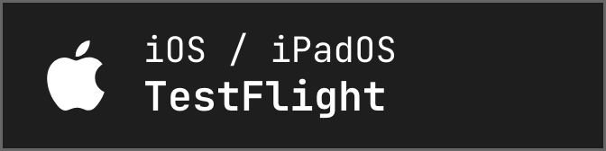
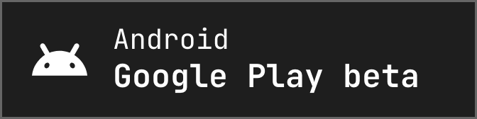

<p align="center">
  <picture>
    <source media="(prefers-color-scheme: dark)" srcset="logo.png">
    
  </picture>
</p>

<div align="center">
  <h2>
    <a href="https://clojars.org/com.blockether/vis"></a>
    <a href="https://pypi.org/project/vis-agent/"></a>
    <a href="https://github.com/Blockether/vis/blob/main/LICENSE">
      
    </a>
    <a href="https://vis.blockether.com/"></a>
    <a href="https://vis.blockether.com/extensions/"></a>
  </h2>
</div>

# Vis

Vis is a coding agent you can adapt to your tools and workflow.
Give it tools for your project, measure the results on real tasks, and use failures
to improve those tools and checks.

<p align="center">
  <picture>
    <source media="(prefers-color-scheme: dark)" srcset=".github/assets/vis-loop-dark.png">
    
  </picture>
</p>

Repeat the same tasks after each change to compare the results.

Follow the work from your terminal, browser, desktop or phone, with the same
sessions on each.

## Install

For macOS (Apple silicon) and Linux (x64 or ARM64). On Windows, use WSL2.
You can [read the installer](https://github.com/Blockether/vis/releases/download/installer/install-vis-agent) first.

```bash
curl -fsSL https://github.com/Blockether/vis/releases/download/installer/install-vis-agent | bash
```

Then run `vis-agent tui` (terminal), `vis-agent web` (browser) or `vis-agent desktop` (desktop app).
All clients show the same sessions.

<p>
<a class="store-windows" href="https://github.com/Blockether/vis/releases/download/v0.5.19/vis-companion-0.5.19-windows-x64.msi"></a>
<a class="store-macos" href="https://github.com/Blockether/vis/releases/download/v0.5.19/vis-companion-0.5.19-macos-universal.dmg"></a>
<a class="store-linux" href="https://github.com/Blockether/vis/releases/download/v0.5.19/vis-companion-0.5.19-linux-x64.AppImage"></a>
<a class="store-apple" href="https://testflight.apple.com/join/4anYT4Wk"></a>
<a class="store-android" href="https://play.google.com/apps/testing/com.blockether.viscompanion"></a>
</p>

[Linux ARM64](https://github.com/Blockether/vis/releases/download/v0.5.19/vis-companion-0.5.19-linux-arm64.AppImage) · [All packages](https://github.com/Blockether/vis/releases/latest) · [Other installation options](resources/vis-docs/distributions.md) · [Pair a phone](resources/vis-docs/index.md#pair-a-phone)

## Documentation

Read the manual at [vis.blockether.com](https://vis.blockether.com/).

## License

Apache License 2.0 — see [LICENSE](LICENSE).

The speech service can install third-party models with separate license terms.
[THIRD_PARTY_MODELS.md](THIRD_PARTY_MODELS.md) lists their authors and licenses.
