<p align="center">
  <picture>
    <source media="(prefers-color-scheme: dark)" srcset="logo.png">
    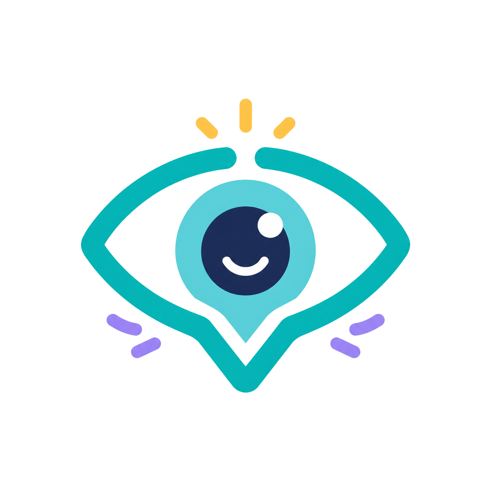
  </picture>
</p>

<div align="center">
  <h2>
    <a href="https://clojars.org/com.blockether/vis"></a>
    <a href="https://pypi.org/project/vis-agent/"></a>
    <a href="https://github.com/Blockether/vis/blob/main/LICENSE">
      
    </a>
    <a href="https://vis.blockether.com/"></a>
    <a href="https://vis.blockether.com/extensions/"></a>
  </h2>
</div>

# Vis

Vis is a coding agent you can adapt to your tools and workflow.
Give it tools for your project, measure the results on real tasks, and use failures
to improve those tools and checks.

Follow the work from your terminal, browser, desktop or phone, with the same
sessions on each.

## Install

Install Vis on the computer where your projects live. The installer does not need
Java or Git. Native packages support Apple silicon macOS and Linux (x64 or ARM64).
On Windows, use Linux in WSL2. See [Runtime distributions](resources/vis-docs/distributions.md)
for source builds and other installation options.

The installer writes to `~/.local/bin` and can update your shell profile. You can
[read it first](https://github.com/Blockether/vis/releases/download/installer/install-vis-agent).

```bash
curl -fsSL https://github.com/Blockether/vis/releases/download/installer/install-vis-agent | bash
```

This installs the engine, Python and two of the three clients. All clients show the
same sessions, so you can start a task in one client and continue it in another.

| Client | What it is | How to get it |
| --- | --- | --- |
| [Terminal client (TUI)](resources/vis-docs/index.md#in-the-terminal) | Vis in your terminal, in the project directory. | Included. Run `vis-agent tui`. |
| [Web app](resources/vis-docs/distributions.md#open-the-web-app) | Vis in a browser, on this computer or on other devices on your network. | Included. Run `vis-agent web`. |
| Companion app | Vis on your desktop, phone or tablet, connected to the engine on your computer. | Run `vis-agent desktop` on macOS or Linux to download and open it automatically.<br><br>Or install the desktop app:<br><a class="store-windows" href="https://github.com/Blockether/vis/releases/download/v0.5.17/vis-companion-0.5.17-windows-x64.msi">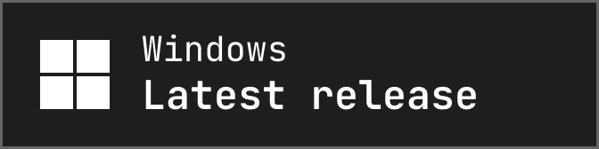</a><br><a class="store-macos" href="https://github.com/Blockether/vis/releases/download/v0.5.17/vis-companion-0.5.17-macos-universal.dmg">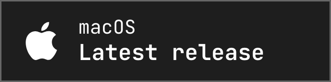</a><br><a class="store-linux" href="https://github.com/Blockether/vis/releases/download/v0.5.17/vis-companion-0.5.17-linux-x64.AppImage">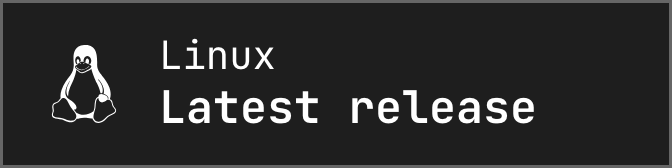</a><br>[Linux ARM64](https://github.com/Blockether/vis/releases/download/v0.5.17/vis-companion-0.5.17-linux-arm64.AppImage) · [All packages](https://github.com/Blockether/vis/releases/latest) · [Desktop setup](resources/vis-docs/distributions.md#open-the-desktop-app)<br><br>Phone and tablet (public beta):<br><a class="store-apple" href="https://testflight.apple.com/join/4anYT4Wk">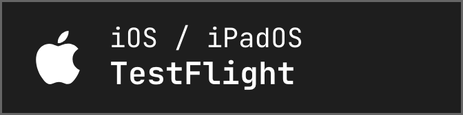</a><br><a class="store-android" href="https://play.google.com/apps/testing/com.blockether.viscompanion">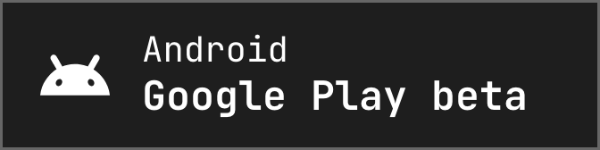</a><br>[Connect the desktop app](resources/vis-docs/index.md#connecting-the-companion-app) · [Pair a phone](resources/vis-docs/index.md#pair-a-phone) |

## Rationale

A capable model can write code, but it does not know how your team works. It does not know which
tests matter, how changes get reviewed or what to check before a release. You do. Vis lets you put
that knowledge into tools the agent can use, instead of a growing list of reminders.

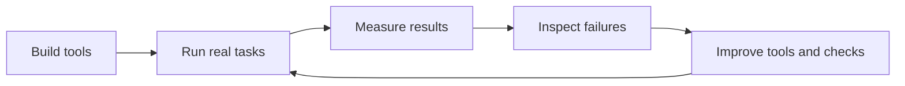

Repeat the same tasks after each change to compare the results.

For example, a function can select and run the right tests for a change. A hook
can check the code after an edit and report problems. You define the operations
and checks. The model decides how to combine them. Your instructions explain the
process, while your code carries out its repeatable parts.

Python connects those steps. Models already use it to work with code and data.
Vis lets them use the same language to compose your tools, inspect results and
reuse useful helper functions. You can start with the built-in tools and add
[extensions](resources/vis-docs/extending.md) as you need them.

You can also see how the answer was reached. **Activities** show actions, results
and failures in the conversation. Your extensions choose what to show, so you
can read a test result or build summary without deciphering a stream of shell
commands. Switch devices to follow the same work, rather than start again.

Read the full [Rationale](resources/vis-docs/rationale.md) in the manual.

## Documentation

Read the manual at [vis.blockether.com](https://vis.blockether.com/) or in
[`resources/vis-docs/`](resources/vis-docs/). Its five modules, in reading order:

- **Intro**: [Rationale](resources/vis-docs/rationale.md) and [Getting started](resources/vis-docs/index.md).
- **Concepts**: one page for each feature, such as [Sessions](resources/vis-docs/sessions.md).
- **Programmatic access**: [Python SDK](resources/vis-docs/python-sdk.md), [Python API reference](https://vis.blockether.com/python-sdk-api/) and [HTTP API](resources/vis-docs/http-api.md).
- **Extensions**: [Extending Vis](resources/vis-docs/extending.md), [code checks example](resources/vis-docs/extension-design.md#check-code-complexity-after-edits) and the [Extension Center](https://vis.blockether.com/extensions/).
- **Reference**: exact facts, such as [Keyboard shortcuts](resources/vis-docs/keyboard-shortcuts.md).

## Screenshot gallery

All images come from one demo project, `fieldnotes`, after real tasks: a project tour,
a bug fix with a regression test and a release preparation.

<table width="100%">
  <tr>
    <td width="42%" align="center"><a href="resources/vis-docs/assets/screenshots/desktop-conversation.png">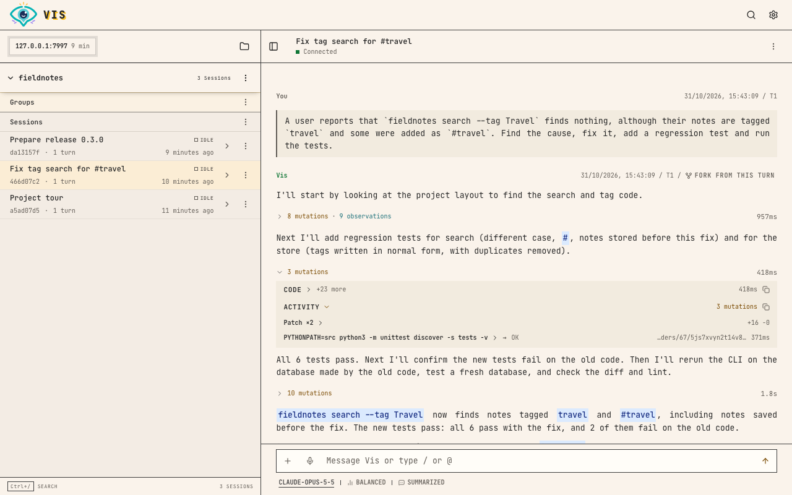</a></td>
    <td width="15%" align="center"><a href="resources/vis-docs/assets/screenshots/ios-conversation.png">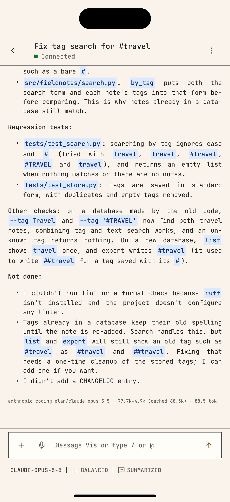</a></td>
    <td width="43%" align="center"><a href="resources/vis-docs/assets/screenshots/tui-conversation.png">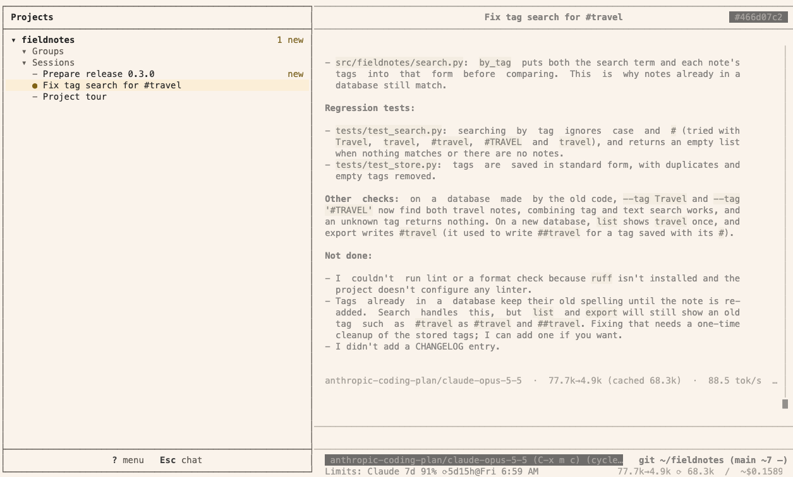</a></td>
  </tr>
  <tr>
    <td width="42%" align="center"><a href="resources/vis-docs/assets/screenshots/desktop-release.png">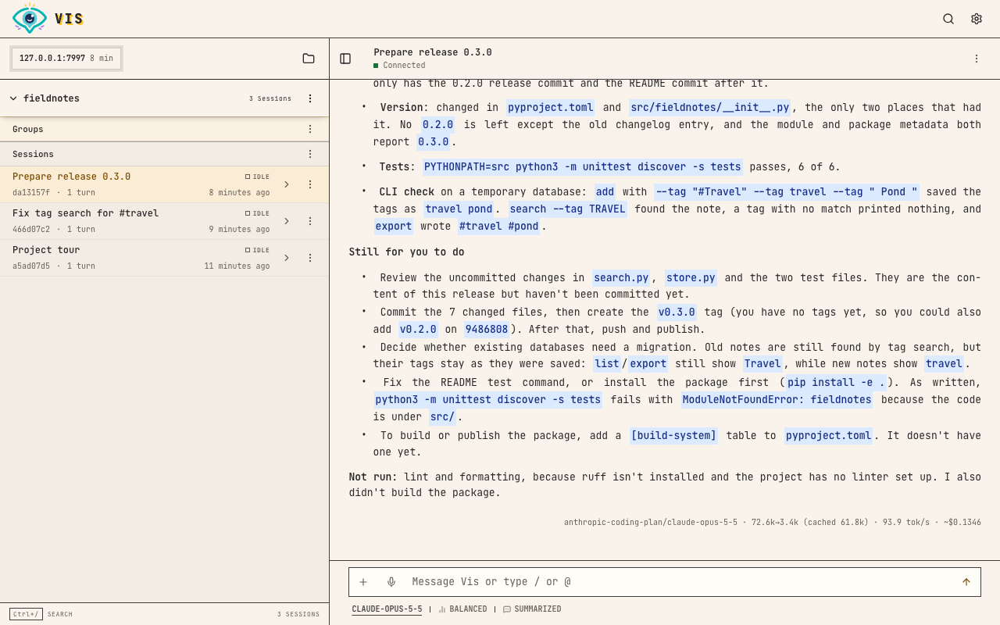</a></td>
    <td width="15%" align="center"><a href="resources/vis-docs/assets/screenshots/ios-project.png">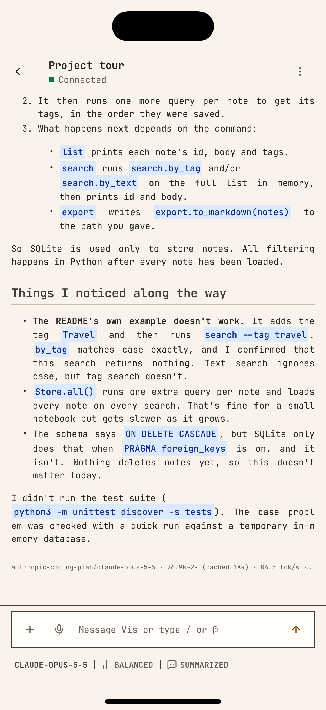</a></td>
    <td width="43%" align="center"><a href="resources/vis-docs/assets/screenshots/tui-sessions.png">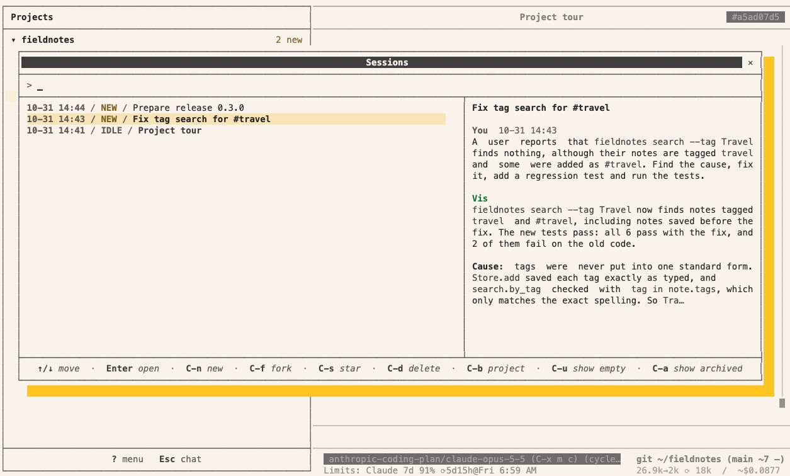</a></td>
  </tr>
  <tr>
    <td width="42%" align="center"><a href="resources/vis-docs/assets/screenshots/desktop-settings.png">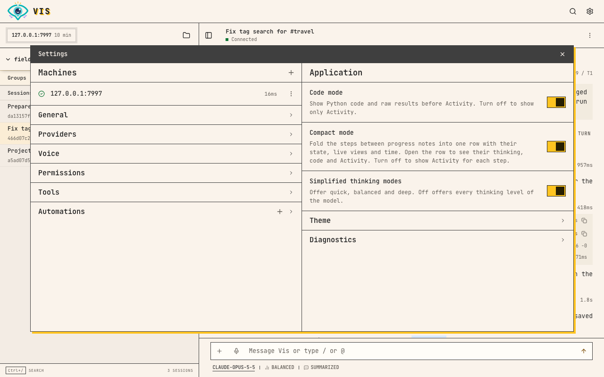</a></td>
    <td width="15%" align="center"><a href="resources/vis-docs/assets/screenshots/ios-sessions.png">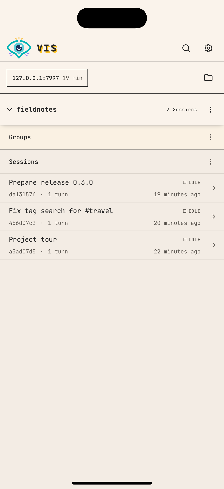</a></td>
    <td width="43%" align="center"><a href="resources/vis-docs/assets/screenshots/tui-settings.png">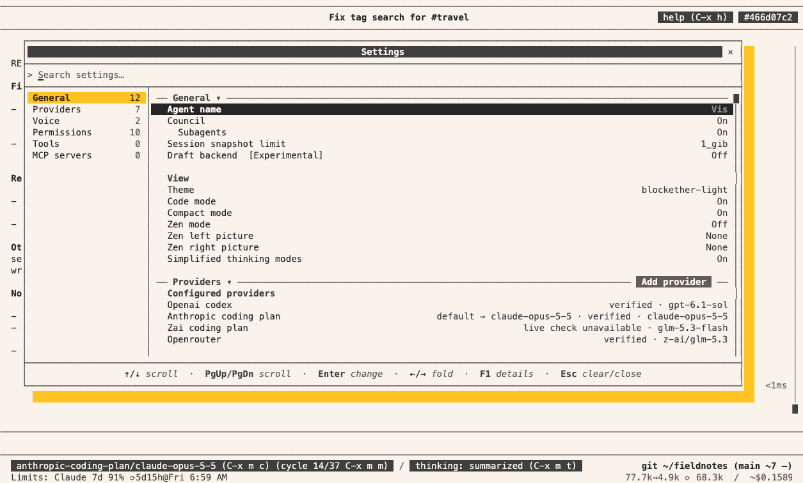</a></td>
  </tr>
</table>

## License

Apache License 2.0 — see [LICENSE](LICENSE).

The speech service can install third-party models with separate license terms.
[THIRD_PARTY_MODELS.md](THIRD_PARTY_MODELS.md) lists their authors and licenses.
