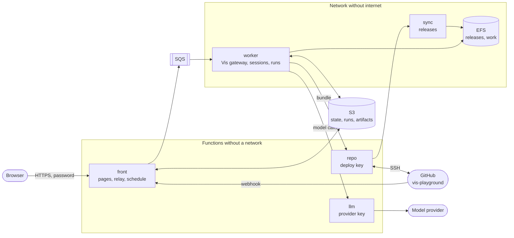

# Vis playground on AWS Lambda

This example runs Vis as a service on AWS Lambda. The Python runtime that Vis embeds
is the custom runtime of each function. Amazon S3 is the database. A GitHub repository
on Amazon EFS is the project of each session. The example has a web application with
three pages, a Vis extension and a set of workflows on the Vis SDK.

| You want to | Read |
| --- | --- |
| See the parts and the data flow | [Architecture](#architecture) |
| Know what a session can and cannot get | [Security](#security) |
| Start the stack in your account | [Deploy](#deploy) |
| Write a workflow | [Workflows](#workflows) |
| Use structured output for a decision | [`decide.py`](decide.py) |

The page `/play/architecture` of a deployed stack shows the same design with diagrams.

## Architecture



One container image holds all the code. The variable `VIS_ROLE` selects the function.

| Function | Network | Holds | Work |
| --- | --- | --- | --- |
| `front` | public address | the password, the webhook secret | Checks the password. Serves the pages and Vis web. Sends each call to the worker through SQS and streams the answer from S3. Starts a worker when work waits. |
| `worker` | private, no internet | no secret | Runs the Vis gateway and the workflow runs. Saves the Vis home directory to S3. |
| `llm` | none | the provider URL and key | Accepts `GET /models` and `POST /chat/completions`. Adds the key and streams the answer. |
| `repo` | none | the GitHub deploy key | Copies the `main` branch to S3. Pushes the commits of a session. |
| `sync` | private, no internet | no secret | Puts a snapshot on EFS and makes it the current release. |

### The custom runtime

The image starts from Amazon Linux 2023 and has no AWS base image and no runtime
interface client. Its entry point is the Python interpreter of the Vis release:

```dockerfile
ENTRYPOINT ["/opt/vis/vis-agent-python/python/bin/python3", "-m", "playground"]
```

[`playground/runtime.py`](playground/runtime.py) speaks the Lambda Runtime API with
the standard library. It supports plain answers and streamed answers.

### S3 is the database

| Key | Content | Life |
| --- | --- | --- |
| `lease.json` | The worker that lives, its last checkpoint and the work that waits | permanent |
| `state/<worker>/<n>.tar.gz` | A checkpoint of the Vis home directory: sessions, transcripts, settings | the last one |
| `workflows/<name>.py` | The source of a workflow | permanent |
| `runs/<run>/…` | The record of a run, its source and the result of each activity | permanent |
| `artifacts/<session>/<name>` | The documents of a session | permanent |
| `tmp/<session>/<path>` | The files that a session wrote in `/tmp` and in its project | 7 days |
| `relay/<call>/…` | The parts of one answer on the way to the browser | 1 day |
| `outbox/<id>.bundle` | The commits that a session publishes | 1 day |
| `repo/HEAD`, `repo/snapshots/<commit>.tar.gz` | The `main` branch | 30 days |

Only one worker lives at a time. A worker takes `lease.json` with a conditional write.
It saves a checkpoint when the home directory changed and names the checkpoint in the
lease with a second conditional write. A worker that lost the lease cannot replace
newer state. All sessions live in the one home directory, so the stack holds many
sessions and each new worker gets them all.

### A commit becomes the project of the next worker

1. GitHub calls the webhook `/hooks/github`. The `front` function checks the signature and starts `repo`. A schedule also starts `repo` each 15 minutes.
2. `repo` clones `main` with the deploy key and writes `repo/snapshots/<commit>.tar.gz`.
3. `sync` extracts the snapshot into a hidden directory and renames it to `releases/<commit>`.
4. `sync` writes a new `CURRENT` file and renames it over the old one.

Each step ends with one rename. A reader sees the old release or the new release, and
never a part of one. A worker reads `CURRENT` one time, at its start. Thus each new
worker uses the newest commit, and a worker that lives keeps its release until it stops.
A workflow run gets its own clone in `work/<commit>-<run>`.

### A session publishes to GitHub

The worker has no route to GitHub and no key. The tool `playground.publish(message)`
commits the work, makes a Git bundle of the new commits and puts it in `outbox/`. The
`repo` function verifies the bundle and pushes it. When `main` did not move, the push
goes to `main`. Else it goes to a branch `playground/<id>`. The function never uses
force. The deploy key opens only this one repository.

A session can thus change `main`: a release is equal to `main`, not to reviewed code.
GitHub runs the files of `.github` with internet access, so `repo` refuses a push that
changes this directory, and `deploy.sh` turns off GitHub Actions for the repository.

### Temporary work goes to S3

The extension has a hook after each `python_execution`, `patch` and `shell` operation.
The hook finds the files that changed in `/tmp` and in the project directory and sends
them to `tmp/<session>/`. The Files tab of a session shows them. S3 removes them after
7 days. The hook copies only regular files. It does not follow a link.

## The web application

| Address | Content |
| --- | --- |
| `/` | Vis web, with the provider of the stack |
| `/play` | The sessions and their Vis activities. Download a transcript. Fork from a turn or from an artifact. Publish the work. |
| `/play/workflows` | The workflow editor with Python highlighting, the activity dialog and the runs |
| `/play/architecture` | The design with diagrams |

The pages work on a phone and on a desktop. They use no framework and no build step.

## Workflows

A workflow is one Python file on the Vis SDK. An activity is a recorded step. When a
worker stops in the middle of a run, the next worker starts the run again and each
completed activity returns its recorded result.

```python
from typing import Literal

from playground.workflows import activity, workflow
from pydantic import BaseModel


class Analysis(BaseModel):
    readiness: Literal["build", "clarify"]
    questions: list[str]


@activity(title="Analysis of the story")
def analyse(ctx, story: str) -> Analysis:
    return ctx.ask(f"Analyse this user story.\n\n{story}", Analysis)


@activity(title="Generate the SPEC")
def spec(ctx, story: str):
    return ctx.document("SPEC.md", f"Write the specification for: {story}")


@workflow(title="Story to SPEC")
def story_to_spec(ctx, story: str = "As a customer I want to pay with a saved card."):
    analysis = analyse(ctx, story)
    if analysis.readiness == "build":
        return {"spec": spec(ctx, story).name}
    return {"questions": analysis.questions}
```

- `ctx.ask(request, Model)` calls `Session.run(request, response_model=Model)` of the SDK and returns a validated Pydantic object. The workflow branches on it.
- `ctx.document(name, request)` lets the session write a document and save it with `playground.save_artifact`. The document is in S3, in the transcript and in the run.
- `ctx.artifact(name, content)` saves a document that the workflow made.

The directory [`workflows/`](workflows) has five workflows: `story_to_spec`,
`incident_triage`, `lead_qualification`, `repository_review` and `change_and_publish`.
The first worker copies them to S3. After that, the page edits the copies in S3.

### The extension

[`extension/playground.py`](extension/playground.py) gives each session the alias `playground`:

| Call | Result |
| --- | --- |
| `playground.workflows()` | The workflows |
| `playground.run_workflow(name, input)` | A new run |
| `playground.run_status(run_id)` | The state of a run |
| `playground.save_artifact(name, content)` | A document in S3 |
| `playground.artifacts()` | The documents of the session |
| `playground.publish(message)` | A push to GitHub |

In Vis web, the command `/workflows` opens a panel that starts a workflow and shows its runs.

### A decision script

[`decide.py`](decide.py) runs on your computer and uses the stack as its Vis gateway. A
session reads an invoice and returns a validated `Review`. Python code applies the
payment policy and selects one of three next steps.

```sh
PLAYGROUND_URL=https://<id>.lambda-url.<region>.on.aws PLAYGROUND_PASSWORD=... python decide.py
```

## Security

| Threat | Control |
| --- | --- |
| A session reads the provider key | Only the `llm` role can read the key. The worker has no SSM permission and no route to SSM. |
| A session calls another provider API | `llm` accepts two calls and only the models of the stack. |
| A session sends data to the internet | The network has no internet gateway and no NAT gateway. The resolver answers only for `amazonaws.com` names. Each endpoint accepts only the resources of this stack. |
| A session pushes to another repository | Only `repo` has a key. The key is a deploy key of one repository. |
| A session rewrites history | `repo` never uses force. A push that is not a fast-forward goes to a new branch. |
| A session makes GitHub run its code | `repo` refuses a push that changes `.github`. GitHub Actions is off for the repository. Do not turn on GitHub Actions in this repository: a workflow on `main` runs the code that a session wrote. |
| A session changes the release of the next worker | `sync` owns `releases/` and `CURRENT`. The worker has another user id on EFS and cannot write there. EFS permits a mount only to the two function roles, each through its own access point. The worker role cannot write `repo/` in the bucket. |
| A bad download gets into the image | The base image has a digest, each downloaded file has a SHA-256 and each Python package has a hash. The extensions and the Maven artifacts have exact versions. |
| A person without the password calls the stack | The `front` function compares the password in constant time and sets a signed, `HttpOnly`, `SameSite=Strict` cookie that ends after 7 days. A request that changes data must come from the same origin. A new password is in effect after 5 minutes. |
| A false webhook | `front` checks the `X-Hub-Signature-256` of GitHub. |
| The credentials of the worker role leave the function | Each S3, SQS and Lambda permission of the worker role has the condition `aws:SourceVpc`. Outside the network of the stack, the credentials permit nothing. |
| A session deletes or overwrites data | The bucket keeps each old version of an object for 7 days. The worker can delete only `state/`, `relay/`, `workflows/` and `tmp/`. |
| A stored answer runs script in the browser | Each relayed answer has a `sandbox` content security policy, and `front` passes only a fixed list of answer headers. |
| A flood of requests makes a large bill | The functions have a concurrency limit: 50 for `front`, 5 for `worker`, 20 for `llm`, 1 for `repo` and 1 for `sync`. `llm` limits the output tokens of each call. |

### The limit that you must know

Lambda does not let a function make a new kernel namespace, a seccomp filter or a
Landlock rule set. Thus the Vis jail cannot start in a function, and the worker runs
without it. The code of a session runs as the user of the worker. It can read the
temporary credentials of the worker role and it can read and change the data of the
other sessions of the stack. For this reason:

- the worker role permits only the bucket prefixes, the queue and the three functions that the worker needs;
- each secret lives in a function that does not run the code of a session;
- one stack is for one team that shares its sessions. Give each tenant its own stack;
- the provider key has no spending limit in this stack. Set a budget for the key at the provider.

A session can also write in `work/` on EFS, which holds the project directories of the
workers and of the runs. It cannot write a release.

## Deploy

You need the AWS CLI, the GitHub CLI, `jq`, `openssl` and Docker or Podman.

```sh
REPOSITORY=<owner>/vis-playground \
PLAYGROUND_LLM_URL=https://api.openai.com/v1 PLAYGROUND_LLM_KEY=... \
./deploy.sh
```

The script is safe to run again. It does these steps:

1. Makes the repository from [`repo-seed/`](repo-seed), if GitHub does not have it.
2. Builds the image and pushes it to Amazon ECR.
3. Stores the secrets in the Parameter Store. It makes the password, the webhook secret and the deploy key.
4. Deploys [`template.yaml`](template.yaml).
5. Adds the webhook to the repository.
6. Starts the first fetch.

| Variable | Default | Use |
| --- | --- | --- |
| `STACK` | `vis-playground` | The name of the stack and the prefix of each resource |
| `AWS_REGION` | `eu-central-1` | The region |
| `ENGINE` | `docker` | `docker` or `podman` |
| `PLAYGROUND_MODELS` | empty | A JSON list of `{name, context, output_limit}`, when the provider has other models |

The stack reserves 77 concurrent executions for its functions. AWS keeps 100 for the
other functions of the account, so the Lambda concurrency limit of the account must be
177 or more.

To remove the stack, delete it in CloudFormation. Then delete the bucket, the ECR
repository and the parameters `/<stack>/*`.

### Cost

The stack has no cost for compute when nobody uses it. The two interface endpoints
and the EFS file system have a fixed cost of about 20 USD each month.

## Run it on your computer

`python -m playground.local` runs all five functions in one process, with directories
in place of S3, SQS, EFS and GitHub. Use it only for development: nothing isolates
the key there. Start it in the image, then open http://localhost:8080:

```sh
docker build --platform linux/arm64 -t vis-playground .
docker run --rm -p 8080:8080 --entrypoint /opt/vis/vis-agent-python/python/bin/python3 \
  -e PLAYGROUND_PASSWORD=local -e PLAYGROUND_LLM_URL=https://api.openai.com/v1 -e PLAYGROUND_LLM_KEY=... \
  vis-playground -m playground.local
```

## Files

| Path | Content |
| --- | --- |
| [`Dockerfile`](Dockerfile) | The image: Vis, the extensions, Git, Java, Clojure and the Maven cache. It holds the Vis release and its checksums |
| [`requirements/`](requirements) | The Python packages of the image, each with its hashes |
| [`extensions.yml`](extensions.yml) | The Vis extensions of the image |
| [`vendor.sh`](vendor.sh) | The editor and the fonts of the pages, each with its checksum |
| [`template.yaml`](template.yaml) | The stack |
| [`deploy.sh`](deploy.sh) | The deployment |
| [`playground/`](playground) | The five functions |
| [`extension/`](extension) | The Vis extension |
| [`workflows/`](workflows) | The first workflows |
| [`web/`](web) | The pages |
| [`repo-seed/`](repo-seed) | The first content of the repository |
| [`decide.py`](decide.py) | The decision script |
