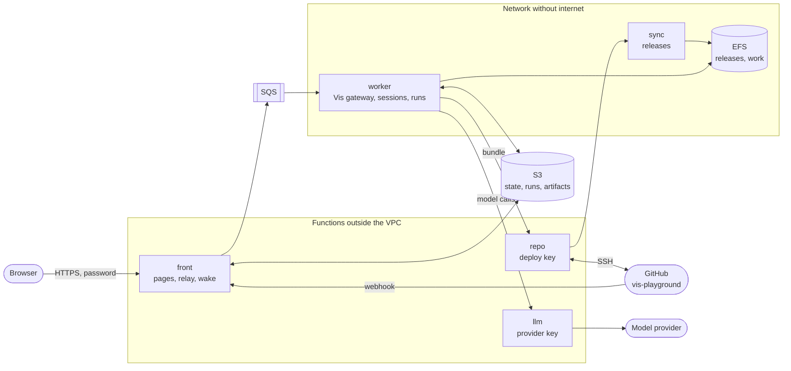

# Vis playground on AWS Lambda

This example runs Vis as a service on AWS Lambda. The Python runtime that Vis embeds
is the custom runtime of each function. Amazon S3 is the database. A GitHub repository
on Amazon EFS is the project of each session. The example has a web application with
four pages, a Vis extension and a set of workflows on the Vis SDK.

| You want to | Read |
| --- | --- |
| See the parts and the data flow | [Architecture](#architecture) |
| Call the stack from a script | [Addresses](#addresses) |
| Write a workflow | [Workflows](#workflows) |
| Make a specification from a README | [The software factory](#the-software-factory) |
| Read the files that a session attached | [Read the attached files with the SDK](#read-the-attached-files-with-the-sdk) |
| Use structured output for a decision | [`decide.py`](decide.py) |
| Know each limit of the stack | [Limits](#limits) |
| Know what a session can and cannot get | [Security](#security) |
| Start the stack in your account | [Deploy](#deploy) |

The page `/play/architecture` of a deployed stack shows the same design with diagrams.

## Architecture



One container image holds all the code. The variable `VIS_ROLE` selects the function.

| Function | Network | Holds | Work |
| --- | --- | --- | --- |
| `front` | public address | the password, the webhook secret | Checks the password. Serves the pages and Vis web. Sends each call to the worker through SQS and streams the answer from S3. Starts a worker when work waits. |
| `worker` | VPC, no internet | no secret | Runs the Vis gateway and the workflow runs. Saves the Vis home directory to S3. |
| `llm` | outside the VPC, internet access, no public address | the provider URL and key | Accepts `GET /models` and `POST /chat/completions`. Adds the key and streams the answer. |
| `repo` | outside the VPC, internet access, no public address | the GitHub deploy key | Copies the `main` branch to S3. Pushes the commits of a session. |
| `sync` | VPC, no internet | no secret | Puts a snapshot on EFS and makes it the current release. |

A worker is one invocation of the `worker` function. Only one worker is active at a
time. A release is a snapshot of the `main` branch on EFS.

### The custom runtime

The image starts from Amazon Linux 2023. It has no AWS Lambda base image and no runtime
interface client. Its entry point is the Python interpreter of the Vis version in the
image:

```dockerfile
ENTRYPOINT ["/opt/vis/vis-agent-python/python/bin/python3", "-m", "playground"]
```

[`playground/runtime.py`](playground/runtime.py) speaks the Lambda Runtime API with
the standard library. It supports plain answers and streamed answers.

### S3 is the database

| Key | Content | Kept for |
| --- | --- | --- |
| `lease.json` | The active worker, its last checkpoint and the work that waits | permanent |
| `state/<worker>/<n>.tar.gz` | A checkpoint of the Vis home directory: sessions, transcripts, attached files, settings | the last one; a checkpoint of a failed worker stays |
| `workflows/<name>.py` | The source of a workflow | permanent |
| `runs/index.json` | One line for each of the 300 newest runs | permanent |
| `runs/<run>/run.json` | The record of a run and of its workflow activities | permanent |
| `runs/<run>/workflow.py` | The source that the run uses, also after an edit of the workflow | permanent |
| `runs/<run>/results/<n>.json` | The result of workflow activity `n` | permanent |
| `runs/<run>/inputs/<key>.json` | A file that a person gave to a waiting run | permanent |
| `artifacts/<session>/<name>` | A copy of the newest version of each file that a session attached | permanent |
| `tmp/<session>/<path>` | The files that a session wrote in `/tmp` and in its project | 7 days |
| `relay/<call>/…` | The parts of one answer on the way to the browser | 1 day |
| `outbox/<id>.bundle` | The commits that a session publishes | 1 day |
| `repo/HEAD` | The commit of `main` at the last fetch | permanent |
| `repo/snapshots/<commit>.tar.gz` | One snapshot for each commit of `main` that the stack fetched | 30 days |

The bucket also keeps each old version of an object for 7 days.

A worker takes `lease.json` with a conditional write. It saves a checkpoint when the
home directory changed and names the checkpoint in the lease with a second conditional
write. Then it deletes the earlier checkpoint. A worker that lost the lease cannot
replace newer state. All sessions are in the one home directory, so the stack holds
many sessions and each new worker gets them all.

A worker that stops between the upload of a checkpoint and the lease write leaves that
checkpoint in `state/`. The template has no lifecycle rule for `state/`: a rule can
remove the only checkpoint of a stack that nobody used for some days. The lease names
the checkpoint that counts. You can delete each other object in `state/`.

### A commit becomes the project of the next worker

1. GitHub calls the webhook `/hooks/github`. The `front` function checks the signature and starts `repo`. A schedule also starts `repo` each 15 minutes.
2. `repo` clones `main` with the deploy key and writes `repo/snapshots/<commit>.tar.gz`.
3. `sync` extracts the snapshot into a hidden directory and renames it to `releases/<commit>`.
4. `sync` writes a new `CURRENT` file and renames it over the old one.

Steps 3 and 4 each end with one rename. A reader sees the old release or the new
release, and never a part of one. A worker reads `CURRENT` at its start for the project
of its sessions: a clone of that release in `work/<commit>`. Each new workflow run
reads `CURRENT` again and gets a clone of the newest release in `work/<commit>-<run>`.
`sync` keeps the 5 newest releases.

### A session publishes to GitHub

The worker has no route to GitHub and no key. The tool `playground.publish(message)`
commits the work, makes a Git bundle of the new commits and puts it in `outbox/`. The
`repo` function verifies the bundle and pushes it. When `main` did not move, the push
goes to `main`. Else it goes to a branch `playground/<id>`. The function never uses
force. A publication that repeats, with no new commit, pushes nothing and makes no
branch: the answer names the branch that has the commits and has `pushed` false. The
deploy key opens only this one repository.

Thus a session can change `main`. A release is a copy of `main`. No person reviews it
first. GitHub runs the files of `.github` with internet access, so `repo` refuses a
push that changes this directory, and `deploy.sh` turns off GitHub Actions for the
repository.

### Temporary work goes to S3

The extension has a hook after each `python_execution`, `patch` and `shell` operation.
The hook finds the files that changed in `/tmp` and in the project directory and sends
them to `tmp/<session>/tmp/` and `tmp/<session>/project/`. The Files tab of a session
shows them. S3 removes them after 7 days. The hook copies only regular files. It does
not follow a link.

### An artifact is a Vis attachment

A document of a session is a native Vis attachment. The extension adds no tool for it.
The model calls the verbs that each Vis session has:

```python
attach(content.encode(), "SPEC.md")  # save a document; the same name again is the next version
list_attachments()  # the files of the session
read_attachment("SPEC.md")  # the bytes of the newest version
```

Vis keeps each version of an attached file in the session, so the transcript shows the
file and a checkpoint holds it. The pages read documents from S3. Thus the API copies
each new attached file to `artifacts/<session>/<name>` when a page or a workflow lists
the artifacts of a session (`Api.mirror` in [`playground/api.py`](playground/api.py)).
The S3 object has the metadata `version` and `turn`, and the list gives the two values
for each file. S3 holds only the newest version of a name.

## The web application

| Page | Content |
| --- | --- |
| `/` | Vis web, with the provider of the stack |
| `/play` | The sessions and their Vis activities. Download a transcript. Fork from a turn or from an artifact. Publish the work. |
| `/play/workflows` | The workflow editor with Python highlighting, the workflow activity dialog and the runs. A waiting run shows where to give its file. |
| `/play/factory` | The software factory: the stations of the `software_factory` workflow as a line, a drop zone for the README, the SPEC with its GitHub commit, and the earlier orders |
| `/play/architecture` | The design with diagrams |

The pages work on a phone and on a desktop. They use no framework and no build step.

### The review of a session

The image has the Vis extension [`vis-review`](../../packages/vis-review). It records
each step of a session that changes files. After the first such step, the button
"Session apps" in the header of Vis web shows the app "Review": the changed files as a
diff, with an undo for a file, for a step and for the session. The command `/review` is
not necessary. The record of the review is in the Vis home directory, so each
checkpoint has it and a new worker shows the same review.

### The names of the projects

A project of Vis web has a name that a person can read:

| Project | Name |
| --- | --- |
| The project of a release | `<repository> · <subject of the commit>` |
| The project of a workflow run | `<title of the run> · <day and time of its start, UTC>` |

The worker gives the name when it makes the project. To change a name, use "Rename
project" in the project menu of Vis web. The worker does not replace a changed name.

## Addresses

The address of the stack is the Function URL of `front`: the output `Url` of the stack.
The pages, `/v1/` and `/play/api/` need the password. Send it as the header
`Authorization: Bearer <password>`, or sign in on a page to get the cookie. A browser
call that changes data must come from a page of the stack.

| Address | Password | Result |
| --- | --- | --- |
| `POST /login` | the form field `password` | Sets the cookie for 7 days and opens `/play` |
| `POST /logout` | no | Removes the cookie |
| `POST /hooks/github` | no; the signature of GitHub | Starts a fetch of `main` |
| `GET /play/assets/*`, `GET /play/vendor/*` | no | The scripts, the styles, the editor and the fonts of the pages |
| `GET /<file>` | no | The static files of Vis web |
| `GET /`, `/play`, `/play/workflows`, `/play/factory`, `/play/architecture` | yes; without it, the sign-in page | The pages |
| `/v1/*` | yes | The Vis gateway: sessions, turns, events, attached files |
| `/play/api/*` | yes | The playground API of the worker |

The playground API has these addresses below `/play/api/`. A body and an answer are JSON.

| Method and address | Body | Result |
| --- | --- | --- |
| `GET status` | | The release, the project directory, the repository, the models, the start time of the worker and the number of runs that are queued or running |
| `GET workflows` | | The workflows with their inputs and workflow activities |
| `POST workflows/check` | `{source}` | The description of a source that is not saved, or the syntax error |
| `GET workflows/<name>` | | One workflow with its source |
| `PUT workflows/<name>` | `{source}` | Saves a workflow |
| `DELETE workflows/<name>` | | Removes a workflow |
| `GET runs` | | The 100 newest runs |
| `POST runs` | `{workflow, input}` | Starts a run. `input` is an object of the inputs of the workflow |
| `GET runs/<id>` | | One run with its workflow activities, its source and its artifacts |
| `POST runs/<id>/cancel` | | Cancels a run and the turn of its session |
| `GET runs/<id>/inputs/<key>` | | The file that a person gave to the run, or `null` |
| `POST runs/<id>/inputs/<key>` | `{name, content}` | Gives a file to a waiting run and starts the run again |
| `GET artifacts?session=<id>` | | The artifacts of a session, each with `name`, `size`, `at`, `turn` and `version` |
| `GET artifacts/<session>/<name>` | | One artifact as a download |
| `GET tmp?session=<id>` | | The temporary files of a session |
| `GET tmp/<session>/<path>` | | One temporary file as a download |
| `POST publish` | `{root, message}` | Commits a project directory and pushes it to GitHub |
| `POST runs/<id>/events` | `{type, …}` | For the run process: records what the run did |
| `GET runs/<id>/results/<n>` | | For the run process: the recorded result of workflow activity `n` |
| `POST tmp` | `{session, files, removed}` | For the hook of the extension: copies the files that a session wrote |

## Workflows

A workflow is one Python file on the Vis SDK. A workflow activity is a recorded step:
a function with `@activity`. One run is one Vis session. When a worker stops in the
middle of a run, the next worker starts the run again and each completed workflow
activity returns its recorded result.

A worker stops 90 seconds before the Lambda time limit. It parks the turn that runs, and
the gateway of the next worker continues that turn. The run records the number of session
turns before each request. Thus the new run process waits for the turn that continues
and sends no second request. A run can use at most 12 processes. Vis continues one turn
in at most three new workers, so keep a turn shorter than about 40 minutes.

```python
from typing import Literal

from pydantic import BaseModel

from playground.workflows import activity, workflow


class Analysis(BaseModel):
    readiness: Literal["build", "clarify"]
    questions: list[str]


@activity(title="Analysis of the story")
def analyse(ctx, story: str) -> Analysis:
    return ctx.ask(f"Analyse this user story.\n\n{story}", Analysis)


@activity(title="Generate the SPEC")
def spec(ctx, story: str):
    return ctx.document("SPEC.md", f"Write the specification for: {story}")


@workflow(title="Story to SPEC")
def story_to_spec(ctx, story: str = "As a customer I want to pay with a saved card."):
    analysis = analyse(ctx, story)
    if analysis.readiness == "build":
        return {"spec": spec(ctx, story).name}
    return {"questions": analysis.questions}
```

This is a short form of [`workflows/story_to_spec.py`](workflows/story_to_spec.py).

| Call | Result |
| --- | --- |
| `@workflow(title=, description=, model=)` | Marks the one function that a run calls. Its arguments after `ctx` are the inputs of the run. `model` selects the model of the session. |
| `@activity(title=)` | Makes a function a workflow activity. Its first argument is `ctx`. |
| `ctx.ask(request, Model)` | Calls `Session.run(request, response_model=Model)` of the SDK and returns a validated Pydantic object. The workflow branches on it. |
| `ctx.ask(request)` | Returns the text of the answer. |
| `ctx.document(name, request)` | Lets the session write a document and attach it with `attach`. Then it reads the files of that turn with `Session.attachments` of the SDK. It returns an `Artifact` (`name`, `session`, `size`, `version`). The document is in the transcript, in S3 and in the run. |
| `ctx.receive(key, title, accept=".md,.txt")` | Waits for a file from a person. It returns an `Upload` (`key`, `name`, `size`, `text`). |
| `ctx.note(text)` | Adds a line to the log of the run. |

`ctx.ask` and `ctx.document` wait 900 seconds for a turn. Change this with `timeout=`.
When a turn attached no file with the name, `ctx.document` sends one more request.
After that, the workflow activity fails.

The directory [`workflows/`](workflows) has six workflows: `story_to_spec`,
`incident_triage`, `lead_qualification`, `repository_review`, `change_and_publish`
and `software_factory`. A worker copies them to S3 when S3 has no workflow. After
that, the page edits the copies in S3. A stack that has workflows does not get a new
sample from a later image: save its source on the Workflows page.

### A run waits for a person

`ctx.receive` gives the run the status `waiting`, and the run process ends. A waiting
run holds no worker and no place of the 3 runs that work at the same time. The
Workflows page and the Factory page show where to give the file. A script can give it too:

```sh
jq -n --rawfile content README.md '{name: "README.md", content: $content}' |
  curl -H "Authorization: Bearer $PLAYGROUND_PASSWORD" --data-binary @- \
    "$PLAYGROUND_URL/play/api/runs/<run>/inputs/readme"
```

The API accepts the file only when the run waits for that key. The file is text of at
most 300 000 bytes. The API stores it in `runs/<run>/inputs/<key>.json` and starts the
run again. The new run process gets each recorded result at once, and `ctx.receive`
returns the file. The record of the workflow activity keeps only the key, the name and
the size of the file.

### The software factory

[`workflows/software_factory.py`](workflows/software_factory.py) makes a specification
from a README and puts it in the GitHub repository. Its one input is `product`, the
name of the product.

| Station | Call | Result |
| --- | --- | --- |
| README intake | `ctx.receive("readme", …)` | The run waits for the README (`.md` or `.txt`) |
| Write the SPEC | `ctx.document("SPEC.md", …)` | The session attaches `SPEC.md`: nine sections, and an identifier for each requirement |
| Quality gate | `ctx.ask(…, Inspection)` | A validated `Inspection`: `verdict` (`pass` or `rework`), `score` (0 to 100) and `gaps` |
| Rework the SPEC | `ctx.document("SPEC.md", …)` | Only for `rework`: the session attaches the next version of `SPEC.md`. There is one rework at most. |
| Ship to GitHub | `ctx.ask(…, Shipment)` | The session writes the newest `SPEC.md` to the project directory and calls `playground.publish`. A validated `Shipment`: `branch`, `commit` and `url` |

The page `/play/factory` shows these stations as a line. Drop the README on the page
to start an order. The page then shows the state of each station, the SPEC, its
commit on GitHub and the earlier orders. Without the page, start a run of
`software_factory` and give the file as in [A run waits for a person](#a-run-waits-for-a-person).

### The extension

[`extension/playground.py`](extension/playground.py) gives each session the alias `playground`:

| Call | Result |
| --- | --- |
| `playground.workflows()` | The workflows |
| `playground.run_workflow(name, input)` | A new run. `input` is an object of the inputs, or a text for the first input |
| `playground.run_status(run_id)` | The state of a run, its workflow activities and its artifacts |
| `playground.publish(message)` | A push to GitHub |

The extension has no tool for documents: see [An artifact is a Vis attachment](#an-artifact-is-a-vis-attachment).
Its prompt tells the model to use `attach`.

In Vis web, the command `/workflows` opens a panel that starts a workflow and shows its
runs. `/workflows <name> <input>` starts a run without the panel.

### Read the attached files with the SDK

The Vis SDK gives the files that a session attached: of the whole conversation, of one
turn, of some turns or of the last turn.

```python
from blockether.vis.engine import GatewayClient

with GatewayClient(url, token=password) as client:
    session = client.session(session_id)
    session.attachments()  # the whole conversation, oldest turn first
    session.attachments(-1)  # the last turn; 0 is the first turn
    session.attachments(turn_id)  # one turn: a turn ID or a `Turn`
    session.attachments([0, -1])  # some turns

    turn = session.send("Write the plan. Attach it as PLAN.md.")
    turn.wait(timeout=600)
    for file in turn.attachments():
        print(file.turn_id, file.filename, file.version, file.size)
        plan = file.text()  # `file.read()` gives the bytes
```

The list holds only metadata: `read()` and `text()` download the file. When a session
attached a name more than one time, the list has each version. A file that a person
sent with a request is not in the list. These calls need `vis-agent` 0.5.18 or later
and a gateway of the same Vis version. `ctx.document` and `decide.py` use them.

### A decision script

[`decide.py`](decide.py) runs on your computer and uses the stack as its Vis gateway. A
session reads an invoice and returns a validated `Review`. Python code applies the
payment policy and selects one of three next steps. For `reject`, the session attaches
the reply to the vendor, and the script reads the files of the last turn with
`session.attachments(-1)`.

```sh
PLAYGROUND_URL=https://<id>.lambda-url.<region>.on.aws PLAYGROUND_PASSWORD=... \
  uv run --with vis-agent==0.5.18 python decide.py
```

A script that waits for a long turn must know one rule. The `front` function ends an
event stream after 870 seconds, and a worker ends its streams when it stops. The Vis web
app connects again. `Turn.wait` and `Session.run` of the SDK 0.5.18 also connect again,
until their `timeout`. They raise `TransportError` only when repeated connections bring
no new event. The turn continues in the stack: read `session.turns()`, or call `wait`
again.

## Limits

Runs and workflows:

- 3 runs work at the same time. The other runs wait in the queue. A waiting run uses no place.
- A run can use at most 12 processes. Each worker change and each given file starts a new process.
- A run can have at most 1000 workflow activities.
- `runs/index.json` holds the 300 newest runs, and `GET runs` returns the 100 newest.
- The name of a workflow and the key of `ctx.receive` have the form `[a-z][a-z0-9_]{1,39}`.
- A workflow file has exactly one function with `@workflow` and at most 200 000 characters.
- A file for a waiting run is text of at most 300 000 bytes. Its name starts with a letter or a digit and has at most 80 characters: letters, digits, `.`, `_`, `-` and spaces.
- `ctx.ask` and `ctx.document` wait 900 seconds for a turn, if you do not set `timeout=`.
- Vis continues one turn in at most three new workers.

Files:

- The API copies an attached file to S3 when its size is at most 2 000 000 bytes and its name has the form of the line above. A larger file stays only in the session.
- The hook copies a written file of at most 1 000 000 bytes. It does not copy `.git`, `__pycache__`, `node_modules`, `.cpcache`, `.venv`, `target`, `.pytest_cache`, `.ruff_cache`, `.clj-kondo` and `.lsp`. It reads at most 20 000 files of a directory.
- A Git bundle for `repo` has at most 100 000 000 bytes. A commit message has at most 200 characters.
- A model request has at most 5 000 000 bytes and asks for one answer.

Time:

- The `front` function waits 55 seconds for the first part of an answer. Then it answers 504.
- An event stream ends after 870 seconds. The client connects again.
- A worker without work stops after 300 seconds. A worker with work gives the work to a new worker after 810 seconds.
- The cookie ends after 7 days. A new password is in effect after 5 minutes.
- `sync` keeps the 5 newest releases on EFS.
- The worker removes a project directory that nothing changed for 14 days. Publish the work before that.
- CloudWatch keeps the log of each function for 14 days. [S3 is the database](#s3-is-the-database) gives the time for each S3 key.

## Security

| Threat | Control |
| --- | --- |
| A session reads the provider key | Only the `llm` role can read the key. The worker has no SSM permission and no route to SSM. |
| A session calls another provider API | `llm` accepts two calls and only the models of the stack. |
| A session sends data to the internet | The network has no internet gateway and no NAT gateway. The resolver answers only for `amazonaws.com` names. Each endpoint accepts only the resources of this stack. |
| A session pushes to another repository | Only `repo` has a key. The key is a deploy key of one repository. |
| A session rewrites history | `repo` never uses force. A push that is not a fast-forward goes to a new branch. |
| A session makes GitHub run its code | `repo` refuses a push that changes `.github`. GitHub Actions is off for the repository. Do not turn on GitHub Actions in this repository: a workflow on `main` runs the code that a session wrote. |
| A session changes the release of the next worker | `sync` owns `releases/` and `CURRENT`. The worker has another user id on EFS and cannot write there. EFS permits a mount only to the two function roles, each through its own access point. The worker role cannot write `repo/` in the bucket. |
| A bad download gets into the image | The base image has a digest. Each file that `curl` downloads has a SHA-256 and each Python package has a hash. The extensions and the Maven artifacts have an exact version, but no hash. The `dnf` packages have no version and no hash in the `Dockerfile`. |
| A person without the password calls the stack | The `front` function compares the password in constant time and sets a signed, `HttpOnly`, `SameSite=Strict` cookie that ends after 7 days. A request that changes data must come from the same origin. A new password is in effect after 5 minutes. The static files are public. The pages, `/v1/` and `/play/api/` need the password or the cookie. |
| A false webhook | `front` checks the `X-Hub-Signature-256` of GitHub. |
| The credentials of the worker role leave the function | Each S3, SQS and Lambda permission of the worker role has the condition `aws:SourceVpc`. Outside the network of the stack, the credentials permit only a write to the log group of the worker. |
| A session deletes or overwrites data | The bucket keeps each old version of an object for 7 days. The worker can delete only `state/`, `relay/`, `workflows/` and `tmp/`. |
| A stored answer or a stored file runs script in the browser | Each relayed answer has a `sandbox` content security policy, and `front` passes only a fixed list of answer headers. The API sends each artifact and each temporary file as plain text and as a download. |
| A flood of requests makes a large bill | The functions have a concurrency limit: 50 for `front`, 5 for `worker`, 20 for `llm`, 1 for `repo` and 1 for `sync`. A call cannot ask for more output tokens than the limit of the model. |

### The limit that you must know

Lambda does not let a function make a new kernel namespace, a seccomp filter or a
Landlock rule set. Thus the Vis jail cannot start in a function, and the worker runs
without it. The gateway and the tools of a session have no AWS credentials in their
environment. But the code of a session runs as the user of the worker. It can read
the temporary credentials of the worker role from the worker process. It can call the
Lambda Runtime API of the worker. It can read and change the data of the other
sessions of the stack. For this reason:

- the worker role permits only the bucket prefixes, the queue and the three functions that the worker needs;
- each secret is in a function that does not run the code of a session;
- one stack is for one team that shares its sessions. Give each tenant its own stack;
- the provider key has no spending limit in this stack. Set a budget for the key at the provider.

A session can also write in `work/` on EFS, which holds the project directories of the
workers and of the runs. It cannot write a release.

## Deploy

You need:

- the AWS CLI version 2, with credentials that can make the stack;
- the GitHub CLI, signed in with admin rights for the repository;
- `git`, `ssh-keygen`, `jq` and `openssl`;
- Docker or Podman.

```sh
REPOSITORY=<owner>/vis-playground \
PLAYGROUND_LLM_URL=https://<provider>/v1 PLAYGROUND_LLM_KEY=... \
PLAYGROUND_MODELS='[{"name":"<model>","context":<tokens>,"output_limit":<tokens>}]' \
./deploy.sh
```

The script is safe to run again. It does these steps:

1. Makes the private repository from [`repo-seed/`](repo-seed), if GitHub does not have it. Turns off GitHub Actions for the repository. Adds the ruleset "main is append-only", if the GitHub plan permits a ruleset.
2. Builds the image and pushes it to Amazon ECR. ECR keeps the 5 newest images.
3. Stores the secrets in the Parameter Store. It makes the password, the webhook secret and the deploy key. GitHub gets the public half of the deploy key, with write access.
4. Deploys [`template.yaml`](template.yaml).
5. Adds the webhook to the repository.
6. Starts the first fetch. Starts the worker one time and sends one request to the stack: Lambda loads a new image at the first start, and that start is slow. Then it prints the address of the stack and the command that reads the password.

| Variable | Default | Use |
| --- | --- | --- |
| `REPOSITORY` | none; necessary | The GitHub repository, as `owner/name` |
| `PLAYGROUND_LLM_URL` | none; necessary at the first run | The base URL of an OpenAI-compatible provider. It must use `https` |
| `PLAYGROUND_LLM_KEY` | none; necessary at the first run | The key of the provider |
| `PLAYGROUND_MODELS` | `glm-5.3`, `gpt-oss-120b`, `qwen3.8-max` | A JSON list of `{name, context, output_limit}`. Set it for each other provider: `llm` refuses a model that is not in the list |
| `STACK` | `vis-playground` | The name of the stack and the prefix of each resource |
| `AWS_REGION` | `eu-central-1` | The region |
| `ENGINE` | `docker` | `docker` or `podman`. The stack of this example was made with `podman` |

The script keeps each secret that exists. To change the provider URL, the provider key
or the password, write the parameter `/<stack>/llm-url`, `/<stack>/llm-key` or
`/<stack>/password` with `aws ssm put-parameter --overwrite`. The `llm` function reads
its parameters when a new instance starts. The `front` function reads the password
again after 5 minutes.

The stack reserves 77 concurrent executions for its functions. AWS keeps 100 for the
other functions of the account, so the Lambda concurrency limit of the account must be
177 or more.

The functions read these optional variables. The template does not set them. To change
one, add it to the `Environment` of the function in `template.yaml`.

| Variable | Default | Function | Use |
| --- | --- | --- | --- |
| `VIS_IDLE_S` | `300` | `worker` | The seconds without work after which a worker stops |
| `VIS_LIFETIME_S` | `900` | `worker`, `front` | The Lambda time limit of the worker. It must be equal to the `Timeout` of the worker in the template |
| `VIS_HANDOFF_MARGIN_S` | `90` | `worker`, `front` | The seconds before the time limit at which a worker gives its work to a new worker |
| `VIS_STREAM_S` | `870` | `front` | The seconds after which an event stream ends |

To remove the stack:

1. Delete the stack in CloudFormation. This also deletes the EFS file system with each project directory: publish the work first.
2. Empty the bucket with all its versions, then delete it. The bucket stays after the stack.
3. Delete the ECR repository and the parameters `/<stack>/*`.
4. Remove the webhook, the deploy key and the ruleset from the GitHub repository.

### Cost

When nobody uses the stack, the only compute is the schedule: it calls `front` each
minute and `repo` each 15 minutes. The two interface endpoints and the EFS file system
have a fixed cost of about 20 USD each month. S3 and the 5 images in ECR add the cost
of their storage.

## Run it on your computer

`python -m playground.local` runs all five functions in one process. It has directories
in place of S3, EFS and GitHub, and a list in place of SQS. The repository starts from
the copy of [`repo-seed/`](repo-seed) in the image. The data is in `/tmp/local` of the
container and goes away with it. Use it only for development: nothing isolates the key
there. Start it in the image, then open http://localhost:8080:

```sh
docker build --platform linux/arm64 -t vis-playground .
docker run --rm -p 8080:8080 --entrypoint /opt/vis/vis-agent-python/python/bin/python3 \
  -e PLAYGROUND_PASSWORD=local -e PLAYGROUND_LLM_URL=https://<provider>/v1 -e PLAYGROUND_LLM_KEY=... \
  -e VIS_MODELS='[{"name":"<model>","context":<tokens>,"output_limit":<tokens>}]' \
  vis-playground -m playground.local
```

Here the list of models is in `VIS_MODELS`: `deploy.sh` reads `PLAYGROUND_MODELS` and
the stack gives the value to the functions as `VIS_MODELS`.

| Variable | Default | Use |
| --- | --- | --- |
| `PLAYGROUND_LOCAL` | `/tmp/local` | The directory of the data |
| `PLAYGROUND_SEED` | `/opt/playground/repo-seed` | The first content of the repository |
| `PORT` | `8080` | The port of the server |

## Files

| Path | Content |
| --- | --- |
| [`Dockerfile`](Dockerfile) | The image: Vis, the extensions, Git, Java, Clojure, the Maven cache, and Python 3.13 with pytest and ruff for the project. It holds the Vis version and its checksums |
| [`requirements/`](requirements) | The Python packages of the image, each with its hashes |
| [`extensions.yml`](extensions.yml) | The Vis extensions of the image |
| [`vendor.sh`](vendor.sh) | The editor and the fonts of the pages, each with its checksum |
| [`known_hosts`](known_hosts) | The SSH host keys of GitHub that `repo` accepts |
| [`template.yaml`](template.yaml) | The stack |
| [`deploy.sh`](deploy.sh) | The deployment |
| [`playground/`](playground) | The five functions |
| [`extension/`](extension) | The Vis extension |
| [`workflows/`](workflows) | The first workflows |
| [`web/`](web) | The pages |
| [`repo-seed/`](repo-seed) | The first content of the repository |
| [`decide.py`](decide.py) | The decision script |
| [`ruff.toml`](ruff.toml) | The format of the Python code: the rules of the repository, with lines of at most 200 characters |
