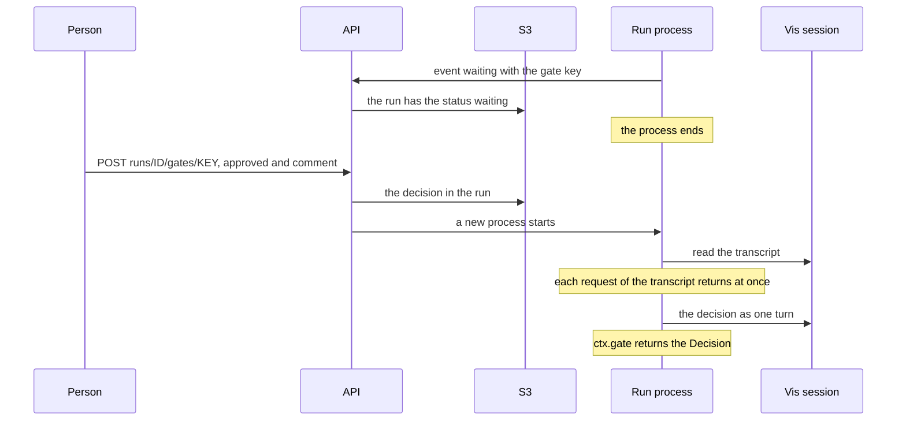

# Software factory: Vis on AWS Lambda

This example runs Vis as a service on AWS Lambda. Amazon S3 is the database. A GitHub
repository on Amazon EFS is the project, and each session works in its own clone of it.
On top are durable workflows on the Vis SDK: a run is one Vis session, it continues
after a worker stops, and it can wait at a gate until a person approves or rejects.

The project is [MIDI Studio](https://github.com/Blockether/midi-studio), in which each
song is [music21](https://www.music21.org/) code. It is a repository of its own, with
its own deployment.

| You want to | Read |
| --- | --- |
| See the parts | [Architecture](#architecture) |
| Write a workflow with a gate | [Workflows](#workflows) |
| Start the stack | [Deploy](#deploy), [Run it on your computer](#run-it-on-your-computer) |
| Know the size, the cold start and the speed | [Performance](#performance) |
| Know each key, address, limit and variable | [docs/reference.md](docs/reference.md) |
| Know what a session can and cannot get | [docs/security.md](docs/security.md) |

## Architecture


One container image holds all the code, and the variable `VIS_ROLE` selects the
function. The entry point is the Python runtime that Vis embeds: the image has no AWS
Lambda base image.

| Function | Holds | Work |
| --- | --- | --- |
| `front` | the webhook secret | Serves the pages and Vis web. Sends each call to the worker through SQS and streams the answer from S3. |
| `worker` | no secret, no internet | Runs the Vis gateway and the workflow runs. Saves the Vis home directory and the work of each session to S3. |
| `llm` | the provider key | Adds the key to a model call of the gateway. It is the only way from the worker to the provider. |
| `repo` | the GitHub deploy key | Copies `main` to S3 and pushes the commits of a session. It never uses force. |
| `sync` | no secret | Puts a snapshot of `main` on EFS as the current release. |

- **One worker at a time.** A worker takes the lease in S3 with a conditional write and
  saves checkpoints of the Vis home directory. Before the Lambda time limit, it gives
  its work to a new worker. Without work, it stops: nothing runs when nobody uses the stack.
- **A commit on `main` becomes a release.** A new session and a new run get a clone of
  the newest release. `durable.resync()` puts the work of a session on a newer release.
- **A session publishes with `durable.publish(message)`.** The push goes to `main` when
  `main` did not move, else to a branch `durable/<id>`.

## Workflows

A workflow is one Python file. The function with `@workflow` is its entry, and each
step is a function with `@activity`. The transcript of the session is the record of a
run: each request of an activity is one turn, and a decision at a gate is one turn too.
A new process starts the function again, and a request that the transcript has returns
the answer of its turn at once. Thus decide only from the input and from the answers of
the session. The Python code of an activity runs again in each new process.

No work runs again by itself. A person can retry a failed run with the button Retry in
a fork, and a workflow can retry an activity with `@activity(retries=2)`. A retry forks
the session: the fork has the transcript before the failed activity, and the run
continues in the fork. The session of the failed attempt stays as it is. The files of
the work directory do not go back.

```python
from pydantic import BaseModel

from durable.workflows import activity, workflow


class Work(BaseModel):
    song: str
    tests_passed: bool


@activity(title="Write the song sheet")
def specify(ctx, prompt: str):
    return ctx.document("SONG.md", f"Write the song sheet for: {prompt}")


@activity(title="Approve the song sheet")
def approve(ctx, sheet):
    return ctx.gate("sheet", "Approve the song sheet", document=sheet)


@activity(title="Record the song")
def record(ctx) -> Work:
    return ctx.ask("Record the song of SONG.md as code and run the tests.", Work)


@workflow(title="Song factory")
def song_factory(ctx, prompt: str = "A slow song about a night train"):
    sheet = specify(ctx, prompt)
    if approve(ctx, sheet).approved:
        return record(ctx)
```

| Call | Result |
| --- | --- |
| `@workflow(title=, description=, model=)` | The entry of the file. Its parameters are the inputs of a run |
| `@workflow(activities=[...], requests=[...])` | The middleware of the run: functions around each activity and around each request |
| `@activity(title=, retries=0)` | A step of a run. With `retries`, a failed step runs again in a fork of the session |
| `ctx.ask(request, Model)` | A validated Pydantic object from the session |
| `ctx.ask(request)` | The answer as text |
| `ctx.ask(request, llm="qwen3.8-max")` | The answer of another language model, for this request only. `ctx.document` and `ctx.delegate` take `llm=` too |
| `ctx.delegate(tasks)` | The session gives each task to its own subagent. Returns the answer of each subagent, in the order of the tasks |
| `ctx.document(name, request)` | The session writes a file and attaches it. Returns a `Document` |
| `ctx.gate(key, title, about="", document=None)` | Stops the run until a person decides. Sends the decision to the session as one turn. Returns a `Decision` with `approved` and `comment` |
| `ctx.note(text)` | A line in the record of the run |

### Models and subagents

A run uses the model of its session: `@workflow(model=)` selects it. `llm=` selects
another model of the stack for one request, and the next request uses the model of the
session again. A request on another model does not use the prompt cache.

```python
@activity(title="Review the song")
def review(ctx) -> list[str]:
    plan = ctx.ask("Name the two weakest parts of the song.", llm="qwen3.8-max")
    return ctx.delegate([
        {"task": f"Check the chords. {plan}", "role": "research", "title": "Chords"},
        {"task": f"Check the drums. {plan}", "role": "research", "model": "gpt-oss-120b"},
    ])
```

A task of `ctx.delegate` is a text, or a `Task`: a typed dict with `task` and optional
`title`, `role` (`research`, `implement` or `verify`), `model`, `provider`,
`iteration_budget` and `files`. A type checker refuses another field or another role.
A subagent has the context of the session and works in the same directory.
The session starts the subagents in one turn, with a Python block that `ctx.delegate`
gives. The answers come from the tool output of that turn, not from the text of the
session. Thus the transcript has the delegation: a new process of the run and a fork
start no second subagent. The session answers a subagent that asks a question. A
subagent that does not complete fails the activity.

### Middleware

A workflow can have middleware, as a Ring handler has. A middleware is a function
around a call: it gets the context, the call as a value and the next function. An
activity still returns its typed result, and the workflow function stays plain Python.

```python
from collections.abc import Callable
from dataclasses import replace
from typing import TypeVar

from durable.workflows import Context, Reply, Request, Send, Step, activity, workflow

T = TypeVar("T")


def audited(ctx: Context, step: Step, call: Callable[[], T]) -> T:
    result = call()
    ctx.note(f"{step.title} gave a {type(result).__name__}")
    return result


def cheap(ctx: Context, request: Request, send: Send) -> Reply:
    if ctx.step and ctx.step.name == "specify":
        return send(replace(request, llm="qwen3.8-max"))
    return send(request)


@workflow(title="Song factory", activities=[audited], requests=[cheap])
def song_factory(ctx, prompt: str = "A slow song about a night train"):
    ...
```

| Middleware | Gets | The next function |
| --- | --- | --- |
| `activities=[...]` | Each activity as a `Step`: `seq`, `name`, `title`, `arguments` and `named` | `call()` runs the activity and returns its result |
| `requests=[...]` | Each request of an activity as a `Request`: `text`, `llm`, `provider` and `timeout` | `send(request)` returns a `Reply`: the `text` of the answer and the `turn_id` |

- The types are real for a type checker: an activity has the arguments and the result type of its function, and `ctx.ask(request, Model)` gives a `Model`. No type of the SDK is `Any`.
- `arguments` and `named` of a `Step` hold `object` values, because one middleware gets each activity. Use `isinstance` before you use a value.
- The first middleware of a list is the outer one.
- `ctx.step` is the activity that runs.
- A middleware of `activities` returns the result type of the activity: `call: Callable[[], T]` and `-> T`. It can return another result of that type, or a result for an activity that failed. A type checker cannot know the type of a result that the middleware makes itself, so give it with `typing.cast`. With `retries`, each attempt goes through the middleware.
- A middleware of `requests` can change the request with `dataclasses.replace`, and it can send more than one request. The decision of a gate does not go through it.
- A middleware runs again in each new process of the run, as the code of an activity does. The transcript knows a request by the text that the last middleware sends. Thus a middleware that changes the text must give the same text each time.

### A gate

A gate is the one way in which a run waits for a person. The run has no process while
it waits, and a waiting run uses none of the 3 places for runs.



A later process of the run reads the decision in the transcript. A fork that ends
before the gate does not have the decision turn, so the run sends the decision again.

A decision is for the document that the person read: the gate keeps its name, its
version and its size with the decision. When the run has another version of the
document in its new process, the decision does not apply. The run writes a note and
waits again with the new version. This occurs when an activity that made the document
runs again, for example after a change of the run record between two deployments.

A person decides in one of four places: the Workflows page, the Factory page, the
Gates tab of the Workflows app in Vis web, or the API. A decision is approve or
reject, with an optional comment. One key holds one decision. For a second decision, use a new
key: `sheet_1`, then `sheet_2`.

### The three workflows

| Workflow | Input | Work |
| --- | --- | --- |
| [`song_factory`](workflows/song_factory.py) | `prompt` | From a prompt to a song on GitHub, with two gates |
| [`studio_review`](workflows/studio_review.py) | none | Runs the tests and the lint, reads each song and writes `REVIEW.md`. High findings also get a fix plan |
| [`remix_and_publish`](workflows/remix_and_publish.py) | `request` | Changes one song. When the tests pass, pushes it to GitHub. Else writes a failure report |


The session records the song in its own clone and does not publish it. At the second
gate, the Review app of the session shows each change. Only an approval starts the
push. After 3 rejections at one gate, the run ends without a push.

## The pages

| Page | Content |
| --- | --- |
| `/dashboard` | The workflow editor and the runs. A waiting run shows its gate. `/` goes here |
| `/dashboard/factory` | The song factory as a line of stations: give a prompt, decide at each gate, see the commit |
| `/dashboard/vis` | Vis web with the sessions. The global apps button of its header opens the Workflows app: Run, Gates and History |

The stack has no sign-in: each person who has the address can use each page.

Vis web can take dictation. The image holds the speech-to-text model NVIDIA Parakeet
TDT 0.6B v3 (CC BY 4.0), and the worker loads it at the first recording.

## Deploy

You need the AWS CLI version 2, the GitHub CLI with admin rights for the repository,
`git`, `ssh-keygen`, `jq`, `openssl`, and Docker or Podman.

```sh
REPOSITORY=<owner>/midi-studio \
DURABLE_LLM_URL=https://<provider>/v1 DURABLE_LLM_KEY=... \
DURABLE_MODELS='[{"name":"<model>","context":<tokens>,"output_limit":<tokens>}]' \
./deploy.sh
```

The script is safe to run again and prints the address of the stack. Vis web and the
Vis apps show the stack with its machine name: `DURABLE_MACHINE_NAME`, else
`Software factory`. The fixed cost is
about 20 USD each month, for two interface endpoints and the EFS file system. The
image gives its workflows only to a stack that has none: a stack with workflows keeps
its own files.

## Performance

Measured on 2026-11-15 in `eu-central-1` on arm64, with a small number of samples.
The times of a call are from one computer in Europe.

| Measure | Value |
| --- | --- |
| Image in ECR | 1.58 GB compressed, 3.64 GB on disk. The speech model is 0.49 GB of the compressed size |
| Cold start of a function (`Init Duration`) | `front` 0.3 to 0.4 s, `worker` 0.6 to 1.2 s, `llm` 0.4 to 0.6 s, `repo` 0.4 s, `sync` 0.7 s. The first start after a new image: 1.4 s |
| Worker start, from the invocation to a ready gateway | 1.9 to 2.1 s: state from S3 0.1 s, project 0.1 s, Vis gateway 1.7 to 1.9 s |
| First answer when no worker runs | 3.9 to 4.1 s for `GET /healthz` through `front`, SQS, `worker` and S3 |
| Answer when a worker runs | 0.3 s for the same call and for `GET /dashboard/api/status` |
| Page `/dashboard` | 0.2 to 0.3 s. `front` serves a page without the worker |
| Memory in use | `front` 86 MB, `llm` 81 MB, `repo` 104 MB, `sync` 69 MB. `worker` 634 MB with an idle gateway, 2953 MB with the speech model and two runs |
| Dictation of 6.4 s of speech | 7.5 s for the first recording, which loads the model, then 0.6 s |
| Run of `song_factory` | 14 to 24 minutes: 1 to 3 minutes to the song sheet, 11 to 20 minutes to record the song. A script decided each gate at once |
| Run of `remix_and_publish` | 8 minutes |

A worker stops after 300 s without work, so the next call pays the first answer time
again. A run continues when its worker changes.

## Run it on your computer

`python -m durable.local` runs all five functions in one process, with directories in
place of S3, EFS and GitHub. Use it only for development: nothing isolates the key there.

```sh
docker build --platform linux/arm64 -t durable-lambda .
docker run --rm -p 8080:8080 --entrypoint /opt/vis/vis-agent-python/python/bin/python3 \
  -e DURABLE_LLM_URL=https://<provider>/v1 -e DURABLE_LLM_KEY=... \
  -e VIS_MODELS='[{"name":"<model>","context":<tokens>,"output_limit":<tokens>}]' \
  durable-lambda -m durable.local
```

Then open http://localhost:8080.

## Security

- Only `llm` can read the provider key and only `repo` has the deploy key. The worker
  network has no route to the internet.
- The stack has no sign-in. Give the address only to people that you trust.
- The Vis jail cannot start in Lambda. The code of a session runs as the user of the
  worker and can read the data of the other sessions: one stack is for one team.
- A gate is a step of a workflow. It is not a security control.

[docs/security.md](docs/security.md) has each threat and its control.

## Files

| Path | Content |
| --- | --- |
| [`durable/`](durable) | The five functions. [`settings.py`](durable/settings.py) is the one module that reads the environment |
| [`durable/workflows/`](durable/workflows) | The workflow SDK, the runs and the process of one run |
| [`workflows/`](workflows) | The three workflows |
| [`extension/`](extension) | The Vis extension with the alias `durable` |
| [`web/`](web) | The pages |
| [`Dockerfile`](Dockerfile), [`requirements/`](requirements), [`extensions.yml`](extensions.yml), [`vendor.sh`](vendor.sh) | The image, with a hash for each download |
| [`template.yaml`](template.yaml), [`deploy.sh`](deploy.sh) | The stack and its deployment |
| [`docs/`](docs) | The reference and the security page |
