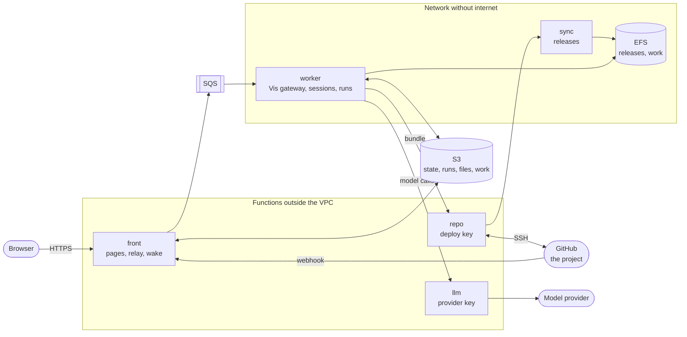
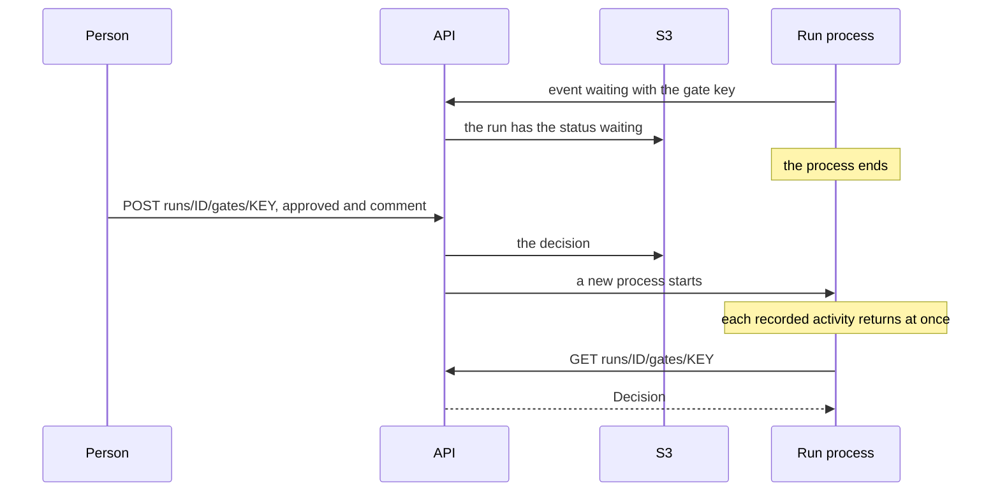
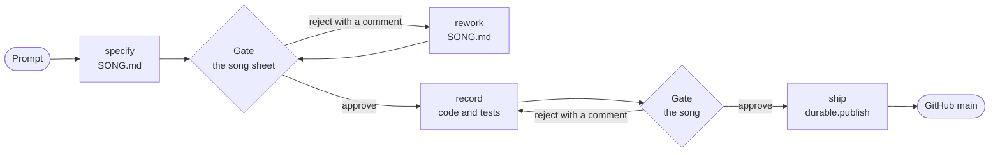

# Durable Lambda: Vis on AWS Lambda

This example runs Vis as a service on AWS Lambda. Amazon S3 is the database. A GitHub
repository on Amazon EFS is the project, and each session works in its own clone of it.
On top are durable workflows on the Vis SDK: a run is one Vis session, it continues
after a worker stops, and it can wait at a gate until a person approves or rejects.

The project is [MIDI Studio](https://github.com/Blockether/midi-studio), in which each
song is [music21](https://www.music21.org/) code. It is a repository of its own, with
its own deployment.

| You want to | Read |
| --- | --- |
| See the parts | [Architecture](#architecture) |
| Write a workflow with a gate | [Workflows](#workflows) |
| Start the stack | [Deploy](#deploy), [Run it on your computer](#run-it-on-your-computer) |
| Know each key, address, limit and variable | [docs/reference.md](docs/reference.md) |
| Know what a session can and cannot get | [docs/security.md](docs/security.md) |

## Architecture



One container image holds all the code, and the variable `VIS_ROLE` selects the
function. The entry point is the Python runtime that Vis embeds: the image has no AWS
Lambda base image.

| Function | Holds | Work |
| --- | --- | --- |
| `front` | the webhook secret | Serves the pages and Vis web. Sends each call to the worker through SQS and streams the answer from S3. |
| `worker` | no secret, no internet | Runs the Vis gateway and the workflow runs. Saves the Vis home directory and the work of each session to S3. |
| `llm` | the provider key | Adds the key to a model call of the gateway. It is the only way from the worker to the provider. |
| `repo` | the GitHub deploy key | Copies `main` to S3 and pushes the commits of a session. It never uses force. |
| `sync` | no secret | Puts a snapshot of `main` on EFS as the current release. |

- **One worker at a time.** A worker takes the lease in S3 with a conditional write and
  saves checkpoints of the Vis home directory. Before the Lambda time limit, it gives
  its work to a new worker. Without work, it stops: nothing runs when nobody uses the stack.
- **A commit on `main` becomes a release.** A new session and a new run get a clone of
  the newest release. `durable.resync()` puts the work of a session on a newer release.
- **A session publishes with `durable.publish(message)`.** The push goes to `main` when
  `main` did not move, else to a branch `durable/<id>`.

## Workflows

A workflow is one Python file. The function with `@workflow` is its entry, and each
step is a function with `@activity`. Durable Lambda records the result of each
completed activity in S3. A new process starts the function again and each recorded
activity returns its result at once. Thus decide only from the input and from the
results of activities.

```python
from pydantic import BaseModel

from durable.workflows import activity, workflow


class Work(BaseModel):
    song: str
    tests_passed: bool


@activity(title="Write the song sheet")
def specify(ctx, prompt: str):
    return ctx.document("SONG.md", f"Write the song sheet for: {prompt}")


@activity(title="Approve the song sheet")
def approve(ctx, sheet):
    return ctx.gate("sheet", "Approve the song sheet", document=sheet)


@activity(title="Record the song")
def record(ctx) -> Work:
    return ctx.ask("Record the song of SONG.md as code and run the tests.", Work)


@workflow(title="Song factory")
def song_factory(ctx, prompt: str = "A slow song about a night train"):
    sheet = specify(ctx, prompt)
    if approve(ctx, sheet).approved:
        return record(ctx)
```

| Call | Result |
| --- | --- |
| `@workflow(title=, description=, model=)` | The entry of the file. Its parameters are the inputs of a run |
| `@activity(title=)` | A step with a recorded result |
| `ctx.ask(request, Model)` | A validated Pydantic object from the session |
| `ctx.ask(request)` | The answer as text |
| `ctx.document(name, request)` | The session writes a file and attaches it. Returns a `Document` |
| `ctx.gate(key, title, about="", document=None)` | Stops the run until a person decides. Returns a `Decision` with `approved` and `comment` |
| `ctx.note(text)` | A line in the record of the run |

### A gate

A gate is the one way in which a run waits for a person. The run has no process while
it waits, and a waiting run uses none of the 3 places for runs.



A person decides in one of four places: the Workflows page, the Factory page, the
Gates tab of the Workflows app in Vis web, or the API. A decision is approve or
reject, with an optional comment. One key holds one decision. For a second decision, use a new
key: `sheet_1`, then `sheet_2`.

### The three workflows

| Workflow | Input | Work |
| --- | --- | --- |
| [`song_factory`](workflows/song_factory.py) | `prompt` | From a prompt to a song on GitHub, with two gates |
| [`studio_review`](workflows/studio_review.py) | none | Runs the tests and the lint, reads each song and writes `REVIEW.md`. High findings also get a fix plan |
| [`remix_and_publish`](workflows/remix_and_publish.py) | `request` | Changes one song. When the tests pass, pushes it to GitHub. Else writes a failure report |



The session records the song in its own clone and does not publish it. At the second
gate, the Review app of the session shows each change. Only an approval starts the
push. After 3 rejections at one gate, the run ends without a push.

## The pages

| Page | Content |
| --- | --- |
| `/` | Vis web. The global apps button of its header opens the Workflows app: Run, Gates and History |
| `/play` | The sessions: transcript, files, work directory, resync and publish |
| `/play/workflows` | The workflow editor and the runs. A waiting run shows its gate |
| `/play/factory` | The song factory as a line of stations: give a prompt, decide at each gate, see the commit |
| `/play/architecture` | This design with diagrams |

The stack has no sign-in: each person who has the address can use each page.

## Deploy

You need the AWS CLI version 2, the GitHub CLI with admin rights for the repository,
`git`, `ssh-keygen`, `jq`, `openssl`, and Docker or Podman.

```sh
REPOSITORY=<owner>/midi-studio \
DURABLE_LLM_URL=https://<provider>/v1 DURABLE_LLM_KEY=... \
DURABLE_MODELS='[{"name":"<model>","context":<tokens>,"output_limit":<tokens>}]' \
./deploy.sh
```

The script is safe to run again and prints the address of the stack. The fixed cost is
about 20 USD each month, for two interface endpoints and the EFS file system. The
image gives its workflows only to a stack that has none: a stack with workflows keeps
its own files.

## Run it on your computer

`python -m durable.local` runs all five functions in one process, with directories in
place of S3, EFS and GitHub. Use it only for development: nothing isolates the key there.

```sh
docker build --platform linux/arm64 -t durable-lambda .
docker run --rm -p 8080:8080 --entrypoint /opt/vis/vis-agent-python/python/bin/python3 \
  -e DURABLE_LLM_URL=https://<provider>/v1 -e DURABLE_LLM_KEY=... \
  -e VIS_MODELS='[{"name":"<model>","context":<tokens>,"output_limit":<tokens>}]' \
  durable-lambda -m durable.local
```

Then open http://localhost:8080.

## Security

- Only `llm` can read the provider key and only `repo` has the deploy key. The worker
  network has no route to the internet.
- The stack has no sign-in. Give the address only to people that you trust.
- The Vis jail cannot start in Lambda. The code of a session runs as the user of the
  worker and can read the data of the other sessions: one stack is for one team.
- A gate is a step of a workflow. It is not a security control.

[docs/security.md](docs/security.md) has each threat and its control.

## Files

| Path | Content |
| --- | --- |
| [`durable/`](durable) | The five functions. [`settings.py`](durable/settings.py) is the one module that reads the environment |
| [`durable/workflows/`](durable/workflows) | The workflow SDK, the runs and the process of one run |
| [`workflows/`](workflows) | The three workflows |
| [`extension/`](extension) | The Vis extension with the alias `durable` |
| [`web/`](web) | The pages |
| [`Dockerfile`](Dockerfile), [`requirements/`](requirements), [`extensions.yml`](extensions.yml), [`vendor.sh`](vendor.sh) | The image, with a hash for each download |
| [`template.yaml`](template.yaml), [`deploy.sh`](deploy.sh) | The stack and its deployment |
| [`docs/`](docs) | The reference and the security page |
