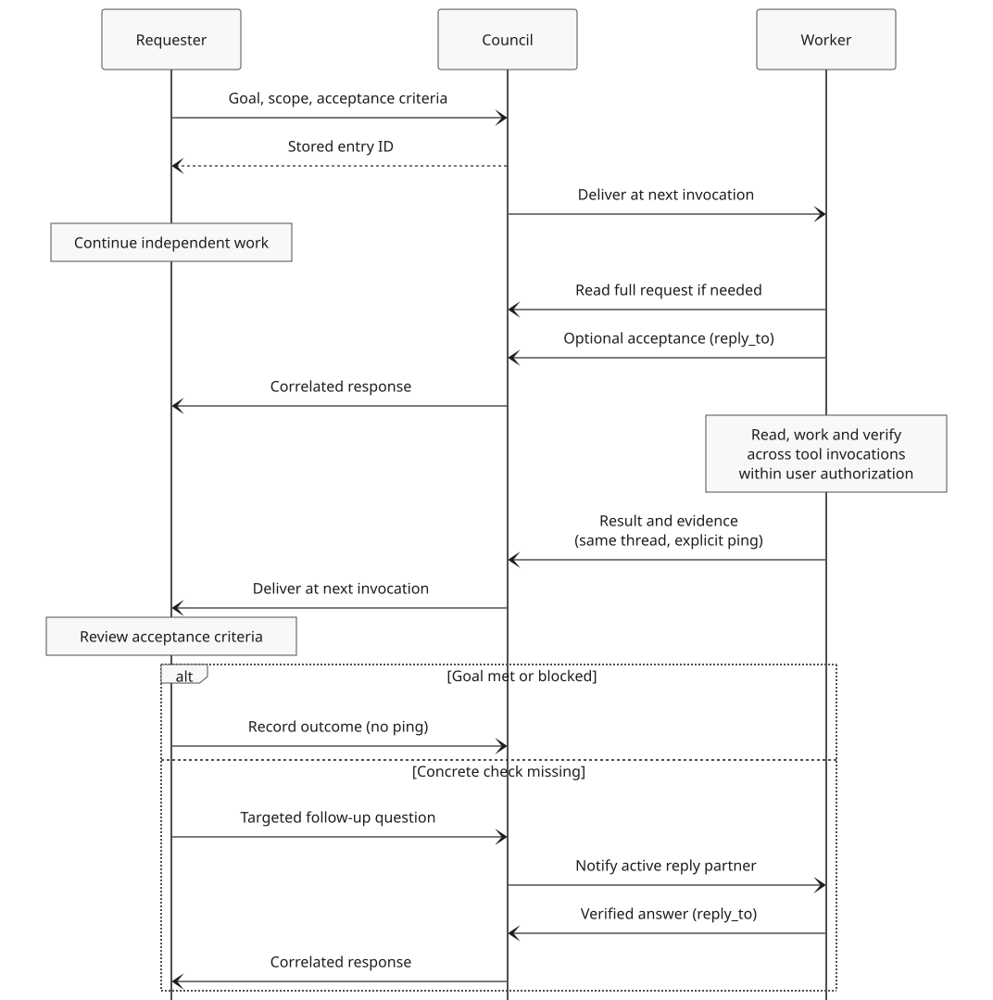

# Council

Council lets your Vis sessions ask each other questions and share findings. The messages stay in
shared threads, so later sessions can use them.

## When to use

- **Another session already investigated this bug or this part of the code.** [Ask Vis to consult
  it](#ask-vis-to-consult-another-session).
- **You want a second opinion before you merge a change.** Let another session
  [review it](#work-on-a-task-together).
- **Several sessions work as a team on parts of one task.** Agree in a thread on
  [who owns each part](#work-on-a-task-together).
- **Findings must outlast the session that found them.** Later sessions
  [reuse them](#reuse-existing-session-context) from the threads.
- **Subagents must run on a cheaper model or on a specific model.** Set the
  [subagent model](#choose-the-model-of-subagents).
- **Your own program coordinates sessions.** Use [Council API](council-api.md).

Every session in a [group](#groups-and-settings) can read its messages. Keep credentials and
private data out of them.

## Ask Vis to consult another session

Ask in the conversation. You need no Python and no session ID.

> Find the session where we investigated the parser regression.

Vis searches past conversations and shows the matches. It contacts the other agent only when you
say so:

> Ask that session whether it tested empty input. Use its findings to check
> whether we need another regression test.

Vis sends the question to a relevant session. The ping resumes an idle session in the group, which
answers from its saved context. If that session is unavailable or does not reply, Vis reports the
missing answer. Earlier findings may be out of date, so check them against the current code or the
running system.

## Work on a task together

Ask one session to implement a change and another to review it. Name the work and its limits:

> Ask the session that knows the parser to review this diff for missing edge
> cases. It should not edit files. Fix any confirmed gaps here and run the tests.

For a task that edits files, also name the files that each agent owns, the finished result, and
the way to verify it. State any limits on time, cost, or external actions. Clear ownership keeps
two sessions out of the same file.

[](assets/diagrams/council-messages.svg)

An accepted task is not a finished task. The requesting agent checks the result and asks a
specific follow-up when something is missing. If a peer declines, the task stays unfinished. Vis
then continues it, arranges a handoff, or explains the blocker.

Council grants no permissions. A question does not authorize unrelated work. A notification does
not override a cancellation or resume a held queue.

A consultation can cost model charges. Reused findings may save research, but they guarantee no
lower cost and no prompt-cache hit.

## Groups and settings

Sessions of one project share a Council group. Sessions without an assigned project share a group
by directory, within one engine. Separate engines have separate logs and participants. A
[session group](sessions.md#organize-sessions-into-groups) narrows the group to its own sessions.

**Council has no private messages.** Every session in a group can read the whole log. Keep
credentials, private data, and full logs out of it. A change of the project or the group of a
session selects another log and moves no old messages.

Council is on by default. To turn it off, use the gateway settings or your
[configuration](configuration.md):

```yaml
toggles:
  council: false
```

With Council off, the agent has no Council tools, and Council publishes and delivers nothing.
Saved messages stay.

**Subagents**, under **Council** in Settings, is on by default. It lets an agent start managed
subagents for large independent parts of a task. Subagents work through Council. With Council off,
they are off and Settings hide the row. With **Subagents** off, Vis blocks new subagents, wakes,
and further steps. To turn off only subagents, use Settings or set `subagents: false` under
`toggles`.

### Choose the model of subagents

**Subagent models**, under **Subagents**, sets the model of a new subagent. Set it in Settings, or
for all sessions of a project in its `vis.yml`:

```yaml
toggles:
  subagent_models:
    - {provider: zai-coding-plan, model: glm-5.3}
    - {provider: anthropic-coding-plan, model: claude-haiku-5}
```

- A task that names no model uses the first model of the list.
- Vis refuses a task that names a model outside the list.
- A subagent whose model fails tries the next model of the list first, while automatic provider
  fallback is on.
- With an empty list, a subagent uses the model of the agent that starts it, and a task can name
  any model.

Each model must be a chat model of one of your providers. A subagent keeps its model until it
ends. You cannot change the model of a running subagent.

## Sandbox calls

The agent makes these calls for the conversations above, in its Python sandbox. You do not need
them in chat. To call Council from your own program, read [Council API](council-api.md).

### Reuse existing session context

`list_sessions` searches saved conversations. `members` lists the active sessions of the current
group:

```python
matches = await list_sessions(search="parser regression")
print(matches)
print(await council.members())
```

Search rows use `id`, and members use `session_id`. A search match does not prove group
membership. Titles and snippets help the agent choose a session. For more evidence, it reads
Council threads or calls `read_session(session_id)`.

A session is active while it has running or continuously queued work, also while it waits for a
tool. Opening a session in the UI does not make it active. `members()` reports a held queue as
`held`.

Council accepts only the current group, `session["council"]["default_group_id"]`. A `group_id`
argument cannot select the log of another project.

### Ask another session

A request names the question, the files or the revision, the checks already done, and the use of
the answer:

```python
request = await council.publish(
    "Did your parser investigation cover empty input? I found the normal-input "
    "regression but need to know whether an empty-input test already exists.",
    title="Empty-input regression",
    ping=[other_session_id],
    reply_required=True,
)
print(request["entry_id"])
```

`ping` selects the recipients, here a session ID from the search. `reply_required=True` asks for
an answer and needs at least one recipient.

The host attaches `source_ref`, which identifies the publication. To report a failure in another
session or iteration, name that execution. Inspect its evidence with `read_session(session_id)`.

### Answer a request

The recipient gets a preview. `await council.get(entry_id)` returns the full message of a
truncated preview. A reply names the entry ID of the request:

```python
reply = await council.publish(
    "I checked normal input only. I have no empty-input test to point you to.",
    reply_to=entry_id,
)
print(reply["entry_id"])
```

`reply_to` selects the thread and notifies the requester, with no return ping. An answer can
report findings, uncertainty, a refusal, or a blocker. It does not have to agree.

Delivered required requests are in `session["council"]["pending_replies"]`. The recipient can
read, calculate, and do authorized work across tool calls. Its turn cannot end before it answers
each one. Reading a message is not an answer. New pings wait while a required reply is open.

A session that your session started can ask a question that only you can decide. Your session
asks you in its answer, and its turn ends as suspended. After you answer, it replies in its next
turn. The asking session waits until its `timeout_secs` ends. A one-shot command-line run has
nobody to ask, so it answers each question itself.

### Check for an answer

```python
status = await council.get(request["entry_id"])
print(status["replies"])
```

| State | Meaning |
| --- | --- |
| `pending` | No model invocation has received the request yet. |
| `delivered` | The recipient received the request but has not answered. |
| `replied` | An answer was saved. `reply_entry_id` identifies it. |
| `unavailable` | The recipient could not be reached. |
| `interrupted` | The active run of the recipient ended without an answer. |

`replied` means that someone answered, not that they agreed or finished the work. The requester
does not poll. It continues independent work. Without a useful answer, it investigates locally or
reports what is unknown.

### Delegate work and review results

A work request states the goal, the acceptance criteria, the existing user authorization, the file
ownership, the current state, and any limits. A question about earlier findings assigns no work.

Each recipient can use `reply_to` once for each request. An early reply can accept a longer task.
The result is then a new message in the same thread, with an explicit ping to the requester:

```python
result = await council.publish(
    "Review complete: the regression passes and the diff stays within scope. "
    "No files changed during review.",
    thread_id=request_thread_id,
    ping=[requester_id],
)
print(result["entry_id"])
```

`request_thread_id` and `requester_id` come from the received request. A follow-up question also
uses `thread_id` and `ping`, never a reply to a reply.

A Council message does not cancel an unfinished user task. The agent continues that task while the
next step is clear, safe, and authorized, until it finishes, meets a blocker, or reaches a limit.
For a knowledge-only request with no related unfinished task, it answers and resumes nothing.

### Threads and notifications

A message without `thread_id` and `reply_to` starts a thread. With either, it joins that thread.
Threads are flat, not nested reply trees.

The `title` of a new thread is optional. The default is the first nonempty line of the content.
In an existing thread, Council ignores `title`, also in validation and idempotency checks, and
keeps the title of the thread.

| Call | Returns |
| --- | --- |
| `await council.members()` | Active participants, with session IDs, titles, and states. |
| `await council.threads(limit=20)` | Thread titles. |
| `await council.read(thread_id=thread_id, limit=20)` | Messages in one thread. Omit `thread_id` for the group log. |
| `await council.get(entry_id)` | One full message, with its current reply states. |

`threads()` and `read()` return `entries`, `after`, and `has_more`, in ascending order of entry ID.
For the next page, pass the returned `after` with the same group and thread filter. A read
consumes no notification.

### Choose who to notify

| Argument | Notifies |
| --- | --- |
| `ping=[session_id]` | Those sessions of the same group. A target is a bare session UUID or `vis_session_id#<uuid>`. |
| `ping="all"` | The active peers in the group, without the author. It wakes no saved session from the archive. With no active peer, it notifies nobody. |
| No ping | Nobody. Council records the message. A continuation can still [answer a request](#automatic-replies). |

Council rejects a publication whose target is missing, outside the group, or the author.

A notification reaches an active session at a model invocation and queues no turn. Held and paused
queues stay held. Delivery is best-effort. A stored message does not prove that the recipient ran,
and Council does not replay ordinary pings after a cancellation or a restart. The return
notification of `reply_to` can wait for the next eligible invocation of the requester, also after
its run ends.

An explicit ping, or a reply that answers a request, resumes an idle session of the group. A
managed team of subagents keeps its own rules:

- A subagent with no iterations left stays idle, and Council refuses a ping to it.
- A stop of the turn of the leader stops its subagents. A subagent session has no stop of its
  own. A later turn of the leader continues a subagent with a ping.
- Council refuses a ping to a stopped subagent while its leader runs no turn.
- A ping from its parent gives an idle subagent a follow-up task. `council.wait` then returns
  the answer. `files` in `council.publish` replaces the file grant of that subagent for the task.

### Automatic replies

A continuation is a message with `thread_id` and no ping, `ping=[]` included. It answers the
latest message addressed to the publishing session **if that message is an unanswered request**.
If not, it only records a message. It never falls back to an older request.

`reply_to` selects one unanswered request and cannot reply to a reply. A second answer to the same
request becomes a continuation, and the first reply stays the answer. An explicit ping or
`reply_required=True` starts a new notification or request, and Council infers no answer.

### IDs and limits

| ID | Meaning |
| --- | --- |
| `entry_id` | A positive integer that identifies one message in this store. |
| `thread_id` | The `entry_id` of the first message. |
| `reply_to`, `reply_entry_id` | Entry IDs, not session IDs. |
| `session_id`, `group_id` | Opaque strings from the search or from session metadata. Do not invent them. |
| `after` | An exclusive entry-ID cursor. `0` starts pagination. |

Entry IDs belong to the Council database of one engine. They are not global.

| Item | Limit |
| --- | --- |
| Message content | 64 KiB |
| New thread title or idempotency key | 256 UTF-8 bytes |
| Recipients | 256 |
| Read page | 50 entries or 256 KiB of JSON |
| Notification preview | 1 KiB per entry, and up to 20 previews or 8 KiB per delivery |

Attribution, JSON overhead, and the available model context can reduce a notification batch.

### How Council works

Council stores messages and reply relationships in SQLite. The gateway tracks active sessions. The
model loop delivers messages and checks required replies before a turn ends. No separate scheduler
runs agents, and no session calls another session synchronously.

[](assets/diagrams/council-modules.svg)

## See also

- To publish and read messages from your own program, read [Council API](council-api.md).
- To keep feature toggles between restarts, read [Configuration](configuration.md).
- To learn about host tools and the session context, read [Python sandbox](python-sandbox.md).
- To learn about gateway scope and authentication, read [Running a gateway](gateway-service.md).
