# Evaluations

An evaluation measures how well an agent solves a set of tasks. You write the tasks, run them with
[Harbor](https://docs.harborframework.com/), then score the results, find why tasks failed and
compare two runs. This page shows each step from an empty folder to a score.

## When to use

- **You want to know if Vis can do a type of work, for example renames.** [Write a
  task](#step-2-write-a-task), then [run it](#step-4-run-the-tasks).
- **You changed a prompt, a tool or a model and want proof that it helps.** Run the same tasks
  before and after the change, then [compare the two runs](#compare-two-runs).
- **You must decide if a change goes in, and you are not sure which number to trust.** Read
  [Decide from the results](#decide-from-the-results).
- **An agent must improve Vis with evaluations, without a person at each step.** Give it [Improve
  an agent with evaluations](#improve-an-agent-with-evaluations).
- **You ran a benchmark, for example Terminal-Bench, and want the score with its uncertainty.**
  Read [Scores and intervals](#scores-and-intervals).
- **You want all numbers of a run at once.** [Report the round](#report-the-round) with one
  command.
- **You want to know why the agent failed tasks.** Read [Failure causes](#failure-causes).
- **You are not sure that your tasks measure the agent and not the task text.** Read [Write a
  fair task](#write-a-fair-task).
- **You want to know if the failure causes or a judge are reliable.** Read [Check the causes
  with labels](#check-the-causes-with-labels).
- **The agent must call a function of your extension, but the real function must not run.**
  [Replace the extension with a mock](#replace-an-extension-with-a-mock).
- **Your users give a request over several messages, and you want to test that conversation.**
  [Write a task with several turns](#write-a-task-with-several-turns).
- **You want a published benchmark of such conversations.** [Import Lost in
  Conversation](#import-lost-in-conversation).
- **You want to know if Vis still remembers early facts when a conversation is larger than the
  model's context.** [Import LongMemEval](#import-longmemeval).
- **You want to know if Vis can repeat an earlier answer word for word from a long conversation.**
  [Import MRCR](#import-mrcr).
- **You want to know if one prompt rule helps on the same tasks.** [Add a rule to the system
  prompt](#add-a-rule-to-the-system-prompt).
- **You want to know how Vis and Harbor share the work.** Read [Vis and
  Harbor](#vis-and-harbor).
- **Your own program must do these steps.** Read [Evaluations API](evals-api.md).

To watch a single session while it runs, use [Sessions](sessions.md). To run a prompt on a
schedule, use [Automations](automations.md).

## Vis and Harbor

Harbor is an open framework for agent evaluations. Vis uses it as its only task runner. Each
tool does a different part of the work:

| Part | Harbor | Vis |
|---|---|---|
| Task format | Defines the task folder: `task.toml`, `instruction.md`, `environment/` and `tests/`. | Adds `tests/checks.json`, which its grader reads. |
| Run | `harbor run` starts a job and runs one trial for each task and attempt. | Gives the `VisAgent` agent and the `HostEnvironment` environment. |
| Verifier | Runs `tests/test.sh` after the agent and reads the reward. | Gives the grader `python -m blockether.vis.evals.grade`. |
| Results | Writes a job folder with one `result.json` for each trial. | Writes the agent trajectory in the Harbor ATIF format. |
| Analysis | `harbor view` shows the trials in a browser. | Gives scores with intervals, failure causes, label checks and paired comparisons. |

The Vis setup is different from the Harbor defaults in three ways:

- **No containers.** Harbor usually runs each trial in Docker. `HostEnvironment` runs each trial
  in a new git repository on your computer. The agent can read files outside that repository,
  so run only tasks that you trust.
- **A Vis grader.** A standard Harbor verifier runs tests, for example `pytest`, and writes a
  reward. The Vis grader also reads the agent trajectory. It can check the answer, the tools
  that the agent used and its errors, not only the files.
- **Scores for every agent.** The analysis reads only standard Harbor files. It scores a job of
  any Harbor agent, for example Claude Code or Codex, in the same way.

For the Harbor concepts, read the Harbor [core concepts](https://docs.harborframework.com/core-concepts)
and the [task overview](https://docs.harborframework.com/tasks/overview).

The steps of this page pass these files from one to the next:

[](assets/diagrams/evals-steps.svg)

## Step 1: Install the tools

You need Python 3.12 or later and a configured provider and model. Read
[Configuration](configuration.md) for the provider.

Install the SDK. It installs Harbor 0.24.0 with it:

```bash
python3 -m venv .venv
. .venv/bin/activate
python -m pip install vis-agent
harbor --version
```

The last command shows `0.24.0`. You do not have to install Vis. When `vis-agent` is missing or another release,
the first run downloads the Vis release of the SDK once. Each trial makes paid model calls. A task
with one attempt costs one agent run.

## Step 2: Write a task

A task is one folder. The folder name is the task name. This example asks the agent to add one
function to a Python file:

```text
tasks/
  add-function/
    task.toml
    instruction.md
    environment/workspace/m.py
    tests/checks.json
    tests/test.sh
```

`task.toml` sets the time limits in seconds:

```toml
[metadata]
lang = "python"

[agent]
timeout_sec = 300.0

[verifier]
timeout_sec = 300.0
```

`instruction.md` is the prompt that the agent gets:

```markdown
In m.py add a new function c that returns 3, placed after b. Keep a and b unchanged.
```

`environment/workspace/` holds the seed files. Each trial starts with a copy of them in a new git
repository. Here, `m.py` defines the functions `a` and `b`.

`tests/checks.json` tells the grader what a correct result is:

```json
{
  "want": {"m.py": ["def c(", "return 3", "def a(", "def b("]},
  "wantnot": {}
}
```

`tests/test.sh` runs the grader. Use it without changes:

```bash
#!/usr/bin/env bash
# Grade the trial. The Vis host environment sets the VIS_HARBOR_* paths.
set -euo pipefail
exec "$VIS_HARBOR_PYTHON" -m blockether.vis.evals.grade "$VIS_HARBOR_TESTS/checks.json"
```

Make the script executable with `chmod +x tasks/add-function/tests/test.sh`. To write the same
folder from Python, use [`write_task`](evals-api.md#write-a-task).

### Choose the checks

A trial passes only when all its checks pass. These are the checks that most tasks need:

| Key | What it checks |
|---|---|
| `want` | Each named file holds each text. |
| `wantnot` | No named file holds any of its texts. |
| `want_answer` | The final answer of the agent holds each text. |
| `want_answer_program` | A Python file in `tests/` accepts the final answer. |
| `want_json_files` | Each named file is JSON Lines with exactly these rows, in this order. |
| `want_tools` | The agent used each named tool. |
| `forbid_tools` | The agent did not use any named tool. |
| `max_patch_calls_per_file` | The agent changed each file with at most this number of successful `patch` calls. |
| `max_total_output_chars` | The tool output of the run stayed below this size. |

`want_answer_program` names a file relative to `checks.json`, for example `"check_answer.py"`. The
file gets the answer on its standard input. Exit code 0 accepts the answer. Any other exit code fails
the check, and the last line of the error output becomes the failure detail.

The grader always checks that the agent finished without an error. The `e2e/` folder of the Vis
repository has 42 tasks that use these checks. Read them for more examples.

To test a project with its own test suite, write a standard Harbor verifier instead. Read the
Harbor guide [Create a task](https://docs.harborframework.com/tutorials/create-a-task).

### Write a fair task

A task that tells the agent the answer measures the instruction, not the agent. Use these rules
for each task. They follow the Anthropic guides in [References](#references).

- **Describe the goal, not the solution.** Give the result and the limits that a person needs.
  Do not copy the texts of `want` into the instruction, unless the exact format is a requirement.
- **Make the task unambiguous.** Two experts who read the instruction must agree on pass or fail.
  Each check must follow from the instruction. A check on a file that the instruction does not
  name fails good agents.
- **Prove that the task can be solved.** Write a reference solution and make sure that it passes
  all checks. A task that nobody can solve gives 0% for every agent.
- **Test both directions.** Add tasks where the correct action is to change nothing, for example
  a file that must stay the same. Check it with `wantnot`. A set of only "change it" tasks
  rewards an agent that always changes files.
- **Grade the result, not the path.** Check the files and the answer. Use `want_tools` and
  `forbid_tools` only when the tool is a requirement, as in the [mock
  example](#replace-an-extension-with-a-mock).
- **Keep the solution out of the trial.** The seed files must not hold the solution, a solved
  copy or a hint in a comment. `HostEnvironment` lets the agent read files outside its
  repository, also the `tests/` folder of the task. Look for such reads in the trajectories.
- **Give a judge a rubric and a way out.** When a model grades the result, give it a detailed
  rubric. Ask for the reason before the score, and let it answer that it does not know. Then
  [check the judge with labels](#check-the-causes-with-labels).
- **Replace tasks that every run solves.** A task that always passes cannot show a change.

After each change of the tasks, read some passed and some failed trajectories. Some broken tasks
show only there, for example a check that passes for the wrong reason.

### Replace an extension with a mock

A task can test an agent that uses a function of your own extension, for example
`mylib.send_some_huge_payload`. In an evaluation, you usually do not want the real function to
send data. Put a mock extension in the seed files instead. The mock returns a made-up answer and
writes one line for each call.

Vis loads the extensions of the project from `.vis/extensions/` in the workspace. A project
extension replaces a global extension with the same `name`, so the agent calls the mock and the
real function does not run. The mock replaces the whole extension, so copy each function that
the agent needs. Keep the names, the parameters and the docstrings the same as in the real
extension. The agent then sees the same contract.

This mock writes the target, the size and the SHA-256 hash of each payload, not the payload:

```python
"""Mock of mylib for evaluations: it records each call and sends nothing."""

import hashlib
import json
from pathlib import Path

import blockether.vis.extension as sdk

# The workspace root is two folders above .vis/extensions/.
LEDGER = Path(__file__).resolve().parents[2] / "payload-calls.jsonl"


class Payloads:
    @sdk.method(
        tag="mutation", activity=sdk.Activity(label="Send payload", show_start=False)
    )
    def send_some_huge_payload(self, target: str, payload: str) -> dict:
        """Send one payload to a named target. Returns the status and the job id."""
        calls = LEDGER.read_text().count("\n") if LEDGER.exists() else 0
        row = {
            "target": target,
            "size": len(payload),
            "sha256": hashlib.sha256(payload.encode()).hexdigest(),
        }
        with LEDGER.open("a") as stream:
            stream.write(json.dumps(row, sort_keys=True) + "\n")
        return {"status": "accepted", "id": f"job-{calls + 1}"}


sdk.register_extension(
    sdk.Extension(
        name="mylib",
        alias="mylib",
        description="Send payloads to the report service.",
        symbols=[sdk.Symbol(Payloads(), name="mylib")],
    )
)
```

Save it as `environment/workspace/.vis/extensions/mylib.py`. Then check the calls in
`tests/checks.json`:

```json
{
  "want_tools": ["mylib.send_some_huge_payload"],
  "want": {
    "payload-calls.jsonl": ["\"target\": \"north\"", "\"target\": \"south\""]
  },
  "want_answer": ["job-1", "job-2"]
}
```

- `want_tools` passes when the agent called the function at least once without an error.
- `want` checks each call in the record. Add one text for each call that you expect.
- `want_answer` shows that the agent used the answers of the mock.

The record must also stay after the trial, because the workspace of a trial is temporary. Name
it in `artifacts` at the start of `task.toml`, before the first table:

```toml
artifacts = ["payload-calls.jsonl"]

[metadata]
```

After the check, Harbor copies the file to `artifacts/payload-calls.jsonl` in the trial folder.
`artifacts/manifest.json` gives the status of each file: `ok`, or `failed` when the file is
missing. A missing file does not change the reward. `write_task` writes this line when you give
[`artifacts`](evals-api.md#write-a-task).

### Write a task with several turns

People rarely give a whole request in one message. They start with a short request, read the answer,
then add a detail or ask a follow-up question. Each of these messages is a turn. A task with several
turns tests if the agent follows the whole conversation, not only the first message.

Write the messages in `instruction.md`. Put a line with only `<!-- vis:turn -->` between two
messages:

```markdown
Write a function `total` in `total.py` that adds numbers.
<!-- vis:turn -->
The input is a list of integers.
<!-- vis:turn -->
Return 0 for an empty list.
```

From Python, give [`write_task`](evals-api.md) a list with one string for each message. It writes
the same file:

```python
from blockether.vis.evals import write_task

write_task(
    "tasks",
    "sum-list",
    [
        "Write a function `total` in `total.py` that adds numbers.",
        "The input is a list of integers.",
        "Return 0 for an empty list.",
    ],
    {"want": {"total.py": ["def total("]}},
)
```

This check only shows that `total.py` defines the function. To test the rule of the last turn, add a
test that calls `total([])`.

This is how the Vis agent runs the task:

1. It starts one Vis session, sends the first message and waits until the answer is complete.
2. It sends the next message to the same session. The agent sees the earlier messages, its own
   answers and its tool results, as in a chat in the app.
3. It does step 2 again for each remaining message.
4. After the last message, Harbor runs the checks once. They grade the last answer and the files in
   the workspace.

If a turn ends with an error, the agent sends no more messages, and the checks fail the trial. A
conversation that grows larger than the context window of the model also fails the trial, because
the agent controls the size of its context. If the provider is not available, for example because
your quota is used up, the trial has no score. The round report lists it as unscored.

The time limit of the task covers all turns together. Set it with `agent_timeout_sec` of
`write_task`, or with `timeout_sec` in the `[agent]` table of `task.toml`.

Other Harbor agents get the whole file, with the marker lines, as one prompt. To compare Vis with
and without turns, write a second folder with the same task names that gives all messages in one
string.

The trial folder keeps the trajectory of each turn in `agent/turns/1.json`, `agent/turns/2.json` and
so on. `agent/trajectory.json` joins all turns, and its totals add up the tokens and the cost of
each turn.

Each turn sends the whole conversation to the model again, so every turn makes the next request
larger. A model can read only a fixed number of tokens in one request. Before that limit, the agent
can fold old turns: it replaces them with a short note that it writes itself. A fact that is not in
the note is lost. To measure what the notes keep, [import LongMemEval](#import-longmemeval).

## Step 3: Check the tasks

A bad task gives wrong scores. For example, its instruction does not name a file that its checks
need. Review each task with the Harbor check rubric:

```bash
python -m blockether.vis.evals.check tasks --provider zai-coding-plan --model glm-5.3-flash
```

The Vis agent reviews each task. The command shows a table of the checks and writes
`check_report.json` in a job folder under `jobs/vis-check/`. Each check makes paid model calls. Correct each task that fails a check before you run it.

## Step 4: Run the tasks

Run all tasks of the folder with the Vis agent:

```bash
export HARBOR_TELEMETRY=off
harbor run --path tasks \
  --agent blockether.vis.evals.agent:VisAgent \
  --env blockether.vis.evals.environment:HostEnvironment \
  --model zai-coding-plan/glm-5.3-flash \
  --jobs-dir jobs --job-name first --n-attempts 1
```

`HARBOR_TELEMETRY=off` stops Harbor from sending usage data. `--n-attempts` sets the trials for
each task. [pass@k and pass^k](#repeated-attempts) need at least k attempts for each task. More
attempts give a smaller interval but cost more. To test a Vis checkout, add `--ak
source=PATH`. To test a raw native image, add `--ak native_bin=PATH`.

### Add a rule to the system prompt

A prompt rule is a sentence that you add to the instructions of the agent. An example is "Fold old
turns before the context budget is full." To learn if a rule helps, measure the same tasks with and
without it:

1. Write the rule in a Markdown file, for example `rule.md`.
2. Run the tasks without the rule, as in the command above.
3. Run the same tasks again with `--ak append_system=rule.md` and a new `--job-name`.
4. [Compare the two runs](#compare-two-runs).

```bash
harbor run --path tasks \
  --agent blockether.vis.evals.agent:VisAgent \
  --env blockether.vis.evals.environment:HostEnvironment \
  --model zai-coding-plan/glm-5.3-flash \
  --jobs-dir jobs --job-name with-rule --n-attempts 1 \
  --ak append_system=rule.md
```

Give an absolute path, or a path relative to the folder where you run `harbor`. Each trial writes
the text of the file to `.vis/APPEND_SYSTEM.md` in its workspace. Vis adds that file at the end of
its system prompt. This option needs the `HostEnvironment` environment. If a task already has
`.vis/APPEND_SYSTEM.md`, the trial stops with an error and does not replace the file.

Vis also reads `~/.vis/SYSTEM.md`, `~/.vis/APPEND_SYSTEM.md` and the `system_prompt` setting of
your account in every trial. Keep them the same for both runs, or the comparison measures them too.

### Import Lost in Conversation

[Lost in Conversation](https://github.com/microsoft/lost_in_conversation) is a published benchmark.
It tests if a model still solves a problem when the user gives the problem in small parts over
several turns. This command downloads the data once, about 30 MB, and writes the math (GSM8K) and
HumanEval code tasks:

```bash
python -m blockether.vis.evals.lic tasks-lic --cache lic.json
python -m blockether.vis.evals.lic tasks-lic-concat --cache lic.json --mode concat
```

The two folders give the same problems in a different form:

- **`tasks-lic`** gives one part of the problem in each turn.
- **`tasks-lic-concat`** gives all parts in one turn. This is the CONCAT control of the paper. The
  importer does not write the FULL control, which is the original problem in one message.

Each folder has 148 tasks: 103 math tasks and 45 code tasks. Both folders have the same task names,
so you can [compare the two runs](#compare-two-runs). The difference in score shows what the split
into turns costs the agent. Use `--task math` or `--task code` for one type. `--limit N` keeps the
first N tasks of each type.

Each task grades the final answer with a program in `tests/check_answer.py`. The math program
follows the grader of the benchmark. The code program runs the HumanEval tests on the last Python
block that defines a function.

The parts come in a fixed order, not from a simulated user as in the original benchmark. The last
turn also says that all details are given. Compare your scores with each other, not with the
published scores.

These conversations are short, a few thousand tokens. They test if the agent combines the parts of a
request. They do not test what the agent keeps when the conversation becomes too long.

### Import LongMemEval

[LongMemEval](https://github.com/xiaowu0162/LongMemEval) tests if an assistant remembers facts from
a long chat history. A user gave facts in earlier chats, for example the degree they graduated with.
Later the user asks "What degree did I graduate with?". The correct answer needs a fact from an
earlier chat, often far from the question.

Each task pastes the earlier chats into user turns of about 10,000 tokens. The first message asks
for a short reply to each one, so the agent usually answers "OK". The last turn gives the current
date and the question. Only the answer to that question counts.

These commands write five tasks of each question type:

```bash
python -m blockether.vis.evals.longmemeval tasks-lme --cache longmemeval_s.json --limit 5
python -m blockether.vis.evals.longmemeval tasks-lme-oracle --cache longmemeval_s.json \
  --limit 5 --mode oracle
```

The first command downloads the cleaned LongMemEval_S file from Hugging Face once, about 280 MB.
`--cache` is the path where the file is kept. The two folders differ in the history that the agent
gets:

- **`tasks-lme`** keeps the original history of about 115,000 tokens, with the facts somewhere in
  it. Then it adds neutral chats until the history has about 300,000 tokens. So the facts are in the
  first part of the conversation, far from the question.
- **`tasks-lme-oracle`** gives only the chats with the facts, in two or three turns. Its score shows
  how well the agent answers without a long conversation.

Both folders have the same task names, so you can [compare the two runs](#compare-two-runs). Use
these options to choose the tasks:

- `--type` selects a question type: `single-session-user`, `single-session-assistant`,
  `multi-session`, `knowledge-update` or `temporal-reasoning`.
- `--id` selects one question. Repeat `--type` or `--id` for more values.
- `--limit N` keeps the first N questions of each type, in the order of their ids.
- `--target-tokens` sets the size of the history, and `--turn-tokens` the size of each pasted turn.

The importer estimates sizes at four characters for each token. The real count depends on the model.
In a test run, Claude Opus counted about 1.4 times the estimate. Each task allows 5 minutes for each
turn, so a long task can run for up to three hours.

A history of 300,000 tokens is larger than the context budget of current models. Vis computes this
budget for each model and shows it as `auto_compress_above` in the session context. It is 250,000
tokens for Claude Opus, 230,000 for GPT models and 200,000 for other models. The budget is never
more than 90% of the context window of the provider.
For example, `anthropic-coding-plan` gives Claude Haiku 4.5 a window of 150,000 tokens, so its
budget is about 135,000.

From 75% of the budget, Vis tells the agent to fold old turns. The model must call `fold_session`
and write the note itself. If the model does not fold, the next request becomes larger than the
window. Vis then drops the oldest turns from that request until it fits. Their note says only how
many turns it dropped, so the facts of those turns are lost. If one turn alone is larger than the
window, the turn fails with `provider_context_overflow`, and the trial fails before the question.

If the window of the provider is larger than the whole history, the model can answer without a fold.
The score then measures recall in a long context, not the fold notes. Read the trajectories to see
if the agent called `fold_session`.

A long task is expensive because each turn sends the whole conversation again. On
`anthropic-coding-plan`, one long task of 35 turns cost $5.91 and took 9 minutes with
`claude-opus-5-5`. With `claude-haiku-4-5`, a task of 36 turns cost about $2 and took 22 minutes. An oracle task
costs a few cents and takes less than a minute. Start with `--limit 1` to learn the cost of your
model.

To read the result, compare each question in the two runs:

- **Both runs pass.** The agent kept the fact through its folds.
- **The oracle task passes and the long task gives a wrong answer.** The agent lost the fact,
  usually in a fold note. Search `agent/trajectory.json` for `fold_session` and read what the agent
  kept. A fold that covers an earlier fold replaces its note, so check that the new note keeps the
  old facts. If the agent never called `fold_session`, Vis dropped old turns, and their facts are lost.
- **The long task fails before the last turn.** The agent did not fold in time, or its fold removed
  too little. `agent/run.json` lists one exit code for each turn that ran, so its last entry is the
  turn that failed.
- **Both runs fail.** The agent cannot answer even with a short history. This question tells you
  nothing about folding.

These test runs on `anthropic-coding-plan` show each case:

- **`claude-opus-5-5` answered correctly without a fold.** The last request had 432,000 input
  tokens. That is more than its budget of 250,000 but less than its window, so the run measured
  recall in a long context.
- **`claude-haiku-4-5` answered correctly after two folds.** It folded at turns 14 and 23, and each
  fold removed about 90,000 tokens. Its window is 150,000 tokens.
- **`claude-haiku-4-5` failed another task at turn 18.** It folded only the first turn, which
  removed 7,000 tokens. The next request was larger than the window.
- **`claude-haiku-4-5` answered correctly after four folds.** It used the keys from the hint, for
  example `t15-t23`. Each new fold covered only the turns after the last fold, so the old notes
  stayed.
- **`claude-haiku-4-5` gave the correct answer and the trial still failed.** Vis refused one fold
  key, `-t16/i1-t25`, so the `activities` check failed. Read `verifier/grade.json` to find the
  check that failed.
- **Both oracle tasks passed** in less than 40 seconds each.

So first check that the model folds, and how much each fold removes. Then compare the answers.

Each task grades the answer with a program in `tests/check_answer.py`. The program checks that each
word and number of the expected answer is in the agent's answer. So the importer keeps only
questions with a short answer, 294 of the 500. It skips preference questions, questions with no
answer in the chats and questions that ask the agent to choose between two things. Extra words do
not fail the check, so an answer with several guesses can pass. The paper uses a model as the judge,
so compare your runs with each other, not with published scores.

The first message asks the agent not to write files. No check enforces this, so read the trajectory
when a score looks too good.

### Import MRCR

[MRCR](https://huggingface.co/datasets/openai/mrcr) tests if an assistant can find and repeat one
answer from a long conversation. The conversation holds many similar requests, for example two
requests for a poem about tapirs. The last request asks for one of them, for example "Prepend
mWEa9DrPT3 to the 2nd poem about tapirs". The correct answer is that earlier answer, word for word,
with the random string at the start.

This command writes five tasks with two similar requests each:

```bash
python -m blockether.vis.evals.mrcr tasks-mrcr --cache mrcr.jsonl --limit 5
```

The command downloads only the rows that it needs, about 1 MB for each long row. `--cache` is a JSON
Lines file that keeps them, so a second run downloads nothing. Use these options to choose the
tasks:

- `--needles` sets the number of similar requests: 2, 4 or 8. More requests make the task harder.
- `--min-chars` and `--max-chars` set the size of the conversation in characters. The defaults keep
  conversations of about 150,000 to 325,000 tokens, which are larger than the context budget of
  current models.
- `--limit N` keeps the first N rows that match, in the order of the data.
- `--turn-tokens` sets the size of each pasted turn, and `--min-ratio` the pass mark of the check.

Each task pastes the earlier conversation into user turns of about 10,000 tokens, as the LongMemEval
tasks do. The last turn gives the request. The check in `tests/check_answer.py` follows the MRCR
grader. The answer must start with the random string, and the rest must match at least 90% of the
expected text. MRCR reports the mean match, so compare your runs with each other, not with published
scores.

MRCR and LongMemEval measure different things. A LongMemEval answer needs one short fact, and a fold
note can keep it. An MRCR answer needs a whole earlier answer word for word, and a fold note seldom
keeps that. So a model that folds can pass LongMemEval and fail MRCR.

For all options of `harbor run`, read the Harbor guide [Run a
job](https://docs.harborframework.com/jobs/run-a-job). When you start the run from Python with
[`run_tasks`](evals-api.md#run-the-tasks), Vis also writes the [round
report](#report-the-round) after the run.

## Step 5: Read the results

Harbor writes one job folder. It holds one folder for each trial:

```text
jobs/first/
  result.json
  add-function__AbC123/
    result.json
    agent/trajectory.json
    verifier/reward.json
    verifier/grade.json
```

| File | Content |
|---|---|
| `result.json` | The reward, the times, the tokens and the Harbor exception of the trial. |
| `agent/trajectory.json` | Each step of the agent in ATIF format: the code, the output and the errors. |
| `verifier/reward.json` | `reward` is 1.0 for a pass and 0.0 for a failure. The other keys are the rewards of each check. |
| `verifier/grade.json` | The evidence of the grader, for example the missing texts. |

To see the trials in a browser, run `harbor view jobs`. Read the Harbor guide [View job
results](https://docs.harborframework.com/results/view-job-results).

### Report the round

One command gives all numbers of the round. Give it the job folder and the task folder:

```bash
python -m blockether.vis.evals.report jobs/first --tasks tasks
```

The command prints these parts:

- The three [pass rates](#scores-and-intervals) with 95% intervals.
- pass@k and pass^k for each k, when each task has more than one attempt.
- The outcomes and the [failure causes](#failure-causes), with the near misses.
- Cohen's kappa and Krippendorff's alpha, when [labels or judge
  samples](#check-the-causes-with-labels) exist.
- The tokens, the time and the estimated cost.

It also writes the same data as JSON to `jobs/first/vis-report.json`. This is the start of the
report of a round with 16 tasks and two attempts for each task:

```text
Round code-tasks - dataset dataset2, model claude-opus-5-5

Score
  Pass rate          12/16 tasks  75.0%  95% CI 50.5-89.8%
  Strict pass rate   12/16 tasks  75.0%  95% CI 50.5-89.8%
  Attempt pass rate  24/32 attempts  75.0%  95% CI 50.5-89.8%
  Detectable change  47.8 points

Repeats (2 attempts per task)
  k  tasks  pass@k  pass^k
  1  16     75.0%   75.0%
  2  16     75.0%   75.0%

Outcomes
  solved: 12 (code-medium-auto, code-medium-few, ...)
  failed_tests: 4 (code-hard-auto, code-hard-few, code-hard-many, code-hard-solo)

Failure causes
  early_stops: The agent finished early and failed the tests in 4 tasks (code-hard-few, ...)
```

Read it from the top:

1. **Score.** 12 of 16 tasks passed. The 95% interval of the pass rate is 50.5% to 89.8%. A
   second round of 16 tasks can detect only a change of 48 points or more.
2. **Repeats.** Each task passed both attempts or failed both, so pass@2 equals pass^2. For the
   same reason, the attempt interval is as wide as the task interval.
3. **Outcomes and causes.** The 4 failed tasks failed their tests after an early stop. Read their
   trajectories first.

`--tasks` gives the time limits of the tasks. Without it, the report cannot find early stops, and
this round shows `no rule matched`.

| Option | Effect |
|---|---|
| `--tasks DIR` | Reads the task folder: the dataset name, the time limits and the tasks without a trial. |
| `--model M` | Counts only the attempts of this model. |
| `--round NAME` | Sets the round name. The default is the folder name. |
| `--labels FILE` | Reads the cause labels. The default is `labels.json` in the job folder. |
| `--judge DIR` | Reads the samples of a judge job. The default is the job folder. |
| `--stage-labels FILE` | Reads the stage labels. The default is `stage-labels.json` in the judge folder. |
| `--json` | Prints the JSON, not the text. |
| `--no-write` | Does not write `vis-report.json`. |

The command ends with exit status 1 when the folder holds no Harbor trials.

## Step 6: Score and compare

The report of Step 5 is enough for one round. The [Evaluations API](evals-api.md) gives each part
in Python, and also compares two runs:

1. [Summarize the round](evals-api.md#summarize-a-round) from the job folder.
2. [Score it](evals-api.md#score-a-round) with 95% intervals.
3. [Find the failure causes](evals-api.md#find-the-failure-causes).
4. [Compare it with another run](evals-api.md#compare-two-runs).

The next sections explain the numbers that these steps give.

## How evaluations work

A benchmark round is a set of Harbor jobs on one dataset, for example Terminal-Bench. Each job
holds trials. A trial is one attempt of the agent at one task. Vis reads these files from each
trial folder:

| File | What Vis reads |
|---|---|
| `result.json` | The reward, the times, the tokens, the cost and the Harbor exception type. |
| `verifier/ctrf.json` | The number of passed and total verifier tests. |
| `agent/trajectory.json` | The agent trajectory in ATIF format: the model, the steps, the tool calls and their error types. |

The round summary keeps names, counts, error types and times. It never copies a prompt, a message,
a log line or a credential. So you can share a summary without the trial folders.

An attempt is **scored** when Harbor verified it and the agent did real work:

- The trajectory names the model that you pinned for the round.
- The model gave output tokens. An attempt where the provider refused every call measures the
  runner, not the agent.
- An attempt that reached the agent time limit is scored, also without a trajectory.

Each task counts once, by its latest scored attempt. A task without a scored attempt is in
`unscored_model_tasks`.

[](assets/diagrams/evals-scoring.svg)

## Scores and intervals

The report gives three pass rates:

| Rate | What it counts |
|---|---|
| Pass rate | Solved tasks out of scored tasks, by the latest attempt of each task. |
| Strict pass rate | Solved tasks out of all dataset tasks. An unscored, unattempted or GPU task counts as failed. |
| Attempt pass rate | Solved attempts out of all scored attempts. The attempts of one task form one cluster. |

Each rate has a 95% interval. A small round has a wide interval. The report also gives
`detectable_change_points`. A second round of the same size, on other tasks, detects a rise or a
fall of this size with 80% power. A smaller change can stay hidden. A comparison on the same tasks
needs a smaller change, see [Plan the number of tasks](#plan-the-number-of-tasks).

The attempts of one task are not independent, so the attempt interval uses clustered standard
errors. More attempts make each task result less noisy. They do not replace more tasks.

### Repeated attempts

When each task has more than one attempt, the report gives two rates for each k from 1 to the
number of attempts:

| Rate | The question that it answers |
|---|---|
| pass@k | Does the agent solve the task in at least one of k attempts? |
| pass^k | Does the agent solve the task in all k attempts? |

Vis estimates both from all attempts of a task, not only from the first k. A task with n
attempts and c solved attempts gives these values. The report shows the mean over the tasks.

```text
pass@k = 1 - C(n - c, k) / C(n, k)
pass^k = C(c, k) / C(n, k)
```

`C(n, k)` is the number of ways to choose k attempts from n. For example, a task that solved 2
of 4 attempts has pass@2 = 1 - 1/6 = 83% and pass^2 = 1/6 = 17%.

- At k = 1, both rates are c / n.
- pass@k goes up with k, and pass^k goes down. A large gap shows an agent that is not
  consistent.
- Use pass@k when one success is enough, for example when a person picks the best result.
- Use pass^k when each run must succeed, for example in an automation.

`unstable_tasks` lists the tasks with both solved and failed attempts. Read them first.

Cost values use metered API prices. They are not subscription charges.

## Failure causes

The diagnosis sorts the failed tasks by cause, with the largest cause first. Each attempt gets one
outcome, then one cause:

| Cause | When it applies |
|---|---|
| `dead_tools` | The attempt repeated one error until its end, for example a lost sandbox. |
| `agent_errors` | Harbor reported an exception, or the trajectory ended with an error. The outcome is `agent_error:<type>`. |
| `agent_timeouts` | The attempt reached the agent time limit. |
| `early_stops` | The agent finished by itself and failed the tests, after at most 25% of its time limit. |
| `unscored` | The attempt ended without a verifier result. |
| `other` | The agent used its time and failed the tests. |

The diagnosis also lists near misses. A near miss is a failed task that passed at least 80% of
its verifier tests. Rewards are all or nothing, so a near miss scores zero. Read its trajectory
first.

## Check the causes with labels

The causes come from rules, and a rule can be wrong. To check them, a person reads failed attempts
and gives each one a cause, a label. Save the labels with
[`save_label`](evals-api.md#check-the-labels), or write `labels.json` in the job folder:

```json
{
  "add-function__AbC123": {"cause": "early_stops"},
  "add-function__XyZ789": {"cause": "other"}
}
```

Vis then compares the labels with the automatic causes. It gives two measures that correct for
agreement by chance:

- **Cohen's kappa** compares two raters, here the rules and the person.
- **Krippendorff's alpha** also accepts more than two raters and missing values.

| Labels and kappa | What it means |
|---|---|
| Fewer than 30 labels | The kappa is not stable yet. Label more failed attempts. |
| Kappa below 0.6 | Do not trust the automatic causes. Correct the rules first. |
| Kappa from 0.6 to 0.8 | Use the causes with a review. Read the disagreements first. |
| Kappa 0.8 or more | You can use the causes without a review. |

Only a person can add a label. Label the attempts without reading the automatic cause first, or
the cause suggests the label.

### Check a judge

A judge is a model that reads trajectories. It sorts each failed trial into a stage:
`understand`, `write`, `verify` or `other`. Run it with three samples for each trial:

```bash
python -m blockether.vis.evals.judge jobs/first --provider P --model M --samples 3
```

The judge writes `judge_stages.json` in a new job folder under `jobs/vis-judge/`. Give that folder
to the report:

```bash
python -m blockether.vis.evals.report jobs/first --judge jobs/vis-judge/judge-20260102-000000
```

The report then gives two checks:

- **The sample agreement** is the share of trials where all samples give the same stage. Its
  alpha corrects it for chance. Correct the rubric of a judge that disagrees with itself before you
  compare it with people.
- **The stage labels** compare the judge with a person. Save them in `stage-labels.json` in the
  judge folder with `save_stage_label`, or write the file, for example
  `{"add-function__AbC123": {"stage": "write"}}`.

| Krippendorff's alpha | What it means |
|---|---|
| Below 0.667 | The samples disagree too much. Make the rubric clearer before you use them. |
| From 0.667 to 0.8 | Use the results only for tentative conclusions. Read the trials where the samples differ. |
| 0.8 or more | You can use the stages of the judge. |

## Compare two runs

A comparison pairs the cases that both runs scored. A case is one task with one agent and one
model. The comparison gives the difference in points with a 95% interval and a verdict:

- `better` or `worse` when the interval excludes zero.
- `no measurable difference` in all other cases.

A result without a clear change can mean two things. The runs can be the same, or the round can
be too small to show a change. To tell them apart, give `margin_points`, the smallest change that
matters to you. The verdict then compares the interval with the margin:

| Verdict | The 95% interval | What it means |
|---|---|---|
| `better` | Is above zero. | The candidate is better. |
| `worse` | Is below zero. | The candidate is worse. |
| `equivalent` | Is inside the margin on both sides. | No change that matters exists in either direction. |
| `not worse` | Starts above the negative margin. | The candidate loses less than the margin. It can be better. |
| `not better` | Ends below the margin and reaches the negative margin. | The candidate gains less than the margin. It can be worse. |
| `inconclusive` | Reaches both sides of the margin. | The round is too small for a decision. |

The comparison also gives an exact McNemar test for each route, and lists the cases that became
better or worse. The interval decides the verdict. The exact test is stricter. When the verdict is
`better` or `worse` and the exact test gives p = 0.05 or more, a caveat says so. Treat that
verdict as likely, not as proved, and add cases.

When the two runs share no case but each run used one route, Vis pairs the cases by task. It then
adds a caveat, because the model and the harness changed together.

## Leaderboard position

Vis reads a public board from Harbor Hub, for example Terminal-Bench 4.0.0. It places your round
on the board by its pass rate and its strict pass rate, each with a range of possible ranks. The
position also lists caveats, for example when the board rows ran more trials for each task.

## Decide from the results

A round gives many numbers, and each number answers a different question. This section tells
you which number to use, when to ignore a number and how to decide on a change.

### Choose the number for your question

| Your question | Use | Do not use |
|---|---|---|
| How good is the agent on these tasks? | The pass rate and its 95% interval. | The rate without its interval. |
| How good is it on the full benchmark? | The strict pass rate. | The pass rate. It leaves out the unscored tasks. |
| Is the agent consistent? | pass^k and `unstable_tasks`. | pass@k. A second attempt hides the first failure. |
| Can a person pick the best of k results? | pass@k. | pass^k. |
| Must each run of an automation succeed? | pass^k. | pass@k. |
| Did my change help? | The verdict of a paired comparison on the same tasks. | Two separate pass rates. Their intervals can overlap when a paired comparison shows a change. |
| Is the change worth its cost? | The verdict with `margin_points`, and the cost for each solved task. | The verdict alone. |
| Where must I improve the agent? | The largest failure cause, the near misses and the unstable tasks. | One failed trial. |
| Are the failure causes correct? | Cohen's kappa over at least 30 labels. | The causes without labels. |
| Is a judge reliable? | Krippendorff's alpha of its samples, then of its stage labels. | One judge sample. |
| Where does the agent rank on a public board? | The leaderboard position with its rank range. | One rank. |

### Ignore a number in these cases

- **The interval is wider than the change that you look for.** A round of 16 tasks cannot show a
  10-point change. Add tasks first.
- **A caveat says that the routes differ.** The model and the harness changed together. You cannot
  tell which change made the difference.
- **A caveat says that the exact test does not confirm the verdict.** Treat the verdict as likely,
  and run more cases before you depend on it.
- **Cases ran on one side only.** The comparison leaves them out. Make sure that they are not the
  hard tasks.
- **Many tasks are unscored.** The pass rate then counts fewer tasks than you think. Use the strict
  pass rate, and find why the attempts were not scored.
- **The kappa is below 0.6, or fewer than 30 labels exist.** Do not choose a fix from the failure
  causes.
- **You changed the agent while you read the failures of the same tasks.** The tasks then measure
  your fixes, not the agent. Confirm the change on tasks that you did not read.
- **You compared many candidates and kept the best one.** By chance, about 1 of 20 candidates
  without a real change passes the 5% level. Run the best candidate again on new tasks.
- **The two rounds used a different checkout, model version or task version.** Pin these before
  both rounds.
- **You compare cost with a subscription.** The cost uses metered API prices.

### Decide on a change

Choose the margin before the rounds run, not after you see the result. Use the smallest change
in points that changes your decision, for example 5 points. Then find the verdict and the cost of
the candidate in this table:

| Verdict | The candidate costs less | It costs the same | It costs more |
|---|---|---|---|
| `better` | Adopt it. | Adopt it. | Adopt it when the gain is worth the cost. |
| `equivalent` | Adopt it. | Keep either. Prefer the simpler one. | Keep the baseline. |
| `not worse` | Adopt it. | Adopt it when it has other benefits. | Add cases. |
| `not better` | Adopt it only when you accept a loss down to the low end of the interval. | Keep the baseline. | Keep the baseline. |
| `inconclusive` or `no measurable difference` | Add cases. | Add cases. | Add cases. |
| `worse` | Keep the baseline. | Keep the baseline. | Keep the baseline. |

To add cases, run more tasks on both sides. [Plan the number of tasks](#plan-the-number-of-tasks)
shows how many you need. Before you adopt a `better` verdict with a caveat, run the candidate
again on new tasks.

Get the cost for each solved task from the report: divide the estimated cost of the round by its
solved tasks.

### Plan the number of tasks

Choose the number of tasks before the rounds, from the smallest change that you want to see. The
table gives the change in points that shows with 80% power, with one attempt for each task:

| Tasks | Same tasks, 20% of results change | Same tasks, 40% of results change | Other tasks, at a 50% pass rate |
|---|---|---|---|
| 12 | 34.7 | 44.7 | 47.9 |
| 20 | 28.5 | 38.2 | 39.6 |
| 30 | 23.2 | 31.6 | 33.5 |
| 50 | 17.9 | 24.7 | 26.7 |
| 100 | 12.6 | 17.6 | 19.4 |
| 200 | 8.9 | 12.5 | 13.9 |
| 400 | 6.3 | 8.8 | 9.9 |

The share of results that change is the share of tasks with a different result in the two
rounds. A small, targeted change moves few tasks, so the first column applies. In a comparison,
`detectable_change_points` gives this value for your own cases.

- More attempts for each task make the change smaller. With 30 tasks, 3 attempts show about 20
  points, and 1 attempt about 30 points.
- A 5-point change needs more than 600 tasks.
- With a small task set, look only for large changes. Or use `margin_points` to show that a
  cheaper change does no harm.

### How Vis checks these statistics

Vis tests each statistic against published reference values. It also tests the claims of this
page, with exact sums over the binomial distribution or with seeded simulations. The tests are
in `packages/vis-agent/tests/test_evals_stats.py` and `test_evals_compare.py`.

| Claim | Measured result |
|---|---|
| A 95% Wilson interval covers the true pass rate 95% of the time. | The mean coverage is 94.6% to 95.4% for 10, 30 and 100 runs. It is never below 91%. |
| The cluster interval stays correct with repeated attempts. | About 95% for 16 to 100 tasks with 2 to 5 attempts. A Wilson interval over all attempts covers only 69% to 90%. |
| Without a true change, a comparison rarely gives `better` or `worse`. | 2% to 6% of comparisons for 16 to 80 tasks, and up to 7.7% for 12 tasks. |
| The exact McNemar test gives a false alarm at most 5% of the time. | At most 5.0% for 1 to 80 changed cases, usually 0% to 3%. It is strict, so it misses some real changes. |
| A true change of `detectable_change_points` shows with 80% power. | 80% to 82% in a comparison. In the report, at least 80% for a rise and for a fall. |
| pass@k and pass^k have no bias. | Their mean over all possible results is equal to the true value. |
| A candidate that is worse by the margin is rarely `not worse`. | 2% to 3% of comparisons with 60 to 200 tasks. |
| Benjamini-Hochberg q-values control the false discoveries. | 8% false discoveries at q ≤ 0.1. |

These checks found one error, which is now corrected. The report used the smaller change of a
rise and a fall as `detectable_change_points`. At a pass rate of 75%, a fall of that size showed
with only 58% power. The report now gives the larger change.

The failure causes, the near-miss limit and the judge rubric are rules, not statistics. No
simulation proves them. Check them on your own tasks with [labels](#check-the-causes-with-labels).

### Example: decide on 12 tasks

Two harnesses ran the same 12 tasks with the same model. Harness A solved 3 tasks and harness B
solved 8. Harness B also cost less for each solved task. The comparison gives:

```text
Baseline 25.0%, candidate 66.7%, difference 41.7 points, 95% CI 7.0 to 64.5 points
Verdict better, exact test p = 0.062, detectable change 41.1 points
Caveat: The interval says better, but the exact test gives p = 0.062. Confirm the change with more cases.
```

1. The interval excludes zero, so the verdict is `better`.
2. The caveat says that the exact test does not confirm it.
3. Harness B costs less, so the table says to adopt it. The caveat says to confirm it first.
4. Only a change of 41 points or more shows reliably on 12 tasks. A second, larger round must
   confirm the result before you report it as proved.

## Improve an agent with evaluations

You, or an agent that reads this page, can improve Vis in a loop. Each loop tests one change.
These steps keep the result honest:

1. **Freeze the code.** Run from a copy of one commit, for example a `git archive` export. A
   shared checkout can change while the rounds run.
2. **Split the tasks.** Read failures only in a development set. Keep a held-out set that you
   never read.
3. **Run the baseline.** Run the development set with a pinned model and the same limits for each
   task. [Report the round](#report-the-round).
4. **Find the largest cause.** Read the failure causes, the near misses and `unstable_tasks`.
   [Check the causes with labels](#check-the-causes-with-labels) before you trust them.
5. **Make one change.** Change one prompt rule, tool or default. Write down the expected effect
   and the margin before you run.
6. **Run the candidate.** Use the same tasks, model, attempts and limits as the baseline.
7. **Compare with the margin.** Choose the action from the [decision
   table](#decide-on-a-change).
8. **Confirm on the held-out set.** Run both versions on the held-out tasks and compare again.
   Keep the change only when this verdict agrees.
9. **Record the result.** Keep the round names, the commit, the verdict, the interval and the
   cost. Record a rejected change too.

Set a stop rule before the first loop. For example, stop after five loops or at the first
`worse` verdict. Do not run the same comparison again until it gives `better`. Each new run is
another chance of a false verdict.

## References

- Anthropic, [Demystifying evals for AI
  agents](https://www.anthropic.com/engineering/demystifying-evals-for-ai-agents): task design,
  pass@k and pass^k, isolated trials and judge calibration.
- Anthropic, [Define success criteria and build
  evaluations](https://docs.claude.com/en/docs/test-and-evaluate/develop-tests): automatic
  grading and rubrics for model judges.
- Evan Miller, [Adding error bars to evals](https://www.anthropic.com/research/statistical-approach-to-model-evals)
  ([arXiv:2411.00640](https://arxiv.org/abs/2411.00640)): intervals, clustered errors, paired
  comparisons and power.
- Donald Schuirmann, "A comparison of the two one-sided tests procedure and the power approach
  for assessing the equivalence of average bioavailability", *Journal of Pharmacokinetics and
  Biopharmaceutics* 15, 1987: equivalence and non-inferiority margins.
- Alan Agresti and Yongyi Min, "Simple improved confidence intervals for comparing matched
  proportions", *Statistics in Medicine* 24, 2005: the paired interval.
- Mark Chen and others, [Evaluating large language models trained on
  code](https://arxiv.org/abs/2107.03374), 2021: the unbiased pass@k estimator.
- Shunyu Yao and others, [τ-bench](https://arxiv.org/abs/2406.12045), 2024: the pass^k metric.
- Philippe Laban and others, [LLMs get lost in multi-turn
  conversation](https://arxiv.org/abs/2505.06120), 2025: the Lost in Conversation benchmark.
- Di Wu and others, [LongMemEval: Benchmarking chat assistants on long-term interactive
  memory](https://arxiv.org/abs/2410.10813), 2025: the LongMemEval benchmark.
- Kiran Vodrahalli and others, [Michelangelo: Long context evaluations beyond
  haystacks](https://arxiv.org/abs/2409.12640), 2024: the MRCR task.
- Jacob Cohen, "A coefficient of agreement for nominal scales", *Educational and Psychological
  Measurement* 20, 1960: Cohen's kappa.
- Klaus Krippendorff, [Computing Krippendorff's
  alpha-reliability](https://repository.upenn.edu/asc_papers/43/), 2011: the alpha and its
  limits 0.667 and 0.8.

## See also

- [Evaluations API](evals-api.md) — write, run, score, diagnose and compare from Python or HTTP.
- [Python SDK](python-sdk.md) — install the SDK and read one run with its trajectory.
- [Sessions](sessions.md) — follow one task while it runs.
- [Harbor documentation](https://docs.harborframework.com/) — tasks, jobs, verifiers and the ATIF
  trajectory format.
