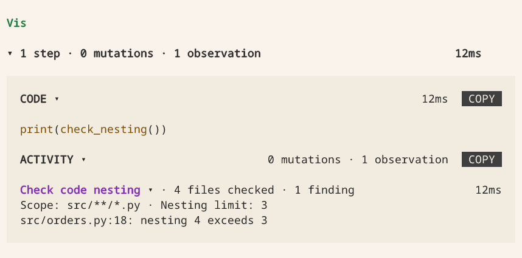
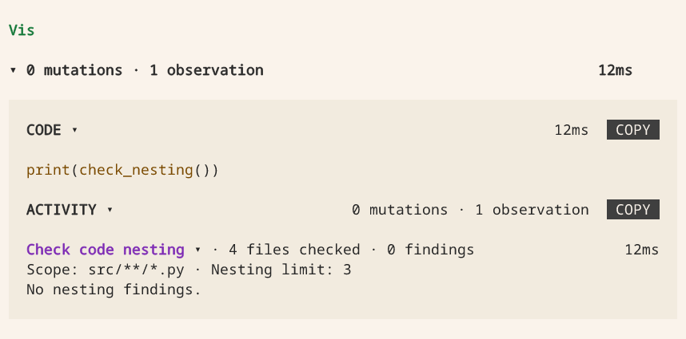

# Extension design

A useful extension gives Vis one clear way to do a job that your project needs. This guide shows how
to choose an operation, describe its inputs, and test it. Start with the [one-file
tutorial](extending.md). For a larger example, use the [tested greeter
package](https://github.com/Blockether/vis/tree/main/packages/vis-agent/examples/greeter).

## When to use

- **The agent repeats the same sequence of calls to get one answer.** [Choose a tool
  boundary](#choose-a-useful-tool-boundary) that returns that answer directly.
- **The agent calls your tool with the wrong arguments or misreads its result.** [Describe
  structure once](#describe-structure-once) and [document default
  behavior](#document-default-behavior).
- **The extension grows and needs tests.** [Keep the entrypoint small](#keep-the-entrypoint-small)
  and [test both boundaries](#test-both-boundaries).
- **People cannot see what a tool did.** [Design its Activity](#design-the-activity-with-the-tool),
  as in the [CI report](#show-a-ci-report-without-hiding-failures).
- **A team rule must be measured after every edit.** Build a [check that runs after each
  edit](#check-code-complexity-after-edits).
- **Other Python programs need the same tool descriptions and help.** Use a [typed
  catalog](#typed-catalog-and-generated-help).

## Choose a useful tool boundary

Choose an operation with one clear result, so that the agent does not rebuild a sequence for every
call. Return Python values, not CLI output or JSON text that callers must parse. A string is enough
for text. Use a frozen dataclass when several fields have different meanings.

Keep reads separate from mutations, and tag each tool by what it does:

- `tag="mutation"` marks a tool that changes state. On a namespace method, write
  `@vis.method(tag="mutation")`.
- `tag="verification"` marks a tool that checks work, such as tests and lint.
- `tag="external"` marks a tool that reaches people or systems outside the session.

Vis uses the tag to [summarize a finished
turn](extension-api.md#report-checks-and-outside-effects). The tag grants no permission and enforces
no policy.

Validate domain constraints in the implementation, and raise a useful exception when one fails.
Type annotations describe the API. They do not validate calls.

## Describe structure once

The registered signature and its resolved types define the parameter names and kinds, the required
or default status, and the result structure. To see them, read `doc("tool.name")`, its `.contract`,
or a `ToolSpec` from `Catalog.spec()`. Do not trust a signature written by hand in prose.

Keep the docstring short and about meaning. Vis combines it with the registered metadata to build
`doc()`, so it repeats no signature, default declaration, or return schema. Every public callable
needs a nonblank docstring. Its first sentence is the `apropos()` preview, so begin with what the
tool does. `apropos()` matches the name and that preview only, so choose predictable names.

Document what the signature and the types cannot say:

- When to call the tool, and what must already be true.
- Units, limits, contextual defaults, and the meaning of an empty or missing result.
- Side effects, safety constraints, and the external services that the call uses.
- Failure conditions, and whether a retry is safe.

Describe a parameter or a result field with `Annotated[T, "meaning"]`. Define result classes at
module level so that Vis can resolve their names. Vis loads the extension file as if it began with
`from __future__ import annotations`. A package or helper module that defines tools needs that
import itself.

`src/vis_greeter/__init__.py` of the packaged example is ordinary Python with no Vis dependency:

```python
"""Ordinary Python code, usable and testable without a Vis session."""

from __future__ import annotations

from dataclasses import dataclass
from typing import Annotated


@dataclass(frozen=True)
class Greeting:
    """The generated greeting, without any external side effects."""

    text: Annotated[str, "Greeting text, ready to display."]
    characters: Annotated[int, "Number of Unicode code points in text, not bytes."]


class Greeter:
    def hello(
        self,
        name: Annotated[str, "Nonblank name of the recipient."],
        *,
        uppercase: bool = False,
    ) -> Greeting:
        """Greet one person. Requires a nonblank name; raises ValueError otherwise.

        Preserves capitalization unless uppercase is requested.
        Does not send a message or modify stored state.
        """
        if not name.strip():
            raise ValueError("name must not be blank")
        text = f"Hello, {name.strip()}!"
        if uppercase:
            text = text.upper()
        return Greeting(text, len(text))
```

## Document default behavior

Say what an omitted argument does when the caller needs to know. The greeter states that it
preserves capitalization unless uppercase is requested, and its signature declares the flag. Test
the omission and an explicit override, so that the statement stays true.

For a contextual default, name the rule, for example "Omitting `repo` uses the repository of the
current project." For `None`, say whether it means automatic selection, no limit, or absence. Do not
write "uses the default."

Vis shows literal defaults in signatures and generated help, so do not copy the values. Explain
what a timeout controls and its units, or what an empty collection means. An opaque object, or a
default outside the inspection budget, appears as `...`. Omit that argument to use the real
default. Do not pass `Ellipsis`.

Inspection never runs a custom `repr()` or a factory. Declared defaults are public metadata, so
resolve credentials inside the tool, not in a parameter default. Read the [contract
reference](extension-api.md#defaults-and-introspection).

## Keep the entrypoint small

Keep reusable business logic in an importable package and the registration in `extension.py`. A
CLI, if useful, is another caller of the same functions. Do not import the entrypoint from domain
code or change `sys.path`. Do not start a login, a network request, or background work during
registration.

This entrypoint is all that connects the packaged example to Vis:

```python
"""Vis entrypoint. The business logic lives in vis_greeter, not in this file."""

import blockether.vis.extension as vis
from vis_greeter import Greeter


def greeting_activity(*, phase, result, **_):
    """Show the greeting and its character count, not the result object's repr."""
    if phase != "success":
        return None
    return vis.ActivityPresentation(
        "Greet person",
        f"{result.characters} characters",
        (vis.ActivityText(result.text[:1000]),),
    )


Greeter.hello = vis.method(
    activity=vis.Activity(
        label="Greet person", show_start=False, render=greeting_activity
    )
)(Greeter.hello)

vis.register_extension(
    vis.Extension(
        name="vis-greeter",
        description="Typed greeting tools and an optional greeting procedure.",
        alias="greet",
        symbols=[vis.Symbol(Greeter(), name="greet")],
    )
)
```

`Symbol(Greeter(), name="greet")` exports `greet.hello(...)`. The public namespace comes from
`Symbol.name`, not from `Extension.alias`. Declare import roots in the [package
manifest](extension-packages.md#package-manifest), or use an [editable
project](extension-development.md). Do not use both for the same source.

## Design the Activity with the tool

Every registered callable owns its Activity, each public method of an object namespace included.
Declare it at the binding, not as a later UI task. The example decorates `Greeter.hello` in the
entrypoint, so the implementation stays independent of Vis.

A person must understand the Activity without Python method names or result types:

- Write the label in English and in sentence case, such as "Greet person" or "Run tests". Keep
  proper names and acronyms.
- Use consistent terms, without profanity or vulgarity.
- Show a meaningful target, count, or outcome in the summary.
- Put selected evidence behind disclosure. Do not serialize the returned object.
- Never change the case of code, paths, or returned content to format a label.

Decide whether a person must see the operation begin. Fast local reads, patches, and greetings use
`show_start=False`, so only the end result is visible. Slow work, network requests, and user input
keep `show_start=True` and can publish intermediate updates. The engine always tracks the start and
the end. Hidden progress never hides a failure, a cancellation, or the final result.

Test empty results, the start visibility, success, failure, and cancellation. Verify that a
presentation error cannot change the tool result. The engine supplies execution state and errors,
but no generic result view. The [Activity API](extension-api.md#activity-presentation) has the
declarations and the limits.

## Give each kind of instruction one owner

| Information | Owner |
| --- | --- |
| Parameter names, kinds, required or default status, and result structure | The registered signature and resolved types |
| Preconditions, units, meaningful default behavior, side effects, and failures | `Annotated` descriptions and a short docstring |
| When to use this extension and where to discover its tools | A short extension `prompt` |
| A procedure of many steps that spans tools | A skill with a clear trigger in its description |
| Project-wide rules | Project instructions, not the prompt of every tool |

In a skill, link to `doc("greet.hello")` and do not copy the API reference. Keep references and
templates beside `SKILL.md`, and read them when needed. To install or read a skill does not run its
procedure and gives no authorization. Read [Prompts and
discovery](extension-api.md#prompts-and-discovery) and [Bundled
skills](extension-packages.md#bundled-skills).

## Test both boundaries

### Test the Python implementation

In a development environment with the SDK and pytest, run the example tests from the copied
`greeter/` directory:

```bash
python -m pip install vis-agent pytest
python -m pytest tests
```

Cover the normal result, omitted arguments, explicit overrides, invalid input, and side effects.
These tests need no gateway. Use the test environment of your project. The SDK that you install
there installs no extension into Vis.

Outside the engine, the SDK works as follows:

- `vis.state`, `vis.log`, and `vis.shell` use a local host.
- `vis.ask` prompts in the terminal. Supply answers with `vis.outside.answer_with({...})` or with
  JSON in `VIS_OUTSIDE_ANSWERS`.
- `VIS_OUTSIDE_NONINTERACTIVE=1` makes input requests undeliverable.
- An outside test cannot prove a session-only operation. For views, use the
  [LiveRecorder](live-views.md#testing-a-view).

### Test the registered tool

1. [Install the local package](extension-packages.md#install-a-package). Then start Vis in the
   target project or run `/reload`.
2. On the next turn, inspect `apropos(r"^greet\.")`, `doc("greet.hello")`, and
   `greet.hello.contract`. Confirm the inputs, the default behavior, and the result fields.
3. Call `await greet.hello("Ada")` and `await greet.hello("Ada", uppercase=True)`. Check the
   returned `.text`. Registration or the extension list proves no call.
4. After an edit, reload and repeat a call. If Vis kept the last working version and marked it
   stale, fix the load failure and call again.

The repository suite loads this package through the real host and covers discovery, sandbox
results, skill reload, and removal. Your integration still needs a representative call against its
own dependencies. For tests in the shared environment of Vis, run `vis-agent python -m pytest`, not
`vis-agent python pytest`.

## Show a CI report without hiding failures

Use a custom Activity when a raw return value leaves the reader to work out what happened. This
example reads an existing local test summary. It does not run tests, contact a CI service, or check
whether the report is current.

After you [install the report reader](#install-the-report-reader), ask Vis:

> Read the CI report at `/workspace/ci-report.json` and show the passed and failed counts.

The Activity says **Read CI report**, summarizes **42 passed · 1 failed**, and holds the source path
as expandable evidence. The agent receives a frozen `CIReport` with all three fields. A report with
failed tests is a successful read, not a claim that the tests passed.

When both counts are zero, the summary is **No tests reported**. A missing file, invalid JSON, or
an invalid count fails the call. The Activity keeps the error type and the message, with a labeled
excerpt of a long message. The engine owns the state, the timing, and the error of the operation,
whatever the presentation does.

### Install the report reader

Prepare a UTF-8 JSON file with this shape, and adapt the output of your CI job to it if needed.
Counts must be nonnegative integers, not booleans. The reader ignores extra fields.

```json
{"passed": 42, "failed": 1}
```

Save the following as `.vis/extensions/ci_report.py`, then [reload
extensions](extending.md#2-load-it). Load only code that you trust. An extension runs in host
CPython, not in the sandbox of the agent.

```python
# ci_report.py
from __future__ import annotations

import json
from dataclasses import dataclass
from pathlib import Path
from typing import Annotated

import blockether.vis.extension as vis


@dataclass(frozen=True)
class CIReport:
    """Counts from a local report, not evidence of a new test run."""

    path: Annotated[str, "Absolute path of the report that was read."]
    passed: Annotated[int, "Number of passing tests in the report."]
    failed: Annotated[int, "Number of failing tests in the report."]


def read_ci_report(
    path: Annotated[str, "Absolute path to a UTF-8 JSON test summary."],
) -> CIReport:
    """Read a local CI summary without running tests or contacting a service.

    The file must contain a JSON object with nonnegative integer passed and
    failed counts. Zero counts mean no tests were reported, not a passing suite.
    Extra fields are ignored. Relative paths and invalid counts raise ValueError;
    file, encoding and JSON errors propagate. Does not modify the file.
    """
    file = Path(path)
    if not file.is_absolute():
        raise ValueError("path must be absolute")
    data = json.loads(file.read_text(encoding="utf-8"))
    if not isinstance(data, dict):
        raise ValueError("report must be a JSON object")
    for name in ("passed", "failed"):
        value = data.get(name)
        if type(value) is not int or value < 0:
            raise ValueError(f"{name} must be a nonnegative integer")
    return CIReport(str(file), data["passed"], data["failed"])


def present_report(*, phase, result=None, error=None, **_):
    if phase == "start":
        return vis.ActivityPresentation(
            headline="Read CI report", summary="Reading local test results"
        )
    if phase == "failure":
        detail = f"{type(error).__name__}: {error}"
        if len(detail) > 1000:
            detail = detail[:1000] + "\n[Error excerpt]"
        return vis.ActivityPresentation(
            headline="Read CI report",
            summary="Could not read test results",
            content=(vis.ActivityText(detail),),
        )
    summary = (
        f"{result.passed} passed · {result.failed} failed"
        if result.passed or result.failed
        else "No tests reported"
    )
    return vis.ActivityPresentation(
        headline="Read CI report",
        summary=summary,
        content=(vis.ActivityText(f"Source: {result.path}"),),
    )


vis.register_extension(
    vis.Extension(
        name="ci-report-example",
        description="Read local CI summaries with a human-readable Activity.",
        alias="ci",
        symbols=[
            vis.Symbol(
                read_ci_report,
                activity=vis.Activity(
                    label="Read CI report", show_start=False, render=present_report
                ),
            )
        ],
    )
)
```

### Call the report reader

The agent discovers `read_ci_report` and calls it directly. For a file at
`/workspace/ci-report.json`, the call is:

```python
report = read_ci_report("/workspace/ci-report.json")
print(report)
```

This quick local read uses `show_start=False`. The callback also handles `start`. If you adapt the
tool to slow work, set `show_start=True`. Before you publish the adapted tool, test its running,
success, failure, and empty states.

## Check code complexity after edits

A skill can remind the agent to check complexity, but a reminder is not a measurement. A hook runs
the check at the edit boundary and gives the agent the findings on its next turn. You choose the
metric, the threshold, and the source files.

This example measures control-flow nesting, not cyclomatic complexity. It reports the deepest chain
of `if`, loop, `try`, `with`, and `match` statements in each Python file. A new function, class, or
lambda starts at depth zero. `elif` counts as another nested `if` in the Python syntax tree.
Comprehensions and boolean expressions add no depth. The limit of three is an example policy, not a
universal definition of good code.

### See the cycle of edit, check, and fix

After you [install the check](#install-the-check), ask Vis:

> Update the order-processing code. Show the nesting check, simplify any reported
> nesting, then show the check again. Run the normal tests before finishing.

1. **Edit.** The hook scans `src/**/*.py` at the edit boundaries and gives the findings to the
   agent on its next request.
2. **Check.** The agent calls `check_nesting()`, and you see a **Check code nesting** Activity.
   Expand it to see the scope, the limit, and each finding with its file and line.
3. **Fix and repeat.** The agent simplifies the code and calls the check again. The new Activity
   shows the new result. The earlier finding stays in the history.

The hook gives feedback without an Activity and forces no fix. The registered tool is the visible
check. It runs a fresh scan with `show_start=False`, so you can also ask for it before an edit.

Select an image to view it at full size.

**Before the fix.** Four files are checked, and one location is above the nesting limit.

[](assets/screenshots/nesting-finding.png)

**After the fix.** The same four files are checked, with no nesting findings.

[](assets/screenshots/nesting-clear.png)

A successful Activity means that the scan returned a report, not that every file passed. Findings
include parse errors and read errors. **No Python files found** is a separate empty state, not a
passed check.

### Know what this checks

- A `python_execution` hook runs when the whole Python block returns, also after a normal Python
  error that follows a write. So it covers `Path.write_text()` and `with open(..., "w")`. Each run
  replaces the report.
- The hook checks writes at these boundaries, not at every filesystem write. It does not watch
  unfinished background processes, a killed interpreter, or edits made outside Vis. Wait for work
  that you start before you rely on the report. Run your normal checks before you accept changes.
- The report is feedback, not a rollback or a security boundary. An after hook cannot undo or
  refuse an edit. For a hard rule, validate inside the domain operation, or use a `before` hook
  with `vis.block(reason)` on the operation to refuse. Keep access controls in the sandbox policy,
  and repeat acceptance checks in CI. Vis logs an ordinary tool-hook error and does not block the
  operation.

### Install the check

For a small Python project with a `src/` directory, save this complete file as
`.vis/extensions/code_quality.py`, then run `/reload`. The file needs Python 3.11 or later and the
SDK that Vis supplies, and no other packages. It runs as trusted host code, so review it first.
Keep `src/` limited to code that you intend to scan, linked files included.

```python
# code_quality.py
import ast
from pathlib import Path

import blockether.vis.extension as vis

PROJECT = Path(__file__).resolve().parents[2]
SOURCE = PROJECT / "src"
LIMIT = 3
REPORT_KEY = f"nesting:{PROJECT}"
SCOPES = (ast.FunctionDef, ast.AsyncFunctionDef, ast.ClassDef, ast.Lambda)
BRANCHES = (
    ast.If,
    ast.For,
    ast.AsyncFor,
    ast.While,
    ast.Try,
    ast.TryStar,
    ast.With,
    ast.AsyncWith,
    ast.Match,
)


def deepest(node, depth=0):
    """Return the greatest control-flow depth and its first source line."""
    if isinstance(node, SCOPES):
        depth = 0
    if isinstance(node, BRANCHES):
        depth += 1
    best = (depth, getattr(node, "lineno", 1))
    for child in ast.iter_child_nodes(node):
        candidate = deepest(child, depth)
        if candidate[0] > best[0]:
            best = candidate
    return best


def scan():
    findings = []
    checked = 0
    try:
        if not SOURCE.is_dir():
            raise OSError("Expected a readable src/ directory.")
        for path in sorted(SOURCE.rglob("*.py")):
            label = str(path.relative_to(PROJECT))
            try:
                depth, line = deepest(ast.parse(path.read_bytes(), filename=label))
            except (OSError, SyntaxError, ValueError, RecursionError) as error:
                findings.append(f"{label}: could not check: {error}")
                continue
            checked += 1
            if depth > LIMIT:
                findings.append(f"{label}:{line}: nesting {depth} exceeds {LIMIT}")
    except OSError as error:
        findings.append(f"Could not scan src/: {error}")
    return {"checked": checked, "limit": LIMIT, "findings": findings}


def check_nesting() -> dict:
    """Scan this project's src/**/*.py and return checked, limit and findings.

    Uses the nesting metric and limit defined in this extension. Parse and read
    errors are findings; zero checked files is not evidence of a passing check.
    Stores the fresh report for the next model request. Does not modify source
    files, run tests or guarantee overall code quality.
    """
    report = scan()
    vis.state[REPORT_KEY] = report
    return report


def present_nesting(*, phase, result=None, error=None, **_):
    headline = "Check code nesting"
    if phase == "start":
        return vis.ActivityPresentation(headline, "Scanning src/**/*.py")
    if phase == "failure":
        detail = f"{type(error).__name__}: {error}"
        if len(detail) > 1000:
            detail = detail[:1000] + "\n[Error excerpt]"
        return vis.ActivityPresentation(
            headline, "Could not check code nesting", (vis.ActivityText(detail),)
        )
    checked, findings = result["checked"], result["findings"]
    files = "file" if checked == 1 else "files"
    issues = "finding" if len(findings) == 1 else "findings"
    summary = f"{checked} {files} checked · {len(findings)} {issues}"
    if not checked and not findings:
        summary = "No Python files found"
    detail = "\n".join(findings) or (
        "No nesting findings." if checked else "Add Python source files under src/."
    )
    if len(detail) > 6000:
        detail = (
            detail[:6000] + "\n[Excerpt; full findings are in the returned report.]"
        )
    return vis.ActivityPresentation(
        headline,
        summary,
        (
            vis.ActivityText(f"Scope: src/**/*.py · Nesting limit: {result['limit']}"),
            vis.ActivityText(detail),
        ),
    )


def after_edit(call):
    check_nesting()


def context(env):
    return {
        "code_quality": vis.state.get(
            REPORT_KEY, {"findings": ["Nesting has not been checked yet."]}
        )
    }


vis.register_extension(
    vis.Extension(
        name="project-nesting",
        description="Report excessive Python control-flow nesting after edits.",
        alias="quality",
        symbols=[
            vis.Symbol(
                check_nesting,
                activity=vis.Activity(
                    label="Check code nesting", show_start=False, render=present_nesting
                ),
            )
        ],
        ctx=context,
        op_hooks=[vis.OpHook(["patch", "python_execution"], after_edit, phase="after")],
    )
)
```

The callback reads the current files, not the text of the tool call. It scans all `src/**/*.py`
files each time. So it sees new files, deletions, and several writes in one block, and it parses no
Python write commands. For a large repository, narrow the scope or move the work into your existing
analyzer.

### Use the findings

The hook supplies the report on the next model request as a `session["code_quality"]` contribution
such as:

```python
{
    "checked": 4,
    "limit": 3,
    "findings": ["src/orders.py:18: nesting 4 exceeds 3"],
}
```

The agent can show you a fresh result with the registered tool:

```python
print(check_nesting())
```

The file and the line show the agent where to flatten a branch or extract a function. An empty
`findings` list means that the scanned files passed this metric. It says nothing about tests or
overall code quality.

`vis.state` stores the report per project, and `ctx` supplies it on the next model request. Text
returned from an after hook cannot do that, because Vis ignores the return value.

The repository tests run this exact extension through the SDK and the host. They cover patches,
both Python write forms, a write followed by an exception, and cleared findings after a fix. They
call the registered check and verify its end-only Activity, findings, clear results, and empty
source tree. The metric tests cover scope boundaries, syntax errors, and missing source directories.

## Typed catalog and generated help

Use a catalog when Vis and other Python callers need structured tool descriptions and generated
help. Registration needs no catalog.

`vis.Catalog(symbols)` adapts the same `Symbol` contracts that registration uses into immutable
data. It is not a second registry. It answers these calls:

- `spec()` returns typed top-level entries.
- `spec("counter.write")` returns a `ToolSpec`.
- `help("counter.write")` returns `HelpDocument(tool, text)`.

The `members` of a namespace keep full public names, nested capabilities included. The catalog
excludes hidden tools. A name of the wrong type raises `TypeError`. An unknown or hidden name raises
`ValueError`. Discovery does not validate configuration, authenticate, create files, or call the
described tools.

This complete, tested entrypoint has a read and a mutation. Python callers and Vis invoke the same
methods. An optional CLI calls those methods too and does not parse generated help. You need no CLI
framework and no inheritance.

```python
# counter.py
from __future__ import annotations

from dataclasses import dataclass
from pathlib import Path
from typing import Annotated

import blockether.vis.extension as vis


@dataclass(frozen=True, slots=True)
class Count:
    """The nonnegative count stored in a caller-owned file."""

    value: Annotated[int, "Number of completed items."]


class CounterError(RuntimeError):
    """The file could not be read or written; no success result is returned."""


def present_count(*, phase, result=None, error=None, **_):
    if phase == "failure":
        return vis.ActivityPresentation("Counter", str(error))
    if phase == "start":
        return vis.ActivityPresentation("Counter", "Accessing the count file")
    return vis.ActivityPresentation("Counter", f"{result.value} completed items")


class Counter:
    @vis.method(activity=vis.Activity(label="Read counter", show_start=False, render=present_count))
    def read(self, path: Annotated[str, "Caller-owned UTF-8 count file."]) -> Count:
        """Read a count; a missing file means zero. Does not create files.

        Raises TypeError for a non-string path, ValueError for a blank path,
        and CounterError for unreadable or invalid stored data.
        """
        self._validate_path(path)
        try:
            value = int(Path(path).read_text(encoding="utf-8"))
            if value < 0:
                raise ValueError("Stored count must be nonnegative")
            return Count(value)
        except FileNotFoundError:
            return Count(0)
        except (OSError, ValueError) as error:
            raise CounterError("Cannot read count") from error

    @vis.method(tag="mutation", activity=vis.Activity(label="Write counter", show_start=False, render=present_count))
    def write(self, path: str, *, value: Annotated[int, "Nonnegative completed-item count."]) -> Count:
        """Replace the caller-owned file's count; its parent directory must exist.

        Validate before IO: wrong types raise TypeError; blank paths and negative
        counts raise ValueError. Write failures raise CounterError. No retries.
        """
        self._validate_path(path)
        if type(value) is not int:
            raise TypeError("value must be an integer")
        if value < 0:
            raise ValueError("value must be nonnegative")
        try:
            Path(path).write_text(str(value) + "\n", encoding="utf-8")
        except OSError as error:
            raise CounterError("Cannot write count") from error
        return Count(value)

    def _validate_path(self, path):
        if not isinstance(path, str):
            raise TypeError("path must be a string")
        if not path.strip():
            raise ValueError("path must not be blank")


symbols = (vis.Symbol(Counter(), name="counter"),)
catalog = vis.Catalog(symbols)
vis.register_extension(vis.Extension(
    name="counter-example", description="A counter with generated tool help.",
    alias="counter", symbols=(*symbols, vis.Symbol(catalog, name="doctor")),
))
```

The same callable metadata supplies structured values, generated help, and `doc()` in Vis.
`ParameterSpec` keeps the parameter kind, requiredness, `has_default`, and `default_is_none`, and
never the default value. `TypeSpec` describes result fields, containers, literals, and `Annotated`
meaning at every level of nesting.

The catalog returns records and nested collections as frozen dataclasses and tuples. Lookup does
not inspect mutable runtime state, so rebuild the catalog when declarations change.

In Vis, inspect `await doctor.spec("counter.write")` and `await doctor.help("counter.write")`, then
compare `doc("counter.write")`. The catalog covers the `symbols` that you pass to it. The separate
`doctor` discovery adapter is not in that snapshot. Test the same scope against the registered
public names:

```python
vis.testing.assert_catalog(
    catalog,
    names=["counter.read", "counter.write"],
    mutations=["counter.write"],
)
```

`assert_catalog` checks name parity, mutation parity, generated help, and unresolved types, with
decorated methods and nested result fields included. It allows data that is explicitly opaque or
`Any`. It is not a runtime type checker.

In integration tests, pass names that come from registration or `apropos()`, because successful
construction is not proof. Also call the registered tools. Test keyword-only binding, invalid input
before IO, operational exceptions, and result immutability. The SDK suite runs the code above. The
real host verifies `spec`, `help`, `doc`, discovery, and invocation together.

For long-running observations, use the [synchronous monitoring
recipe](live-views.md#monitor-a-fixed-build-set) and its cancellation tests. Catalog inspection must
not start the readers of an observation. The catalog regression invokes that registered
observation, cancels it, and checks reader cleanup. A cancellation never becomes a successful
observation. An Activity presents a result to people and does not replace typed result data.
Serialize only at a transport edge.

## See also

- For exact declarations, contracts, and callback rules, read [Extension API](extension-api.md).
- For editable imports and dependency preparation, read [Using an existing Python
  project](extension-development.md).
- For the package layout that you distribute, read [Installing and sharing
  extensions](extension-packages.md).
