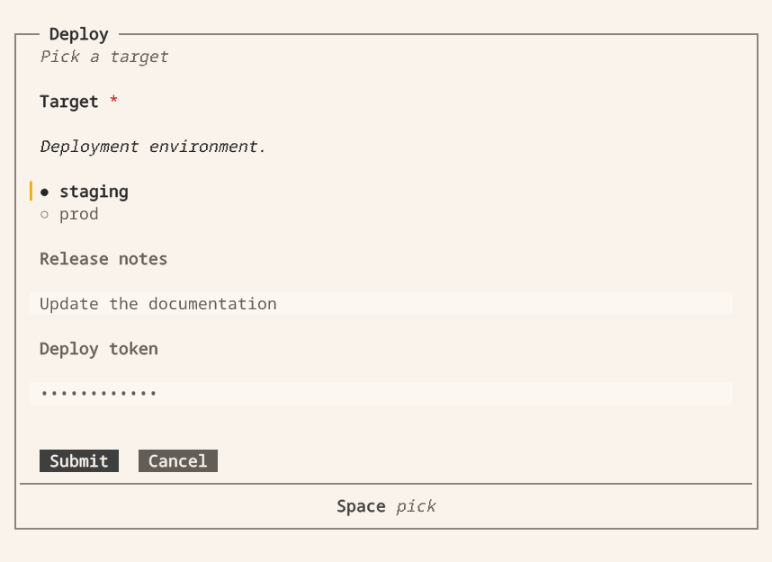

# Forms and user input

A form asks the user for a choice, a password or token, or a confirmation. `vis.ask` shows the form
in the terminal or the Companion app, waits, and returns the answer to your Python code.

## When to use

- **A tool is about to do something that needs the approval of a person**, such as a deployment.
  [Ask for confirmation](#ask-and-handle-cancellation) and stop if the person cancels.
- **The tool needs a token or a one-time code that must not appear in the conversation.** A
  `password` or `otp` field returns [a handle, not the value](#the-answer).
- **Only a person can make the choice**, such as the environment for a deployment. Offer the
  options as [fields](#fields).
- **The input must be valid before the tool continues.** Add [validation](#validation) that
  refuses a bad value with a message.

To show progress and ask no question, use a [live view](live-views.md). A live view can also
[collect input](live-views.md#collect-input-in-a-view) while work runs.

## Before you start

Call `vis.ask` from a registered tool, a user command, or a session-bound hook. The call needs a
calling session and an available TUI or Companion client. It cannot run during registration or
from a passive provider callback. Outside Vis, the SDK uses terminal input, as
[testing outside Vis](extension-design.md#test-the-python-implementation) shows.

## Ask and handle cancellation

Call your operation only after a submitted answer, and handle cancellation in your code. This
fragment belongs in your tool. The module imports `blockether.vis.extension as vis` and supplies its
own `deploy` function.

```python
answer = vis.ask("Deploy", [
    {"name": "env", "label": "Target", "description": "Deployment environment.",
     "type": "select", "options": ["staging", "prod"], "is_required": True},
    {"name": "notes", "type": "multiline", "label": "Release notes"},
    {"name": "token", "type": "password", "label": "Deploy token"},
], description="Pick a target", timeout_ms=120000)

if answer:                       # false when cancelled, timed out or undeliverable
    deploy(answer["env"], answer.reveal("token"))
else:
    vis.log("info", "deploy skipped: " + answer.reason)
```

The request opens this form in the Vis terminal, with the password masked.

[](assets/screenshots/ask.png)

| Option | Meaning |
| --- | --- |
| `description` | Markdown under the title. |
| `submit_label`, `cancel_label` | Button labels. |
| `is_cancellable` | `False` removes the cancel button. |
| `timeout_ms` | 5 minutes by default. `0` waits until the person answers or cancels. |

Every key is a snake_case string, such as `timeout_ms`. Vis refuses a camelCase or kebab-case key
with an error that names the right spelling. It refuses an unknown key by name.

A form from a tool call shows the name of that tool, so that the person knows which tool asks.

## The answer

`vis.ask` never raises for a refusal. It returns an `Answer` that is truthy when the person
confirmed:

| Attribute | Meaning |
| --- | --- |
| `answer.values` | The value of every field, defaults included. `answer["env"]` reads one value. |
| `answer.reason` | For a falsy answer: `cancelled`, `timeout`, `undeliverable`, or the reason of the host. |
| `answer.reveal(name)` | Resolves a secret handle in process. |

A `password` or `otp` field returns an opaque `vis-secret:` handle. The transcript, the logs, and
the model get only the handle. To get the value, call `answer.reveal(name)` or `vis.reveal(handle)`.
`vis.forget(handle)` removes the value. Do not print or log the revealed value.

If no client can show the form, the request logs an error and returns `undeliverable` at once.
The session of an extension automation run cannot ask the person, so its request also returns
`undeliverable` at once.

A form from a subagent shows in the session of its leader, because the person watches that
session. The form names the subagent that asks. The answer goes to the call of that subagent.

## Fields

`name` is the key of the field in `answer.values`, and `id` is an alias for `name`. `label` shows
above the input. The optional `description` shows under the label.

| `type` | Answers with | Notes |
| --- | --- | --- |
| `plaintext` | string | The default type. |
| `password` | secret handle | Shown as dots. |
| `multiline` | string | |
| `select` | one option value, or a list in option order with `is_multiple=True` | A multiple selection can be empty unless the field is required. |
| `toggle` | one option value, or a list with `is_multiple=True` | [Joined options](components.md#toggle) that stay visible. |
| `checkbox` | `true` or `false` | A required checkbox must be ticked. |
| `range` | number | `min` (0), `max` (100), `step` (1). Out-of-range values are refused. |
| `datetime` | string | `mode` is `date` (`YYYY-MM-DD`), `time` (`HH:MM`) or `datetime` (`YYYY-MM-DDTHH:MM`, the default). `min` and `max` take the same form. |
| `otp` | secret handle | Digits only, one box per digit. `min_length` and `max_length` set the length (default 6, at most 12). |

The common keys are `placeholder`, `default`, `is_required`, `min_length`, `max_length`, and
`validate`. A `select` also takes `options`. An option is a string, or
`{"value": ..., "label": ...}` when the stored value and the shown text differ. Vis refuses an
answer that names an undeclared option.

On confirmation, the engine rejects a blank `is_required` field in an answer from a form or from an
HTTP request.

## Layout

Use [Flex](components.md#flex) for fields that belong on the same line. Use
[Grid](components.md#grid) for fields that need equal columns. Use [Section](components.md#section)
to add a title and frame around related fields. The same [layouts](components.md#layout) work in
live views.

```python
form = vis.ui.section(
    vis.ui.paragraph("Staging does not send on-call alerts."),
    vis.ui.flex(
        vis.ui.select("env", [vis.ui.select.option("staging", "Staging"), vis.ui.select.option("prod")],
                      label="Environment", is_required=True),
        vis.ui.slider("canary", label="Canary %", min=0, max=100, step=5, default=10),
        direction="row", is_wrapping=True, gap="sm",
    ),
    vis.ui.checkbox("ack", label="I read the runbook", is_required=True),
    vis.ui.password("token", label="Deploy token", is_required=True),
    label="Target",
)

answer = vis.ask("Deploy", [form], submit_label="Deploy")
```

The layout does not change `answer.values`. It is a flat map keyed by field name. Names must
be unique. Layout nodes do not take input keys such as `default`, `options`, or `validate`.
Fields do not take layout keys such as `children` or `direction`. Headings and paragraphs
cannot receive focus and do not appear in the answer.

A form has its own submit button. It can show other [components](components.md), such as a
status, table, or card, above the inputs. `vis.ask` refuses a `dialog` or `menu` at any depth.
Use a [live view](live-views.md) for those components.

## Validation

`validate` is a function, or a list of functions that run in order until one refuses. A validator
receives the coerced value, or the value and the flat map of every answer. To accept, return `None`
or `True`. To refuse, return a message string.

In this fragment, your module imports `re` and defines the validator `is_free`. `is_free` returns
`None` for an available slug and an error message for any other slug.

```python
def a_slug(text):
    if not re.fullmatch(r"[a-z][a-z0-9-]*", text):
        return "lowercase, digits and dashes"


answer = vis.ask("Sign up", [
    vis.ui.plaintext("slug", label="Project", validate=[a_slug, is_free]),
    vis.ui.password("pass", label="Password",
                 validate=lambda text: "at least 12 characters" if len(text) < 12 else None),
    vis.ui.password("again", label="Repeat it",
                 validate=lambda text, values:
                     None if text == values["pass"] else "the two do not match"),
])
```

- Vis refuses a validator with any other signature when it builds the request. It also refuses a
  value that is not a function, such as a regex string.
- `False` refuses with `is not valid`. A validator that raises refuses with
  `could not be validated: <exception>`.
- Validators do not run on blank answers. To reject a blank answer, use `is_required`.
- Validation runs in the engine on confirmation. The form shows the error message of each field.

## See also

- To write the extension that calls `vis.ask`, read [Extending Vis](extending.md).
- To show progress while an extension runs, read [Live views](live-views.md).
- To look up every component and its builder, read [Components](components.md).
