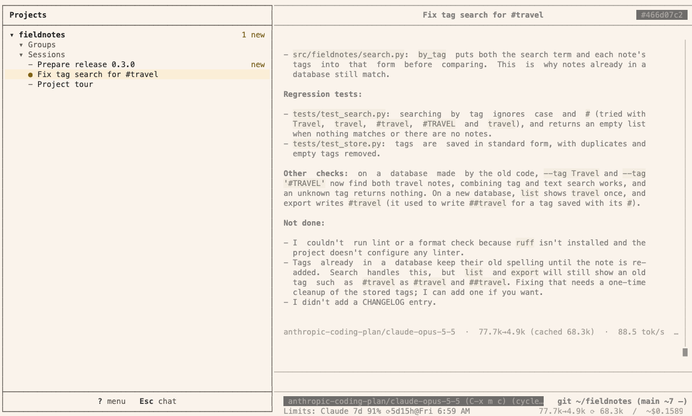

Vis is an AI agent that works in your project. Give Vis a task and a project folder. Vis reads
files, edits code, and runs commands and checks. **Activities** show each step that Vis takes.

The terminal, desktop, and phone apps connect to the computer that holds your project and show the
same sessions.

## Start using Vis

If you are new to Vis, follow the [Quickstart](quickstart.md). It installs Vis, connects a model,
and runs a first task.

If Vis is already installed, choose what you want to do:

- [Continue, stop, fork, or find your work](sessions.md) in saved sessions.
- [Choose a provider and a model](configuration.md#providers-and-models), or use a local model.
- [Connect the desktop app or a phone](quickstart.md#connect-an-app) to the sessions on your computer.
- [Use your phone away from home with Tailscale](gateway-service.md#access-from-anywhere-with-tailscale). Vis finds the Tailscale address by itself.
- [Ask another session for help](council.md) or for a second review.
- [Learn how Vis keeps a long conversation usable](context-management.md).
- [Read why Vis works this way](rationale.md).

## Customize Vis

Vis can follow the rules of your project, reuse instructions for a task, and load tools from
extension packages.

- [Choose providers, models, and project settings](configuration.md).
- [Tell Vis how your codebase works](project-instructions.md).
- [Give Vis reusable instructions for a task](skills.md).
- [Add an extension or share your own](extension-packages.md).
- [Give the web app your own name, logo, and theme](white-label.md).

## Automate or embed Vis

Vis can run a task without a chat, or run inside your own program.

- [Run a prompt on a schedule or from a webhook](automations.md).
- [Run Vis from a Python program](python-sdk.md) with the Python SDK.
- [Call a gateway over HTTP](http-api.md) from any language.
- [Build a tool that Vis can call](extending.md) in an extension.

## Run Vis for a team

One gateway can serve several people and devices.

- [Compare installation methods and update Vis](distributions.md).
- [Run a gateway as a shared service](gateway-service.md).

## Compare Vis with other agents

The table compares the features of five coding agents. It uses the documentation of each agent on
20 November 2026. Features change often, so check the documentation of an agent before you choose.

| Feature | Vis | [Claude Code](https://code.claude.com/docs) | [Codex](https://developers.openai.com/codex) | [OpenCode](https://opencode.ai/docs) | [pi](https://pi.dev) |
| --- | --- | --- | --- | --- | --- |
| License | Apache-2.0 | Proprietary | Apache-2.0 | MIT | MIT |
| Models | [Many providers and local models](configuration.md#providers-and-models) | Claude models | OpenAI models, and other providers that you configure | Many providers and local models | Many providers and local models |
| Apps | Terminal, desktop, web, iOS, and Android | Terminal, IDE, desktop, web, iOS, and Android | Terminal, IDE, desktop, web, and phone | Terminal, beta desktop app, web, and phone | Terminal |
| How the model uses tools | [A Python program in each step](rationale.md#python-connects-the-steps). Extensions add Python functions, which the model finds with `apropos` [when it needs them](context-management.md#discovery-instead-of-catalogs). | Tool calls | Tool calls | Tool calls | Tool calls, and an optional JavaScript `codemode` tool |
| Extensions | [Python packages](extension-packages.md) | Plugins with skills, hooks, subagents, and MCP servers | Skills and MCP servers | JavaScript and TypeScript plugins | TypeScript extensions and packages |
| Subagents | [Yes](council.md) | Yes | Yes | Yes | No, a package can add them |
| Use from your own code | [Python SDK](python-sdk.md) and [HTTP API](http-api.md) | Agent SDK for Python and TypeScript | Codex SDK and app server | JavaScript SDK and HTTP server | TypeScript SDK and RPC |

## Gallery

<section class="screenshot-gallery" id="screenshot-gallery" data-screenshot-gallery role="region" aria-roledescription="carousel" aria-label="Vis screenshots">
  

  <figure class="screenshot-gallery__slide" id="desktop-gallery" role="group" aria-roledescription="slide" aria-label="1 of 9">
    
    <figcaption>Desktop · Conversation</figcaption>
  </figure>

  <figure class="screenshot-gallery__slide" id="ios-gallery" role="group" aria-roledescription="slide" aria-label="2 of 9">
    
    <figcaption>iOS · Conversation</figcaption>
  </figure>

  <figure class="screenshot-gallery__slide" id="tui-gallery" role="group" aria-roledescription="slide" aria-label="3 of 9">
    
    <figcaption>TUI · Conversation</figcaption>
  </figure>

  <figure class="screenshot-gallery__slide" role="group" aria-roledescription="slide" aria-label="4 of 9">
    
    <figcaption>Desktop · Release</figcaption>
  </figure>

  <figure class="screenshot-gallery__slide" role="group" aria-roledescription="slide" aria-label="5 of 9">
    
    <figcaption>iOS · Project tour</figcaption>
  </figure>

  <figure class="screenshot-gallery__slide" role="group" aria-roledescription="slide" aria-label="6 of 9">
    
    <figcaption>TUI · Session navigator</figcaption>
  </figure>

  <figure class="screenshot-gallery__slide" role="group" aria-roledescription="slide" aria-label="7 of 9">
    
    <figcaption>Desktop · Settings</figcaption>
  </figure>

  <figure class="screenshot-gallery__slide" role="group" aria-roledescription="slide" aria-label="8 of 9">
    
    <figcaption>iOS · Sessions</figcaption>
  </figure>

  <figure class="screenshot-gallery__slide" role="group" aria-roledescription="slide" aria-label="9 of 9">
    
    <figcaption>TUI · Settings</figcaption>
  </figure>

  

  

    <button type="button" data-previous aria-controls="screenshot-slides" aria-label="Previous screenshot">← Previous</button>
    1 / 9
    <button type="button" data-next aria-controls="screenshot-slides" aria-label="Next screenshot">Next →</button>
  

</section>
