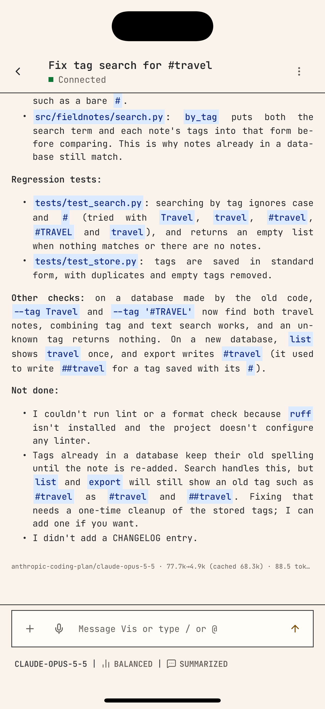
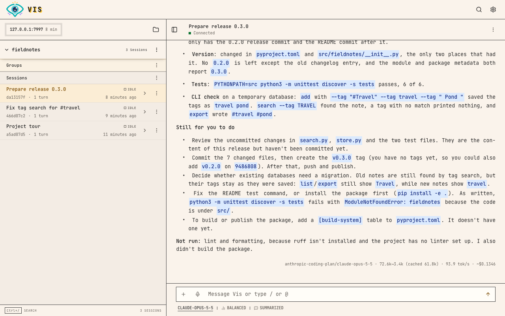
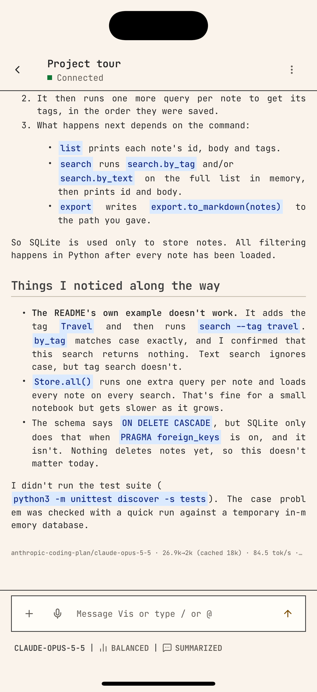
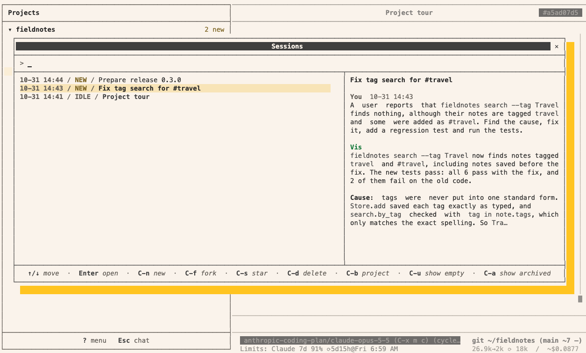
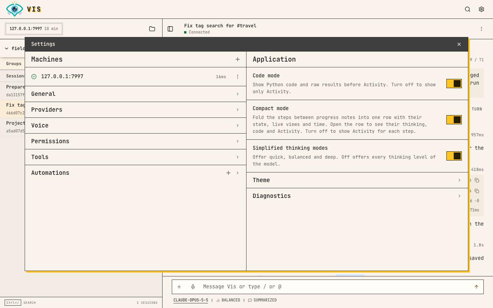

Vis is an AI agent that works in your project. Give Vis a task and a project folder. Vis reads
files, edits code, and runs commands and checks.

**Activities** show each step of Vis as a view of that step, not as raw tool output. For example, a
database query shows as formatted SQL, and its result shows as a table. Each tool can have its own
view. To give your tool a view, read [Show a CI report without hiding failures](extension-design.md#show-a-ci-report-without-hiding-failures).

Vis works through a Python runtime that stays alive for the whole session. The functions that Vis
writes stay available in later steps. In a long session, Vis builds helpers for your problem, and it
uses them again instead of the same commands each time. To learn what the runtime keeps, read
[Sandbox state after a restart](python-sandbox.md#sandbox-state-after-a-restart).

Most coding agents give the model a fixed list of tools, and the model calls one tool by its name
in each step. Vis gives the model a [CPython interpreter](python-sandbox.md) instead. In each step,
the model writes a short Python program that calls the tools as Python functions and uses their
results. Extensions add more functions, and the model finds them with `apropos` when it needs them.
The [process jail](jail.md) is off by default. With the jail on, commands run under Seatbelt on
macOS or bubblewrap on Linux.

The terminal, desktop, and phone apps connect to the computer that holds your project and show the
same sessions.

## How Vis runs a task

This step searches the project and runs the tests in one Python program:

```python
hits = grep({"query": ["def parse_date"], "paths": ["src"]})
print(hits)
tests = await shell("pytest tests/test_dates.py -q")
result = await tests
print(result.exit, tests.logs(-10).out)
```

Only the printed text goes back to the model. The full results stay in Python variables, as
[Reading tool results](python-sandbox.md#reading-tool-results) describes.

[](assets/diagrams/execution-model.svg)

Vis saves each session and the helpers that the model wrote. With `toggles.introspection: true`,
the model can also read your earlier sessions. You can then turn work that you repeat into a tool:

> Read my last three release sessions. Write a helper that runs their checks in the same order.
> Then make it an extension with tests.

An extension runs the same steps each time, and the model calls it as one function. This needs fewer
model steps than a new plan for each release. [Extending Vis](extending.md) shows how to build an
extension. [Feature toggles](configuration.md#feature-toggles) has the introspection setting.

## Improve Vis for your project

Vis works best when you adapt it to your project and check the effect of each change. Build tools
for your project, run real tasks, measure the results, and improve the tools where tasks fail.
Then run the same tasks again.

[](assets/diagrams/improvement-loop.svg)

Vis has a part for each step of the loop:

- **Measure.** [Evaluations](evals.md) run the same tasks before and after a change, score the
  results, and [compare the two runs](evals.md#compare-two-runs).
- **Build.** [Extensions](extending.md) turn work that you repeat into tested Python tools.
- **Watch.** A [live view](live-views.md) shows a long operation, such as a CI run or a build, in
  one place while the agent waits. It shows progress, tables, logs, and controls. You build forms
  and views from the same [components](components.md).

A script and the agent use the same CPython and the same shared packages. `vis-agent python --shared`
runs your script with the packages of the agent, so a helper that the agent wrote also runs as a
script. The tool functions of the agent, such as `grep` and `shell`, are available in two ways:

- An extension calls them through `vis.tools`, in the session that called it. Read
  [Call other session tools](extension-api.md#call-other-session-tools).
- A script that uses the [Python SDK](python-sdk.md) sends a block of code to a session. The block
  runs with all tools of that session and no model.
  [Operations](sessions-api.md#operations) lists the call `post_session_run`.

A plain script that calls `vis.tools` gets an error. [Run programs with
`vis-agent python`](python-sandbox.md#run-programs-with-vis-agent-python) has the details.

## Start using Vis

If you are new to Vis, follow the [Quickstart](quickstart.md). It installs Vis, connects a model,
and runs a first task.

If Vis is already installed, choose what you want to do:

- [Continue, stop, fork, or find your work](sessions.md) in saved sessions.
- [Choose a provider and a model](configuration.md#providers-and-models), or use a local model.
- [Connect the desktop app or a phone](quickstart.md#connect-an-app) to the sessions on your computer.
- [Use your phone away from home with Tailscale](gateway-service.md#access-from-anywhere-with-tailscale). Vis finds the Tailscale address by itself.
- [Ask another session for help](council.md) or for a second review.
- [Learn how Vis keeps a long conversation usable](context-management.md).
- [Read why Vis works this way](rationale.md).

## Customize Vis

Vis can follow the rules of your project, reuse instructions for a task, and load tools from
extension packages.

- [Choose providers, models, and project settings](configuration.md).
- [Tell Vis how your codebase works](project-instructions.md).
- [Give Vis reusable instructions for a task](skills.md).
- [Add an extension or share your own](extension-packages.md).
- [Give the web app your own name, logo, and theme](white-label.md).

## Automate or embed Vis

Vis can run a task without a chat, or run inside your own program.

- [Run a prompt on a schedule or from a webhook](automations.md).
- [Run Vis from a Python program](python-sdk.md) with the Python SDK.
- [Call a gateway over HTTP](http-api.md) from any language.
- [Build a tool that Vis can call](extending.md) in an extension.

## Run Vis for a team

One gateway can serve several people and devices.

- [Compare installation methods and update Vis](distributions.md).
- [Run a gateway as a shared service](gateway-service.md).

## Compare Vis with other agents

The table compares the features of five coding agents. It uses the documentation of each agent on
20 November 2026. Features change often, so check the documentation of an agent before you choose.

| Feature | Vis | [Claude Code](https://code.claude.com/docs) | [Codex](https://developers.openai.com/codex) | [OpenCode](https://opencode.ai/docs) | [pi](https://pi.dev) |
| --- | --- | --- | --- | --- | --- |
| License | Apache-2.0 | Proprietary | Apache-2.0 | MIT | MIT |
| Models | [Many providers and local models](configuration.md#providers-and-models) | Claude models | OpenAI models, and other providers that you configure | Many providers and local models | Many providers and local models |
| Apps | Terminal, desktop, web, iOS, and Android | Terminal, IDE, desktop, web, iOS, and Android | Terminal, IDE, desktop, web, and phone | Terminal, beta desktop app, web, and phone | Terminal |
| How the model uses tools | [A Python program in each step](rationale.md#python-connects-the-steps). Extensions add Python functions, which the model finds with `apropos` [when it needs them](context-management.md#discovery-instead-of-catalogs). | Tool calls | Tool calls | Tool calls | Tool calls, and an optional JavaScript `codemode` tool |
| Extensions | [Python packages](extension-packages.md) | Plugins with skills, hooks, subagents, and MCP servers | Skills and MCP servers | JavaScript and TypeScript plugins | TypeScript extensions and packages |
| Subagents | [Yes](council.md) | Yes | Yes | Yes | No, a package can add them |
| Use from your own code | [Python SDK](python-sdk.md) and [HTTP API](http-api.md) | Agent SDK for Python and TypeScript | Codex SDK and app server | JavaScript SDK and HTTP server | TypeScript SDK and RPC |

## Gallery

<section class="screenshot-gallery" id="screenshot-gallery" data-screenshot-gallery role="region" aria-roledescription="carousel" aria-label="Vis screenshots">
  <div class="screenshot-gallery__track" id="screenshot-slides" tabindex="0" aria-label="Vis screenshots; use Left and Right arrow keys to browse">

  <figure class="screenshot-gallery__slide" id="desktop-gallery" role="group" aria-roledescription="slide" aria-label="1 of 9">
    <a class="screenshot-gallery__image" href="assets/screenshots/desktop-conversation.png" aria-label="Open full-size screenshot: Desktop · Conversation">
      
    </a>
    <figcaption>Desktop · Conversation</figcaption>
  </figure>

  <figure class="screenshot-gallery__slide" id="ios-gallery" role="group" aria-roledescription="slide" aria-label="2 of 9">
    <a class="screenshot-gallery__image" href="assets/screenshots/ios-conversation.png" aria-label="Open full-size screenshot: iOS · Conversation">
      
    </a>
    <figcaption>iOS · Conversation</figcaption>
  </figure>

  <figure class="screenshot-gallery__slide" id="tui-gallery" role="group" aria-roledescription="slide" aria-label="3 of 9">
    <a class="screenshot-gallery__image" href="assets/screenshots/tui-conversation.png" aria-label="Open full-size screenshot: TUI · Conversation">
      
    </a>
    <figcaption>TUI · Conversation</figcaption>
  </figure>

  <figure class="screenshot-gallery__slide" role="group" aria-roledescription="slide" aria-label="4 of 9">
    <a class="screenshot-gallery__image" href="assets/screenshots/desktop-release.png" aria-label="Open full-size screenshot: Desktop · Release">
      
    </a>
    <figcaption>Desktop · Release</figcaption>
  </figure>

  <figure class="screenshot-gallery__slide" role="group" aria-roledescription="slide" aria-label="5 of 9">
    <a class="screenshot-gallery__image" href="assets/screenshots/ios-project.png" aria-label="Open full-size screenshot: iOS · Project tour">
      
    </a>
    <figcaption>iOS · Project tour</figcaption>
  </figure>

  <figure class="screenshot-gallery__slide" role="group" aria-roledescription="slide" aria-label="6 of 9">
    <a class="screenshot-gallery__image" href="assets/screenshots/tui-sessions.png" aria-label="Open full-size screenshot: TUI · Session navigator">
      
    </a>
    <figcaption>TUI · Session navigator</figcaption>
  </figure>

  <figure class="screenshot-gallery__slide" role="group" aria-roledescription="slide" aria-label="7 of 9">
    <a class="screenshot-gallery__image" href="assets/screenshots/desktop-settings.png" aria-label="Open full-size screenshot: Desktop · Settings">
      
    </a>
    <figcaption>Desktop · Settings</figcaption>
  </figure>

  <figure class="screenshot-gallery__slide" role="group" aria-roledescription="slide" aria-label="8 of 9">
    <a class="screenshot-gallery__image" href="assets/screenshots/ios-sessions.png" aria-label="Open full-size screenshot: iOS · Sessions">
      
    </a>
    <figcaption>iOS · Sessions</figcaption>
  </figure>

  <figure class="screenshot-gallery__slide" role="group" aria-roledescription="slide" aria-label="9 of 9">
    <a class="screenshot-gallery__image" href="assets/screenshots/tui-settings.png" aria-label="Open full-size screenshot: TUI · Settings">
      
    </a>
    <figcaption>TUI · Settings</figcaption>
  </figure>

  </div>

  <div class="screenshot-gallery__controls" hidden>
    <button type="button" data-previous aria-controls="screenshot-slides" aria-label="Previous screenshot">← Previous</button>
    <span role="status" aria-live="polite" aria-atomic="true">1 / 9</span>
    <button type="button" data-next aria-controls="screenshot-slides" aria-label="Next screenshot">Next →</button>
  </div>
</section>
