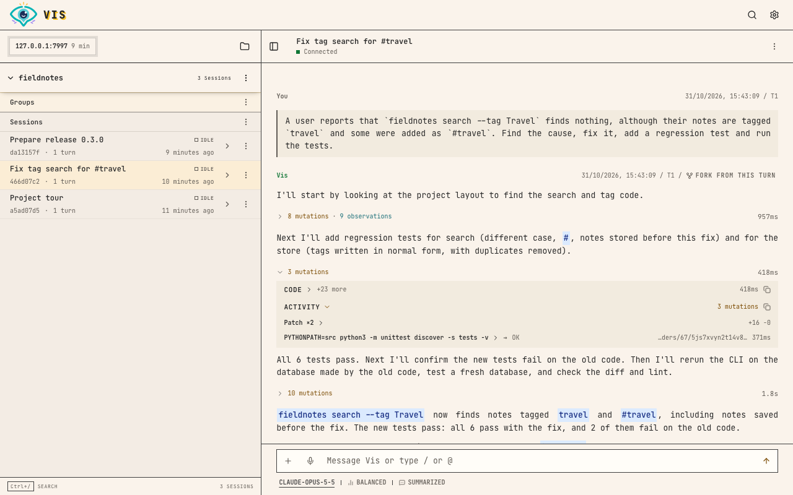
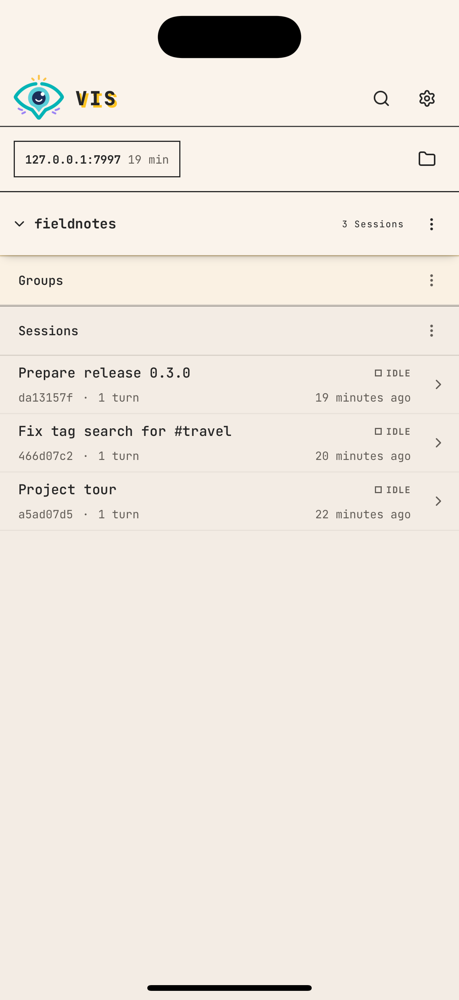
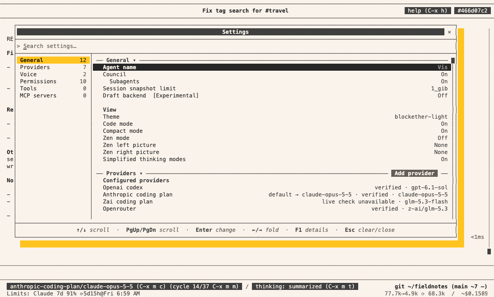

Vis is an AI agent that works in your project. Give Vis a task and a project folder. Vis reads
files, edits code, and runs commands and checks. **Activities** show each step that Vis takes.

The terminal, desktop, and phone apps connect to the computer that holds your project and show the
same sessions.

## Start using Vis

If you are new to Vis, follow the [Quickstart](quickstart.md). It installs Vis, connects a model,
and runs a first task.

If Vis is already installed, choose what you want to do:

- [Continue, stop, fork, or find your work](sessions.md) in saved sessions.
- [Choose a provider and a model](configuration.md#providers-and-models), or use a local model.
- [Connect the desktop app or a phone](quickstart.md#connect-an-app) to the sessions on your computer.
- [Use your phone away from home with Tailscale](gateway-service.md#access-from-anywhere-with-tailscale). Vis finds the Tailscale address by itself.
- [Ask another session for help](council.md) or for a second review.
- [Learn how Vis keeps a long conversation usable](context-management.md).
- [Read why Vis works this way](rationale.md).

## Customize Vis

Vis can follow the rules of your project, reuse instructions for a task, and load tools from
extension packages.

- [Choose providers, models, and project settings](configuration.md).
- [Tell Vis how your codebase works](project-instructions.md).
- [Give Vis reusable instructions for a task](skills.md).
- [Add an extension or share your own](extension-packages.md).
- [Give the web app your own name, logo, and theme](white-label.md).

## Automate or embed Vis

Vis can run a task without a chat, or run inside your own program.

- [Run a prompt on a schedule or from a webhook](automations.md).
- [Run Vis from a Python program](python-sdk.md) with the Python SDK.
- [Call a gateway over HTTP](http-api.md) from any language.
- [Build a tool that Vis can call](extending.md) in an extension.

## Run Vis for a team

One gateway can serve several people and devices.

- [Compare installation methods and update Vis](distributions.md).
- [Run a gateway as a shared service](gateway-service.md).

## Find reference information

The reference pages list the [keyboard shortcuts](keyboard-shortcuts.md), the
[extension API](extension-api.md), the [components](components.md) of forms and live views, and the
[log files](logging.md). Each Feature API page shows the calls for one feature in Python and in HTTP.
Start with the [Sessions API](sessions-api.md).

## Work safely

Vis edits files and runs commands with the permissions of your user account. Start with a task that
changes no files, and review each diff before you use it. To limit what child processes can read,
write, and reach on the network, read [Process jail and network policy](jail.md).

Keep token authentication on when a phone or another computer connects. Read
[Running a gateway](gateway-service.md) before you open a gateway to a network. To report a problem
without exposing private data, read [Reporting a bug](reporting-bugs.md).

## Gallery

<section class="screenshot-gallery" id="screenshot-gallery" data-screenshot-gallery role="region" aria-roledescription="carousel" aria-label="Vis screenshots">
  

  <figure class="screenshot-gallery__slide" id="desktop-gallery" role="group" aria-roledescription="slide" aria-label="1 of 9">
    
    <figcaption>Desktop · Conversation</figcaption>
  </figure>

  <figure class="screenshot-gallery__slide" id="ios-gallery" role="group" aria-roledescription="slide" aria-label="2 of 9">
    
    <figcaption>iOS · Conversation</figcaption>
  </figure>

  <figure class="screenshot-gallery__slide" id="tui-gallery" role="group" aria-roledescription="slide" aria-label="3 of 9">
    
    <figcaption>TUI · Conversation</figcaption>
  </figure>

  <figure class="screenshot-gallery__slide" role="group" aria-roledescription="slide" aria-label="4 of 9">
    
    <figcaption>Desktop · Release</figcaption>
  </figure>

  <figure class="screenshot-gallery__slide" role="group" aria-roledescription="slide" aria-label="5 of 9">
    
    <figcaption>iOS · Project tour</figcaption>
  </figure>

  <figure class="screenshot-gallery__slide" role="group" aria-roledescription="slide" aria-label="6 of 9">
    
    <figcaption>TUI · Session navigator</figcaption>
  </figure>

  <figure class="screenshot-gallery__slide" role="group" aria-roledescription="slide" aria-label="7 of 9">
    
    <figcaption>Desktop · Settings</figcaption>
  </figure>

  <figure class="screenshot-gallery__slide" role="group" aria-roledescription="slide" aria-label="8 of 9">
    
    <figcaption>iOS · Sessions</figcaption>
  </figure>

  <figure class="screenshot-gallery__slide" role="group" aria-roledescription="slide" aria-label="9 of 9">
    
    <figcaption>TUI · Settings</figcaption>
  </figure>

  

  

    <button type="button" data-previous aria-controls="screenshot-slides" aria-label="Previous screenshot">← Previous</button>
    1 / 9
    <button type="button" data-next aria-controls="screenshot-slides" aria-label="Next screenshot">Next →</button>
  

</section>

## Learn more

### Get started

| Page | Read it to |
| --- | --- |
| [Overview](index.md) | Learn what Vis does and find the page for your task. |
| [Quickstart](quickstart.md) | Install Vis, try a first task, and connect an app. |
| [Rationale](rationale.md) | Learn the reasons behind the design of Vis. |
| [Reporting a bug](reporting-bugs.md) | Report a problem without exposing private data. |

### Guides

**Use Vis**

These workflows work in the Companion app. Shared features also work in the terminal.

| Page | Read it to |
| --- | --- |
| [Sessions](sessions.md) | Continue, stop, or find your work. |
| [Context management](context-management.md) | Learn how filters and summaries keep a long conversation usable. |
| [Council](council.md) | Ask another session for help or a second review. |
| [Automations](automations.md) | Run a prompt on a schedule or from a webhook. |
| [Siri and Shortcuts](shortcuts.md) | Talk to Vis with the Action Button and use answers in shortcuts. |
| [Speech and voices](speech.md) | Speak text, transcribe recordings, and add your own voices. |
| [Sounds](sounds.md) | Hear a sound when a turn finishes, waits for you, or fails. |
| [Private links](private-links.md) | Open links to company hosts that only the gateway can reach. |

**Run Vis**

| Page | Read it to |
| --- | --- |
| [Runtime distributions](distributions.md) | Compare installation methods and update Vis. |
| [Running a gateway](gateway-service.md) | Install and operate a shared agent service. |
| [Process jail and network policy](jail.md) | Set the rules for child processes. |
| [Python sandbox](python-sandbox.md) | Learn where Python runs, which packages it has, and what it can access. |

**Customize Vis**

| Page | Read it to |
| --- | --- |
| [Configuration](configuration.md) | Choose providers and models, and save project settings. |
| [Project instructions](project-instructions.md) | Tell the agent how your codebase works. |
| [Skills](skills.md) | Give Vis reusable instructions for a task. |
| [Installing and sharing extensions](extension-packages.md) | Add an extension or share your own. |
| [White label](white-label.md) | Give the web app your own name, logo, links, and theme. |

**Build on Vis**

| Page | Read it to |
| --- | --- |
| [Extending Vis](extending.md) | Choose a capability and build your first tool. |
| [Extension design](extension-design.md) | Design and test typed tools. |
| [Using an existing Python project](extension-development.md) | Prepare editable uv packages for Vis. |
| [Provider extensions](provider-extensions.md) | Register an LLM provider from an extension. |
| [Forms and user input](human-input.md) | Ask for a choice, a credential, or a confirmation. |
| [Live views](live-views.md) | Show progress that a person can watch and stop. |
| [Native builds for Java and Clojure extensions](jvm-native-image.md) | Add Java or Clojure tools to Vis. |
| [Extension troubleshooting](extension-troubleshooting.md) | Diagnose loading errors and call errors. |
| [Python SDK basics](python-sdk.md) | Install the SDK, run a private agent, and connect to a gateway. |
| [HTTP API basics](http-api.md) | Authenticate requests, read the OpenAPI document, and handle errors. |
| [Evaluations](evals.md) | Score benchmark rounds, find failure causes, and compare runs. |
| [Decision models](decision-models.md) | Download Laya, train it, and publish FP32 versions. |

### Reference

| Page | Read it to |
| --- | --- |
| [Keyboard shortcuts](keyboard-shortcuts.md) | Look up the keys of the terminal app. |
| [Extension API](extension-api.md) | Look up declarations, tool contracts, and host operations for extensions. |
| [Components](components.md) | Look up every component of forms and live views. |
| [Logs and diagnostics](logging.md) | Find log files, formats, and retention, and learn what to share. |

**Feature APIs**

| Page | Read it to |
| --- | --- |
| [Sessions API](sessions-api.md) | Create sessions, send messages, follow progress, and manage saved work. |
| [Context management API](context-management-api.md) | Read the context budget, the usage, and the cache health. |
| [Project instructions API](project-instructions-api.md) | Run prompt templates and skills, and control goals. |
| [Council API](council-api.md) | Publish and read Council messages, and wake sessions. |
| [Automations API](automations-api.md) | Manage automations, runs, secrets, and webhooks. |
| [Evaluations API](evals-api.md) | Read benchmark scores, failure causes, and comparisons. |
| [Speech API](speech-api.md) | Speak text, transcribe audio, and manage your own voices. |
| [Sounds API](sounds-api.md) | Change the sound settings and choose your own sound files. |
| [Private links API](private-links-api.md) | Read the proxy settings and send requests through the gateway. |
| [White label API](white-label-api.md) | Read and set the brand of the web app. |
| [Configuration API](configuration-api.md) | Change settings and reload extensions. |
