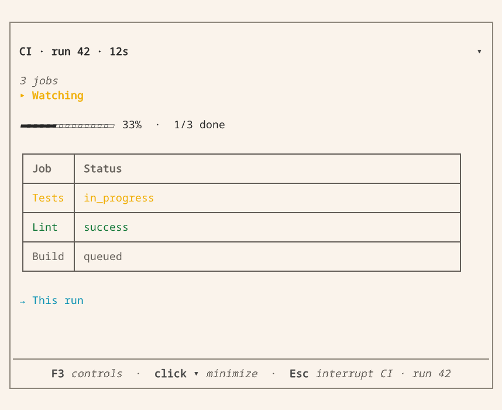
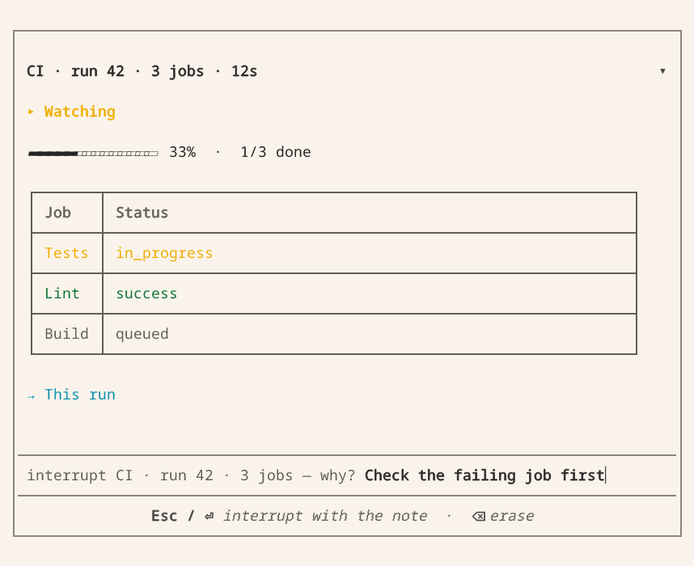

# Live views

A live view shows a long operation, such as a build, in one place, with no new chat message for
each update. Your extension opens the view with `vis.live(...)` and updates its progress, tables,
logs, and controls while the work runs. The view shows in the terminal and in the Companion app,
and a person can stop it at any time.

## When to use

- **Your tool waits for a CI run or a deployment that takes minutes.** Show the jobs as they
  finish, as [Watch a CI run](#watch-a-ci-run) does.
- **You want one dashboard for several builds.** Keep them in [one
  view](#monitor-a-fixed-build-set), not in one message for each update.
- **Errors get lost in a long log.** [Give each line a
  severity](#add-severity-to-streaming-output), so that failures stand out.
- **The person who watches must act or stop.** Add [buttons](#add-spinners-and-buttons), and handle
  the [interruption](#interruption) when the person stops the view.
- **Your extension needs a view that stays open between tool calls, such as a board.** Open it in
  the [side panel](#choose-a-placement).
- **People must review a change or answer you after your code returns.** Attach an [app](#apps).
- **You must know why your app failed or what it did.** Write to the [app
  log](#write-to-the-app-log).
- **Vis shows an error card in place of a node.** [Stay inside the
  limits](#stay-inside-the-limits), and [test the view](#testing-a-view) at its limits.
- **People must act in an app with single keys.** Add [shortcuts](#add-shortcuts-to-an-app).
- **Your program must show a moving 3D world, such as a game.** Draw a [scene](#draw-a-3d-scene).
- **You need to show the steps of a plan, with notes and pictures.** Draw a
  [board on a canvas](#draw-a-board-on-a-canvas).
- **People must plan work as issues in columns and move them.** Show a [board of
  issues](#track-issues-on-a-board).
- **The model must know what people do in an app or an HTML page.** Give it a
  [note](#tell-the-model-what-people-see).
- **Your own program, not an extension, must own an app.** [Run it from your
  program](#run-an-app-from-your-own-program).
- **The person must fill in values while the work runs.** [Collect input in the
  view](#collect-input-in-a-view).
- **Your own program must list, read, or interrupt live views.** Read [Sessions
  API](sessions-api.md#watch-live-views).

For the normal status of a tool, use [Activity
presentation](extension-api.md#activity-presentation). To ask a question and wait for the answer,
use a [form](human-input.md).

## Before you start

Open an inline live view inside a registered tool or a user command that has a calling session. Do
not open it while the extension registers. A [panel view](#choose-a-placement) can open from any
extension callback, also at registration. When a person stops a view, the view ends, but the
external job can continue.

## In the terminal

This live view updates one pane as jobs finish.

[](assets/screenshots/live-running.png)

Press F3 for the keyboard controls, which expand a disclosure, select a row, or press a button.
Press Escape to open the stop confirmation, which [Interruption](#interruption) describes.

[](assets/screenshots/live-stop.png)

## Watch a CI run

Put this code in a trusted extension module, and register `watch_run` with `vis.Symbol` to call it
from Vis. It needs the GitHub CLI, a signed-in account, and a working directory inside the target
repository. `run_id` is the numeric ID of an Actions run. The function returns the final receipt of
the view, not a GitHub run object. For a full integration with typed results and error handling, read the [GitHub extension
of the repository](https://github.com/Blockether/vis/blob/main/.vis/extensions/gh.py).

```python
import json
import time

import blockether.vis.extension as vis

TONES = {"": "running", "success": "ok", "skipped": "idle"}  # anything else is an error


def poll(run_id):
    done = vis.shell({"op": "background", "id": "gh",
                      "command": f"gh run view {run_id} --json jobs,status,conclusion,url"}).wait(60)
    return json.loads(done["out"])


def watch_run(run_id: int) -> dict:
    """Watch a GitHub Actions run; stopping the view does not cancel the run."""
    run = poll(run_id)
    with vis.live(
        f"CI · run {run_id} · {len(run['jobs'])} jobs",
        [
            vis.ui.status("run", "Watching", tone="running"),
            vis.ui.progress("progress"),
            vis.ui.table("jobs", columns=[vis.ui.table.column("job", "Job"),
                                       vis.ui.table.column("state", "Status")]),
            vis.ui.link("links", links=[{"id": "run", "label": "This run", "target": run["url"]}]),
        ],
    ) as view:
        seen = {}
        counts = None
        while True:
            if view.is_interrupted:
                return view.close(summary="Stopped watching before the run completed")
            for job in run["jobs"]:
                state = job["conclusion"] or job["status"]
                if seen.get(job["databaseId"]) != state:
                    seen[job["databaseId"]] = state
                    view["jobs"].upsert(str(job["databaseId"]), [job["name"], state],
                                        tone=TONES.get(job["conclusion"], "error"))
            completed = sum(1 for j in run["jobs"] if j["status"] == "completed")
            total = len(run["jobs"])
            if total and (completed, total) != counts:
                view["progress"].set(done=completed, total=total)
                counts = (completed, total)
            if run["status"] == "completed":
                break
            deadline = time.monotonic() + 5
            while (remaining := deadline - time.monotonic()) > 0:
                view.sleep(remaining)
                if view.is_interrupted:
                    return view.close(summary="Stopped watching before the run completed")
            run = poll(run_id)
        view["run"].set(run["conclusion"], tone=TONES.get(run["conclusion"], "error"))
        return view.close(summary=f"Run result: {run['conclusion']}")
```

GitHub can return a run before it publishes the jobs. While the job count is unknown, declare the
progress without a `total`, because `total=0` is invalid. When jobs show, set both `done` and
`total`, and update the total if GitHub adds jobs.

## Monitor a fixed build set

To watch several builds that are **already selected**, use one synchronous tool and one live view.
The coordinator below runs at most two read-only requests at one time, and it keeps the last
observation of each build. It does not start deployments, schedule dependencies, or cancel remote
jobs. The model needs no general shell access.

Supply a domain adapter `read_once(build, *, deadline, stop)` that returns `"running"`,
`"succeeded"`, or `"failed"` for that exact environment and build ID. The adapter is the code of
your CI client, **not a Vis API**. It must obey these rules:

- Use pinned identities, not an alias that moves, such as "latest".
- Obey the absolute `time.monotonic()` deadline across connection, reads, retries, and pagination.
  Stop when the `threading.Event` with the name `stop` is set.
- Close responses, sockets, and each per-request client in `finally` or `with`.
- Make only read requests. Keep authentication in the configuration of the trusted extension. Do
  not return credentials or raw exception messages.
- Make no Vis host calls from the reader threads. Only the thread that called the tool owns and
  updates the view.

A read timeout on a socket is not a deadline for the whole request, and Python cannot force a
running thread to stop. Use a client with bounded operations, and test its cleanup.

```python
# monitor.py
import math
import time
from concurrent.futures import ThreadPoolExecutor
from dataclasses import asdict, dataclass
from threading import Event

import blockether.vis.extension as vis


@dataclass(frozen=True)
class Build:
    environment: str
    build_id: str


def watch_builds(builds, read_once, *, timeout_s=600.0, poll_s=5.0):
    """Observe a fixed set; return after all locally owned readers have stopped."""
    builds = tuple(builds)
    if not builds or len(set(builds)) != len(builds):
        raise ValueError("Choose a nonempty set of distinct environment/build pairs")
    if any(not b.environment.strip() or not b.build_id.strip() for b in builds):
        raise ValueError("Environment and build ID must be explicit")
    if any(not math.isfinite(n) or n <= 0 for n in (timeout_s, poll_s)):
        raise ValueError("Timeout and poll interval must be finite and positive")
    last = [{**asdict(b), "state": "unobserved", "read_error": None} for b in builds]
    due = [0.0] * len(builds)
    pending = {}
    stop = Event()
    deadline = time.monotonic() + timeout_s
    outcome = "completed"
    with vis.live("Watch builds", [
        vis.ui.status("status", "Watching pinned builds", tone="running"),
        vis.ui.table("builds", columns=[vis.ui.table.column("environment", "Environment"),
                                    vis.ui.table.column("build", "Build"),
                                    vis.ui.table.column("state", "Last observation")]),
    ]) as view:
        pool = ThreadPoolExecutor(max_workers=2, thread_name_prefix="ci-reader")
        try:
            for i, row in enumerate(last):
                view["builds"].upsert(str(i), [row["environment"], row["build_id"],
                                              row["state"]])
            while True:
                if view.is_interrupted:
                    outcome = "interrupted"
                    break
                # Never call result() on an unfinished future or use ordered map().
                for future in [f for f in pending if f.done()]:
                    i = pending.pop(future)
                    try:
                        state = future.result()
                        if state not in {"running", "succeeded", "failed"}:
                            raise ValueError("Unknown build state")
                        last[i]["state"] = state
                    except Exception as error:
                        # A read error is not a failed CI build or a successful read.
                        last[i]["read_error"] = type(error).__name__
                    due[i] = time.monotonic() + poll_s
                    row = last[i]
                    view["builds"].upsert(str(i), [row["environment"], row["build_id"],
                                                  row["read_error"] or row["state"]])
                if any(row["state"] == "failed" for row in last):
                    outcome = "failed"
                    break
                if any(row["read_error"] for row in last):
                    outcome = "observation_error"
                    break
                if all(row["state"] == "succeeded" for row in last):
                    break
                now = time.monotonic()
                if now >= deadline:
                    outcome = "timeout"
                    break
                for i, build in enumerate(builds):
                    if len(pending) == 2:
                        break
                    if (i not in pending.values() and due[i] <= now
                            and last[i]["state"] != "succeeded"):
                        pending[pool.submit(read_once, build,
                                            deadline=min(deadline, now + 5.0),
                                            stop=stop)] = i
                # Futures do not wake the view. Check them within 100 ms; Stop
                # wakes this host wait immediately. UI events do not reset due[].
                view.sleep(min(0.1, max(0.0, deadline - time.monotonic())))
        except vis.Interrupted:
            # Stop can race with any view update, not just the explicit flag read.
            outcome = "interrupted"
        except BaseException:
            outcome = "failed"
            raise
        finally:
            stop.set()
            try:
                reason = "failed" if outcome == "observation_error" else outcome
                receipt = view.close(reason=reason, summary=f"Monitor: {outcome}")
            finally:
                pool.shutdown(wait=True, cancel_futures=True)
        if receipt["reason"] == "interrupted":
            outcome = "interrupted"  # a concurrent human Stop takes precedence
    return {"outcome": outcome, "observations": last, "view": receipt}
```

Register only the typed wrapper, not the coordinator that takes a callback. This example has
`monitor.py` and your domain client in the [project
environment](extension-development.md#prepare-the-project-environment) of the extension:

```python
# .vis/extensions/ci_monitor.py
import blockether.vis.extension as vis
from monitor import Build, watch_builds
from my_ci import read_build  # your bounded, read-only adapter described above


def watch(builds: list[Build], timeout_s: float = 600.0) -> dict:
    """Watch these exact builds together. Stop watching never cancels remote jobs."""
    return watch_builds(builds, read_build, timeout_s=timeout_s)


def present(*, phase, args, kwargs, result, error):
    if phase == "start":
        summary = "Watching the selected build set"
    elif phase == "failure":
        summary = f"Monitoring could not finish: {type(error).__name__}"
    else:
        summary = f"{result['outcome']}: {len(result['observations'])} builds"
    return vis.ActivityPresentation("Watch builds", summary)


vis.register_extension(vis.Extension(
    name="ci-monitor", alias="ci", description="Read-only monitoring of pinned CI builds.",
    symbols=[vis.Symbol(watch, name="watch_builds",
                        activity=vis.Activity(label="Watch builds", render=present))],
))
```

**A fast failure does not skip cleanup.** When a read reports a failure, the view closes, but the
caller returns only after the slower readers finish their bounded cleanup. `Future.cancel()` cannot
kill a request that already runs.

Do not use `shutdown(wait=False)` in its place, because work then continues after the return with
no sign of it. The snapshots are the last observations before the stop, and late results during
cleanup do not change them. `unobserved` does not mean running or successful.

**The recipe is not durable background execution.** An open live view suspends only the normal
wall-time limit of the block that called it. Network deadlines and the overall timeout of the
recipe still apply. A synchronous call keeps its caller busy, so
the model cannot call a second "stop" tool during that call. Use the UI or an independent SDK
client. Monitoring ends at the return, and it does not recover after a worker restart or a gateway
restart.

Before you ship your adapter, test these cases:

- A fast failure next to a slow read.
- Successful completion.
- A stop during a wait and during an update.
- Request errors.
- The overall timeout.
- The release of each thread and each response that your code owns.

The [recipe
tests](https://github.com/Blockether/vis/blob/main/packages/vis-agent/tests/test_monitor_recipe.py)
of the repository run these code blocks with controlled readers and `LiveRecorder`. They do not
check your CI service or your credentials.

## Nodes

A view declares each node once with an ID, and your code addresses a node by that ID. `view[id]`
returns a typed handle that has only the verbs of its node type:

| Builder | Shows | Verbs on `view[id]` |
| --- | --- | --- |
| `vis.ui.status(id, text, tone=…, detail=…)` | Status text with an optional detail line | `.set(text, tone=, detail=, label=)` |
| `vis.ui.progress(id, total=…)` | A bar | `.set(value=, done=, total=)` |
| `vis.ui.stat(id, stats=[…])` | A strip of counters | `.set(stat_id, value_text, label, tone=)`, `.remove(*ids)`, `.clear()` |
| `vis.ui.steps(id, steps=[…])` | A checklist | `.set(step_id, label, tone=, detail=, value=)`, `.remove(*ids)`, `.clear()` |
| `vis.ui.timeline(id, lanes=[…])` | Bars on one shared time axis | `.set(lane_id, label, start, end=, tone=, detail=)`, `.remove(*ids)`, `.clear()` |
| `vis.ui.badge(id, badges=[…])` | A row of short labels | `.set(badge_id, label, tone=)`, `.remove(*ids)`, `.clear()` |
| `vis.ui.listing(id, items=[…], is_ordered=False)` | A list of points with bullets or numbers | `.set(item_id, text, detail=, tone=)`, `.order(is_ordered)`, `.remove(*ids)`, `.clear()` |
| `vis.ui.chart(id, series=[…], kind="bar", categories=[…])` | Numbers as bars or lines | `.set(series_id, label, values, tone=)`, `.configure(kind=, categories=, label=)`, `.remove(*ids)`, `.clear()` |
| `vis.ui.output(id, label=…, default_expanded=False)` | Retained lines that collapse on their own | `.write(*lines, tone=)`, `.clear()` |
| `vis.ui.table(id, columns=[vis.ui.table.column(…)], groups=[vis.ui.table.group(…)])` | Rows with IDs, which can fold into groups | `.upsert(row_id, cells, tone=, parent=)`, `.group(group_id, label=, tone=, order=, is_open=)`, `.replace(rows)`, `.select(*row_ids)`, `.remove(*ids)`, `.clear()` |
| `vis.ui.link(id, links=[…])` | Links that a person can open | `.add(link_id, label, target, target_kind=, tone=)` |
| `vis.ui.paragraph(id, text)` | A paragraph with inline formatting | `.set(text)` |
| `vis.ui.heading(id, text, level=2)` | A heading at level 1 to 6 | `.set(text, level=)` |
| `vis.ui.divider(id)` | A rule between sections, vertical in a `wrap` group | None. Use `view.add(...)` or `view.drop(id)`. |
| `vis.ui.code(id, text, language=None)` | Literal code that keeps its whitespace | `.set(text, language=)` |
| `vis.ui.spinner(id, text="Working", variant="braille")` | An activity indicator | `.set(text=, variant=, is_active=)` |
| `vis.ui.button(id, label, is_disabled=False, variant=None)` | An action for the person. `variant` is `primary`, `secondary`, or `destructive`. `is_selected=True` or `False` makes the button one choice of a row, such as a tab, and the Companion app marks the current choice. | `.set(label=, is_disabled=)` |
| `vis.ui.disclosure(id, label, *nodes, default_expanded=False)` | A column that collapses | Children update by their own IDs. |
| `vis.ui.scene(id, width, height, objects=[vis.ui.scene.object(…)])` | A 3D world, which [each client draws](#draw-a-3d-scene) | `.put(object_id, **changes)`, `.mesh(mesh_id, vertices, faces)`, `.set(background=, fov=, is_wrapping=, tick_ms=)`, `.remove(*ids)`, `.clear()` |
| `vis.ui.canvas(id, cards=[vis.ui.canvas.card(…)])` | A [board with items and arrows](#draw-a-board-on-a-canvas) | `.card(id, title, **keys)`, `.shape(…)`, `.note(…)`, `.frame(…)`, `.text(…)`, `.put(*cards)`, `.focus(id, zoom=)`, `.fit()`, `.select(*ids)`, `.set(…)`, `.remove(*ids)`, `.clear()` |
| `vis.ui.board(id, columns, issues)` | Columns of [issues that people move and change](#track-issues-on-a-board) | `.issue(id, title, column, **keys)`, `.put(*issues)`, `.move(id, column, index)`, `.apply(event)`, `.replace(issues)`, `.select(id)`, `.set(…)`, `.remove(*ids)`, `.clear()` |

`vis.ui.output(...)` builds a `log` node. The `output` name differs from `vis.log`, which writes
a line to the engine log.

To update a status and keep its detail, omit `detail`. To remove the detail line, pass `detail=""`:

```python
view["state"].set("Polling", detail="Waiting for jobs")
view["state"].set("Running")             # Keeps the detail.
view["state"].set("Complete", detail="")  # Clears the detail.
```

A keyed update inserts a new ID or updates an existing ID in its position. Log lines have no IDs,
so each write appends. `.clear()` removes the displayed lines and the recorded lines.

When a view has exactly one node of a type, the view itself has the verb of that type:
`view.status(...)`, `view.progress(...)`, `view.write(...)`, and `view.row(...)`. To change the
layout of an open view, read [Layout and text](#layout-and-text).

### Read and search a log

Each log starts collapsed and has its own expanded state. A patch keeps the choice of the reader.
`default_expanded=True` changes only the first state of an active view. A completed receipt starts
collapsed again and keeps its saved output.

A live view shows the whole log. When you open a log, the Companion app and the terminal read the
record back to its first line. This includes output from before the client attached. `window_lines` sets
only the size of the tail that the model reads and of the tail that a client gets when it attaches.

While the earlier lines load, one line says so. The same line reports a failed read. Search reaches
the record in both cases.

An expanded log has **Search** in the Companion app, and **Search log** in the terminal through the
F3 controls or the pointer. Search ignores case and finds a literal substring in the whole saved
record, also in lines outside `window_lines` and in closed views. Results have the original line
numbers, which start at 1, and come in pages of 200. They are a snapshot, and **Refresh results**
adds new output. After code clears a log, search no longer finds the earlier lines.

In the Companion app, **Clear search** or Escape in the search field brings back the normal output.
`/` moves the focus from the output to search. Without a record loader, the panel says that search
covers only the loaded lines. In the terminal, an empty query browses the record, Enter opens a
full wrapped line, and Escape cancels a read that runs.

A client reads the record of a log node in pages with the [Sessions
API](sessions-api.md#watch-live-views). A request names the log node and takes `query`, `from`, and
`limit`. `from` is a match offset that starts at 0, and an empty query matches all lines.

The response has `lines`, `line_numbers`, `matched`, and `total`. The gateway limits a page to the
default size of the log window. A styled page also has `line_tones`, aligned with `lines`, where
`null` means plain text.

### Add severity to streaming output

To tell failures, warnings, and successful steps apart in a log, write with a tone, as in
`view["log"].write(..., tone="error")`. The typed `vis.LogTone` values are `"idle"`, `"running"`,
`"ok"`, `"warn"`, and `"error"`. Without `tone`, the lines are plain text. A tone applies to all
lines of one call, not to later calls.

```python
with vis.live("Build output", [vis.ui.output("log", label="Build log")]) as view:
    view["log"].write("10:42:00 INFO $ npm test")
    view["log"].write("10:42:01 WARN cache unavailable", tone="warn")
    view["log"].write("10:42:02 ERROR compiler failed", tone="error")
    view["log"].write("    at compile (src/build.ts:42:7)")
```

Keep the severity words in the text, so that the log is clear without color. The terminal and the
Companion app use the semantic colors of their theme. Plain stderr and Markdown receipts keep the
same text. Search results keep the colors in the Companion app, and the search and full-line
dialogs of the terminal show plain text. A completed receipt keeps the style metadata and the
original line numbers.

Redact secrets **before** you call `write` or seed `lines`. The presentation redaction of the
engine is an extra safeguard, and it does not detect every kind of secret. Styles never split,
hide, or replace text before redaction, search, or copy. HTML and URLs in output stay literal, with
no links and no markup that runs.

ANSI is not a styling API. C0 and C1 controls other than tab and newline show as visible `\uXXXX`
text, so Escape shows as `\u001b`. Vis never runs cursor moves, OSC links, clipboard escapes, or
color escapes.

Each argument of `write` is one complete line of the record, not a raw network fragment. In your
adapter, decode and join partial lines before you redact and append them. Append new output. Do not
clear the log and write a snapshot again.

Each batch keeps its own tone, also when Vis merges updates. Styles do not change `window_lines`,
retention, or search pages. The earlier pages that a client reads back keep their tones. For a separate snippet in a known
language, use `vis.ui.code(..., language=...)`, but not for the mixed log.

For raw wire clients, an `append` operation can have `tone` only for a log node. A log snapshot can
have `line_tones`, with one tone or `null` for each line. Clojure uses `:tone` on log append
operations and `:line-tones` on seeded log nodes. These closed enums accept no CSS, free color
values, HTML, or terminal commands.

### Add spinners and buttons

The spinner variants are `braille`, `dots`, `line`, and `pulse`. `is_active=False` stops a spinner
and keeps its text. A completed receipt never animates, and the Companion app obeys the
reduced-motion preference.

An accepted press adds 1 to the `clicks` of that node in the shared state and wakes
`view.sleep(...)`. Read the count with `view.state()`. Disabled buttons and completed receipts
refuse a press. Treat a network request without confirmation as uncertain, and check the state
before you repeat an action with consequences.

```python
with vis.live("Review", [
    vis.ui.heading("title", "Build review", level=1),
    vis.ui.paragraph("intro", "Read the output before continuing."),
    vis.ui.code("example", "print('ready')", language="python"),
    vis.ui.spinner("waiting", "Waiting for review", variant="dots"),
    vis.ui.disclosure("details", "Build details",
                   vis.ui.output("tests", label="Test output"),
                   vis.ui.output("build", label="Build output")),
    vis.ui.divider("review-actions"),
    vis.ui.button("continue", "Continue"),
]) as view:
    view["tests"].write("Tests passed")
    while not view.is_interrupted:
        state = view.state()
        if not state:
            break
        pressed = next(n for n in state["nodes"] if n["id"] == "continue")
        if pressed["clicks"]:
            view["continue"].set(is_disabled=True)
            view["waiting"].set("Review accepted", is_active=False)
            break
        view.sleep(60)
```

With one argument, `vis.ui.heading(text)` and `vis.ui.paragraph(text)` stay form decorations. With
two positional arguments, they declare live nodes with IDs.

### Group, select, and replace table rows

A table takes `order="insertion"`, which is the default, `"newest-first"`, or a map such as
`{"by": "duration", "dir": "desc"}`. Rows with the same `parent="tests"` show under one group that
collapses. The group stays closed until the reader opens it. Each client shows the group with its
name and its row count, so keep the name stable and let Vis count.

A group that you do not declare takes its ID as its name. It sorts after the declared groups, in
the order in which its first row arrived.

Declare a group to name, color, or order it. In the table builder, use
`vis.ui.table.group("tests", label="Tests", tone="error", order=0)`. During the run, use
`view["jobs"].group("tests", tone="error")`.

Declarations merge by ID, so a later call changes only the keys that it passes. A renamed group
keeps the fold of the reader. `is_open=True` opens the group when it first arrives, and after that
the choice of the reader applies. Vis does not show a declared group with no rows.

With `is_selectable=True`, people can select rows. Read the selection with `view.state()`.

To show a new set of rows, call `.replace(rows)`. It sets all rows in one step. A selected row that is in the new set stays
selected. A row that is not in the new set goes away with its selection. `.clear()` and then
`.upsert(...)` drops the whole selection.

```python
view["chats"].replace([vis.ui.table.row(chat.id, [chat.title, chat.category])
                       for chat in chats if chat.category == category])
```

An empty list empties the table. A table holds at most `max_rows` rows, so Vis refuses a larger
set.

### Draw a 3D scene

A `scene` node shows a small 3D world, such as a game board. Your Python code keeps all the logic
and sends only shapes, places, turns, and colors. No code of yours runs in a client.

```python
field = vis.ui.scene(
    "field", 48, 24,
    label="Field",
    fov=30,
    is_wrapping=True,
    tick_ms=100,
    objects=[vis.ui.scene.object("ship", "cone", x=24, y=12, scale=1.2, color="#7dd3fc")],
)
app = vis.attach(vis.ui.app("Asteroids", field, key="asteroids"))

app["field"].put("rock-1", mesh="icosahedron", x=10, y=6, scale=2, color="#a8a29e")
app["field"].put("ship", x=25, rz=-45)  # Sends only the changed keys.
app["field"].remove("rock-1")
```

- The x axis points right, the y axis up, and the z axis toward the viewer. The camera shows the
  rectangle from `(0, 0)` to `(width, height)` at `z=0`.
- `fov` is the vertical field of view in degrees, from 0 to 120, with a default of 40. Use 0 for a
  flat, orthographic view.
- `rx`, `ry`, and `rz` turn an object in degrees, first about x, then about y, then about z.
- The built-in meshes are `box`, `tetrahedron`, `octahedron`, `icosahedron`, `sphere`, and `cone`.
  The tip of a cone points to +y. Add your own shape with
  `vis.ui.scene.mesh(mesh_id, vertices, faces)` or `.mesh(...)`. List the corners of each face
  counterclockwise, as seen from outside.
- One light shades each face. An object with `is_emissive=True` shows its own color without shade.
- A scene holds at most 32 custom meshes and 512 objects.

`.put(object_id, **changes)` adds an object or changes only the keys that you give, and a new
object needs `mesh`. `.objects` returns the objects as Vis holds them, by ID. `.set(...)` changes
`background`, `fov`, `is_wrapping`, or `tick_ms`.

Send one update for each tick of your loop. The Companion app draws the scene with WebGL and moves
each object smoothly from its last place to its new place in `tick_ms`. With `is_wrapping=True`, an
object that leaves at one edge moves in smoothly at the opposite edge. To move an object without
the smooth motion, give it a new ID.

The terminal draws the same scene in true color, and each character shows two pixels with the `▀`
half block.

### Draw a board on a canvas

To show the steps of a release, put the build and its checks in a frame. Use arrows to show which
steps depend on others. Give each item a unique ID so that you can update it or draw an arrow to it.

```python
ui = vis.ui
board = ui.canvas(
    "board",
    [
        ui.canvas.frame("release", "Release", color="blue"),
        ui.canvas.card("build", "Build", parent="release", icon="code", progress=0.6),
        ui.canvas.frame("checks", "Checks", parent="release", border="dashed"),
        ui.canvas.shape(
            "ready", "Ready?", parent="checks", shape="diamond", color="teal",
            after=ui.canvas.edge("build", label="Artifact", route="elbow", end_mark="triangle"),
        ),
        ui.canvas.note("notes", "Release notes", color="yellow", text="List the **changes**."),
    ],
    flow="right",
    pattern="grid",
    is_selectable=True,
)
app = vis.attach(ui.app("Release", board, key="release"))
canvas = app["board"]
canvas.text("approval", "Approval required", parent="checks")
```

Open the app in the Companion app. The **Checks** frame appears inside **Release**. An arrow with
an **Artifact** label connects **Build** and **Ready?**.

In the terminal, press `F4` in an app to change between the list and the map. You can also press
`m` if the app does not use that key and you are not in a text field. For a board in a live
view, open its transcript entry first, then press `F4`.

- Press the arrow keys or `h`, `j`, `k`, and `l` to move the map. Hold `Shift` with an arrow key to
  move by one screen. Drag the map or turn the mouse wheel to move it. Hold `Shift` and turn the
  wheel to move sideways, or swipe sideways on a touchpad.
- Press `+` or `-` to change the scale. Hold `Ctrl` and turn the wheel to zoom at the pointer.
  Press `0` or `Home` to fit the board, or `End` to return to
  the app owner's view. When the titles do not fit, the overview shows dots instead.
- Press `Tab` or `Shift+Tab` to focus an item. In an app, press `Enter` to select the item or open
  its comment editor. Press `Shift+Enter` to open the comment editor on a selectable item if your
  terminal sends that key. Use the list to read all threads.
- If the app owner locks the board, you cannot move or change the scale of the map.

The `text` of an item is Markdown. The Companion app and the terminal list render it as a session
message. The terminal map shows a text preview. Zoom in to see more, or use the list for formatting.

### Add a picture or recording to a canvas

To show an image in a card, change `release.png` to the path of your PNG file. You can also pass
image bytes to `ui.canvas.picture`. Give `alt` a description of what the image shows. An empty
or blank description is not valid. A recording uses an HTTP or HTTPS URL. The Companion app
loads the recording when a person starts playback.

```python
canvas.card(
    "preview", "Preview", parent="release",
    picture=ui.canvas.picture("release.png", alt="The release board on a phone", fit="contain"),
    caption="Figure 1. The board on a phone.",
)
canvas.card(
    "demo", "Demo", after="preview",
    media={"kind": "video", "url": "https://example.com/release.mp4", "alt": "A release walkthrough"},
)
```

Use `kind="audio"` in `media` for a sound recording. Change the example URL to the address of
your recording. Use `fit="contain"` to show the whole picture. The default, `cover`, fills the
picture area and can cut the edges. The pictures in canvas items count toward the view's picture
byte limit.

### Move or update a canvas

In the Companion app, drag to move the board and pinch to zoom. With a mouse, hold Ctrl or Command
and turn the wheel. The board controls zoom in, zoom out, show the items at full size, and fit the
whole board. Double-click an item to put it in the center at full size.

Call `.focus(item_id, zoom=)` to put an item in the center. Call `.fit()` to show the whole board.
`zoom` is a scale from 0 to 4. Use 1 for full size or 0 to fit the focus. After a person moves the
board, it stays there until the person presses **Fit** or you send a different `zoom` or `focus`.

Use `.set(is_locked=True)` to stop people from moving the board. With `is_selectable=True`, read
the selection with `.selected_ids` and set it with `.select(*ids)`.

Use `.card(id, title, **keys)`, the other item methods, or `.put(*cards)` to add items. An item
with an ID already on the board replaces the whole item. Use `.remove(*ids)` to remove items and
`.clear()` to remove them all. Read `.cards` for the items that Vis holds, by ID.

### Comment on a canvas item

Open the board as an app. Select the comment control on an item to start a thread, or open an
existing thread to reply. Write the comment, then press **Send** to send the drafts to the session.

To answer as the app owner, use the comment's `thread_id` from the Send receipt if that thread
has space for a reply. If the thread is full or no longer exists, use `item_id` to start a new
thread on the same item. Read the threads with `canvas.threads`.

```python
canvas.reply("Check the size before release.", item_id="build")

for receipt in app.submissions("delivered"):
    for comment in receipt.get("comments", []):
        if comment["node_id"] != "board" or comment.get("item_id") not in canvas.cards:
            continue
        thread = next((t for t in canvas.threads if t["id"] == comment["thread_id"]), None)
        if thread is not None and len(thread["messages"]) < 50:
            target = {"thread_id": thread["id"]}
        else:
            target = {"item_id": comment["item_id"]}
        canvas.reply("I will check this.", submission_id=receipt["id"], **target)
```

Call `canvas.resolve(thread_id)` when a thread needs no more work. Pass `is_resolved=False`
to reopen the thread. Both calls keep the current messages and draft. A `thread` patch
can change only the resolution if its `thread` value has `id` and `is_resolved` only.

Use a different ID for each item and thread on a canvas. Call `canvas.remove(thread_id)`
to remove a thread. Removing an item also removes its threads. Replacing an item keeps its threads.

### Canvas options

A board holds up to 200 items and 100 threads. Each item holds up to 16 incoming arrows and 8
badges. Each thread holds up to 50 messages. When a thread is full, you cannot save a new reply
in that thread. You can still add its messages to your next session message without a note.

If the thread fills after you save a reply, Send includes the reply in its receipt and gives it
to the app. The reply does not appear in the full thread. Answer it in a new thread on the same item.

IDs, the board label, item titles, and author names have a limit of 200 characters. Item details
and arrow labels have a limit of 80 characters. Badge text has a limit of 40 characters. Item text
and media URLs have a limit of 2,000 characters. Captions and alternative text have a limit of 300
characters. Each draft and message has a limit of 4,000 characters.

| Option | Values and effect |
|---|---|
| `flow` | `right` puts the steps from left to right, and `down` puts them from top to bottom. `auto`, the default, uses `down` on windows narrower than 560 pixels and `right` otherwise. |
| `pattern` | `dots`, `grid`, `lines`, or `plain`. The default is `dots`. |
| `column`, `row` | Set an item's step with `column` and its place in that step with `row`. An item without a fixed step goes one step after the last item that it comes from. |
| `parent` | Names the frame that holds an item. Frames can nest to a depth of 4. An item with an unknown parent or a parent that is not a frame stays on the board. |
| `kind`, `shape` | The item kinds are `card`, `shape`, `note`, `frame`, and `text`. A `shape` item uses `rectangle`, `rounded`, `pill`, `ellipse`, `diamond`, `hexagon`, `parallelogram`, `cylinder`, or `document`. |
| `color`, `fill`, `border` | Choose `gray`, `red`, `orange`, `yellow`, `green`, `teal`, `blue`, `purple`, or `pink`. Set `fill` to `none`, `soft`, or `solid`. Set `border` to `solid`, `dashed`, `dotted`, `double`, `thick`, or `none`. |
| `size`, `icon`, `animation` | Use `small`, `medium`, or `large`. Use an app icon name such as `code`, `checklist`, or `image`. Choose `pulse`, `glow`, `bounce`, or `shake` for movement. |
| `text`, `meta`, `tone`, `badges` | Add text with inline formatting, a detail line, a status, or up to 8 badges. |
| `caption`, `progress` | Put a line below the item with `caption`. Set `progress` from 0 to 1 to show how much work is done. |

Pass an item ID, a `ui.canvas.edge(source_id, **keys)` value, or a list of both to `after`. Each
arrow ends at the item that holds it. An arrow from a missing item appears when that item arrives.

| Arrow option | Values and effect |
|---|---|
| `label`, `tone`, `color` | Add a label or set the color. |
| `route` | `curve`, `straight`, or `elbow`. The default is `elbow`. An elbow uses right angles and tries to avoid items and other arrows. It may use a direct line if it cannot find a route. |
| `line` | Uses the same values as `border`. `none` orders the items without drawing an arrow. |
| `start_mark`, `end_mark` | `none`, `arrow`, `triangle`, `circle`, `diamond`, or `bar`. The defaults are `none` at the start and `arrow` at the end. |
| `is_active`, `animation` | Set `is_active=True` to animate the arrow. Choose `flow`, `dash`, `dot`, or `pulse`. The default is `flow`. |

### Track issues on a board

A board shows issues in columns. With `is_editable=True`, a person drags an issue to another
column or place, and opens an issue to change it. On a phone, a person holds an issue, then drags
it. A person can also make and delete issues.

```python
import blockether.vis.extension as vis

ui = vis.ui
board = ui.board(
    "sprint",
    [
        ui.board.column("todo", "To do"),
        ui.board.column("doing", "In progress", limit=3),
        ui.board.column("done", "Done", is_done=True),
    ],
    [
        ui.board.issue("i1", "Add the sign-in page", "todo", key="WEB-1", kind="story",
                       priority="high", assignee="ada", points=3, labels=["web"]),
        ui.board.issue("i2", "Fix the token refresh", "doing", key="WEB-2", kind="bug",
                       is_flagged=True),
    ],
    people=[ui.board.person("ada", "Ada Lovelace", color="#7c3aed")],
    is_editable=True,
)


def on_event(event):
    # A move is already done. An edit asks you to make the change.
    app["sprint"].apply(event, key_prefix="WEB")


app = vis.attach(ui.app("Sprint", board), on_event=on_event)
```

The host moves an issue when a person drops it, and then sends a `move` event with `item_id`,
`column`, and `index`. The host does not change an issue for an `edit` event. Your code makes the
change, so that it can give the next key or save the issue. `Board.apply(event)` does both kinds.
An `edit` event without `item_id` asks for a new issue, and `is_removed` asks to delete
`item_id`.

A column with `limit` shows a warning when it holds more issues. Each client sorts the issues of
a column by `rank`, and then by their order in `issues`. An issue with no `rank` has rank 0. A
move gives each issue of the target column its place as its new rank.

## Layout and text

`vis.ui.row(id, *nodes)`, `vis.ui.column(id, *nodes)`, `vis.ui.grid(id, *nodes)`, and
`vis.ui.wrap(id, *nodes)` arrange nodes with the layout terms of [Ask
forms](human-input.md#layout). Each group of a live view has an ID. Groups nest, and a nested group
uses the width inside its parent, not the full screen width.

In the Companion app, a row has columns of equal width, each at least `12rem` wide. As the space
narrows, the row wraps into fewer columns and then stacks. A single column can shrink below that
minimum to fit a narrower panel. In the terminal, a row has columns of equal width when each child
gets at least 24 text cells after spacing. If not, the whole row stacks. A column always stacks.

Use a grid for many nodes of one kind, such as cards. It shows equal columns and continues on new
rows. `vis.ui.grid(id, *nodes, max_columns=3)` limits the columns. A narrow panel shows fewer
columns, and the narrowest panels stack them. In the terminal, each grid column also needs 24 text
cells.

Use a wrap for nodes that keep their own width, such as buttons, stats, and statuses. They stand
side by side and continue on a new line when the next node does not fit. Buttons in a grid or a
wrap work in both clients.

```python
vis.ui.column("board",
           vis.ui.grid("services", *cards, max_columns=3),
           vis.ui.wrap("actions",
                    vis.ui.button("approve", "Approve release"),
                    vis.ui.button("rerun", "Run checks again")))
```

Each `vis.ui.row`, `vis.ui.column`, `vis.ui.grid`, `vis.ui.wrap`, and `vis.ui.disclosure` needs at
least one child. Without children, these Python builders raise `ValueError` immediately. If you
have no nodes yet, add the group when its first child is ready.

`view.add(node)` appends a top-level node. With `after=`, the new node becomes the next sibling of
the named node in the same container:

```python
view.add(vis.ui.column("builds", vis.ui.status("linux", "Queued")))
view.add(vis.ui.status("macos", "Queued"), after="linux")  # Inside builds.
view.add(vis.ui.status("summary", "Watching"), after="builds")  # After the group.
```

To grow a group, name one of its children in `after=`, not the group. `view.drop(id)` removes a
node, and a removed group takes its children with it. A group keeps the live interactions of its
children and produces no form answer.

`vis.ui.divider("section-break")` draws a rule between sections, as an HTML `<hr>` does. The rule
fills the width of its container in the terminal and the Companion app, also inside columns and
disclosures. It stays in completed receipts. Directly inside a `vis.ui.wrap` group, it is a
vertical line between the items of that line.

A divider has only an ID, with no label, content, style options, or update verbs. For a section
title, use a heading. To remove the rule, call `view.drop("section-break")`. The wire node is
`{"id": "section-break", "type": "divider"}`.

Display text accepts inline Markdown: `` `code` ``, `**bold**`, `_italic_`, and links. Status text
wraps and is justified in its column.

Vis never runs log lines or code blocks. Terminal controls in logs show as visible escapes, and
other text stays literal. There is no general Markdown node, because each node type has its own
Markdown output.

In each view, Vis redacts text that looks like a labeled credential, also in your own text. When a
word that contains `token`, `password`, `secret`, `cookie`, or `otp` comes before `:` or `=`, the
value after it shows as `[REDACTED]`. So `Tokens: 5` shows as `Tokens: [REDACTED]`. To show such a
value, change the label, for example to `5 tokens left`.

## Updating

- `view.sleep(seconds)` blocks in the host until the view changes, the view closes, or the time
  ends. It returns `True` for a change or a close, and `False` for a timeout. The wait polls no
  state, and a timeout without a change returns no view payload. In a view loop, use it in place of
  `time.sleep`.
- A wait publishes no view update and no activity. Send only data that changed. An external service
  still needs its own poll interval, because a click or a stop must not start another GitHub
  request. The example keeps its deadline of five seconds when a view event wakes it early.
- A wait time must be finite and at most 86400 seconds. A time of zero or less returns `False`
  without a host call.
- `with view.batch(): ...` sends several node changes as one patch.
- Vis sends the first update immediately and batches later updates within `flush_ms`, which is 100
  ms by default. Set the interval with `vis.live(..., flush_ms=…)`. A read and `view.close(...)`
  flush the updates that wait.
- An open live view suspends the normal wall-time limit of the block that called it. Set explicit
  deadlines for external requests and for the whole monitoring task, and close the view when the
  work ends. A view is not a durable worker.

## Interruption

A person can stop a view at any time. In the terminal, `Escape` opens a stop confirmation with an
optional note. There, `Escape` or `Enter` confirms, and `Backspace` on an empty line continues the
view. The **Interrupt** button of the Companion app opens the same input.

- `view.is_interrupted` is true when the view ended and the extension did not close it. A read of
  it makes at most one host call in each batch interval.
- `view.is_from_human` is true when a person stopped the view. `view.note` holds the note of that
  person, or `None`.
- After a person stops a view, the agent step that opened it cannot open another live view. Vis
  adds the stop and the note to the output that the agent reads.
- An update to a view that ended raises `vis.Interrupted` with the note, also when the loop does
  not check the flag.
- From the producer, `view.close(reason="interrupted", summary="Stopped monitoring")` closes its
  own view. It does not kill threads or remote jobs.
- From an independent client, interrupt the view with the [Sessions
  API](sessions-api.md#watch-live-views). The action is `interrupt`, not `cancel`. The producer
  must still handle `view.is_interrupted` or `vis.Interrupted` and release its resources.

## Closing

`view.close(reason=…, summary=…, error=…, artifact_id=…, selection_snapshots=…, model_result=…)`
ends the view and returns `is_completed`, `reason`, `is_from_human`, `note`, the final view state,
and `summary`. In Vis, the view that the model gets has a size budget. Clients and saved artifacts
keep the group hierarchy and the current log window.

- `model_result` replaces the result of the model with a string. Clients and the saved artifact
  still get the full view state. A stop by a person at the same time wins and returns an
  interruption result.
- A second close returns the first result. The exit of a context manager closes the view, and an
  exception closes it with the reason `failed`.
- `selection_snapshots` stores other states for selectable rows in the artifact, so people can
  inspect them after the extension exits. The limit is 500 snapshots and 1 MiB.

## Choose a placement

`placement` sets where a view shows and how long it stays open.

| Placement | Where it shows | How long it stays |
| --- | --- | --- |
| `inline` (default) | In the transcript, under the step that opened it | Until its tool call or block ends |
| `panel` | In the side panel of one session | Until your extension closes it or unloads |
| `attachment` | In the transcript and the attachments of the session, as an app | Until your code closes or archives it, also after a gateway restart |

Only extension code can open a `panel` view, and the `py3` sandbox refuses it. A panel
view needs a `key`. Your extension and the key own one view, so a second `vis.live` with the same
key replaces the first view.

```python
import blockether.vis.extension as vis

BOARD = {}


def handle(event):
    if event.type == "activate" and event.node_id == "refresh":
        BOARD["view"]["state"].set("Refreshing", tone="running")


def open_board(session_id):
    BOARD["view"] = vis.live(
        "Release board",
        [vis.ui.status("state", "Idle", tone="idle"), vis.ui.button("refresh", "Refresh")],
        placement="panel",
        key="release-board",
        session_id=session_id,
        on_event=handle,
    )
```

- Open the view in a callback, such as a tool call, a command, or registration code. After that,
  threads of your extension can also change, read, and close it.
- `session_id` selects the session of a panel view.
- Vis saves the last state of a panel view. After a gateway restart, the view shows that state as
  stale until your extension loads again. Open your views again when your extension loads. If the
  load does not open the same key, Vis closes the stale view.
- The Companion app shows no **Interrupt** button on a panel view, because a panel view is a tool,
  not a run. Your extension closes it.

An `attachment` view is an app. Open it with `vis.attach(vis.ui.app(...))`, as [Apps](#apps) shows.

## Collect input in a view

A live view can hold the same [inputs](components.md#inputs) as a form. Each input keeps its
`value` while the view is open, and each client shows the same value.

```python
def choose_target() -> str | None:
    """Show a deploy form in a live view and return the chosen target."""
    with vis.live("Deploy", [
        vis.ui.group("target",
                  vis.ui.select("env", ["staging", "prod"], label="Target", is_required=True),
                  vis.ui.multiline("notes", label="Notes"),
                  vis.ui.button("deploy", "Deploy", action="submit")),
        vis.ui.status("state", "Waiting for a target", tone="idle"),
    ]) as view:
        while not view.is_interrupted:
            for event in view.events(timeout=60):
                if event.type == "submit" and event.node_id == "deploy":
                    view["state"].set(f"Deploying to {event.values['env']}", tone="running")
                    return event.values["env"]
    return None
```

Each action of a person becomes a `vis.LiveEvent`:

| `type` | When | Fields |
| --- | --- | --- |
| `change` | A person changes an input | `node_id` and `value`. A secret input gives only `is_set`. |
| `activate` | A person presses a button or a selectable card | `node_id` |
| `submit` | A person presses a button with `action="submit"` | `node_id` and `values` of the inputs in the group of the button |
| `select` | A person selects rows in a selectable table | `node_id` and `item_ids`, the IDs of the selected rows |

- `view.values()` returns the current value of each input by ID, without the secret inputs.
- `view.events(timeout=None)` returns the events since the last call. With `timeout`, it waits up
  to that number of seconds for the first new event.
- `view.on_event(callback)` calls `callback(event)` for each event that `events` or `sleep` reads.
- In a panel view, `vis.live(..., on_event=callback)` gets each event from the host. The callback
  runs as an extension callback with the session of the view bound, so it can call `Session.send`
  or `vis.sessions.create`.
- `view[id].value` reads one input, and `view[id].set(value)` changes it.

A submit first checks each required input and each validator of the group. A bad value shows an
error at its input, and the view stays open. A `password` or `otp` value never reaches the
transcript, the saved view, or a log. The `submit` event gives a `vis-secret:` handle for it.

To check an input with your own code, give it `validate=`, as in `vis.ask`:

```python
vis.ui.plaintext("port", label="Port",
                 validate=lambda v: None if v.isdigit() else "Use digits only.")
```

- The function gets the value, or the value and all values of the group. It returns `None` for a
  good value, or the error message.
- Your code runs the function when the person submits, before Vis accepts the submit. The function
  never leaves your process.
- An extension and an SDK program get the question from the host. In the `py3`
  sandbox, your code answers it while it reads events with `events`, `sleep`, or `run`.
- If your code does not answer in 5 seconds, Vis refuses the submit. The submit button then shows
  "The app did not answer. Try again."
- A validator lives only in the process that declared it. After a restart, open the view again with
  the same key to restore it.
- An input that `view.add(...)` adds with `validate=` also gets its validator. `view.drop(...)`
  removes the validator with the input.
- When you open a view without `on_event` and without a validated input, an extension answers later
  validators only while it reads events.

## Side panel

People find panel views in these places:

- **Terminal.** Ctrl+X b p opens the side panel, then moves the focus between the panel and the
  transcript. The panel docks at the right when the chat keeps 60 columns. If not, it opens over
  the chat. [Keyboard shortcuts](keyboard-shortcuts.md) lists the panel keys.
- **Companion app on a desktop or a tablet.** The side panel docks at the right of the session, and
  you drag its edge to resize it.
- **Companion app on a phone.** The panel icon next to **Settings** opens the panel as a full page.

When one panel has views of several extensions, each extension gets its own tab.

## Apps

An app is a live view that stays in the session after your code returns. People open it from the
transcript or from the attachments of the session. They comment on a diff, write in a thread, or
fill in inputs, and then they send their work to you. Vis saves the state of the app, also across
gateway restarts.

```python
import blockether.vis.extension as vis

app = vis.attach(vis.ui.app(
    "Review the search change",
    vis.ui.diff("change", patch, old_revision="abc1234", new_revision="def5678"),
    vis.ui.thread("general", label="Questions"),
    key="search-review",
))
```

To tell an app apart in the app menu and the header, give it an `icon`, such as `icon="review"`.
The Companion app draws a picture, and the terminal shows a short text mark that needs no special
font. An app without an icon uses `app`. To change the icon and keep the state, open the app again
by its key with another icon.

The icon names are:

- `app`, `review`, `code`, `terminal`, `files`, `search`, `git`, `branch`.
- `checklist`, `chart`, `dashboard`, `activity`, `calendar`, `clock`, `mail`, `chat`.
- `users`, `globe`, `database`, `cloud`, `server`, `shield`, `lock`, `key`.
- `settings`, `tools`, `rocket`, `flask`, `music`, `image`, `book`, `lightning`.

An app uses these builders and calls:

- `vis.ui.app(title, *nodes, description=None, key=None, icon=None)` declares an app. Its nodes are
  the [components](components.md) of a live view, plus `vis.ui.diff` and `vis.ui.thread`.
- `vis.ui.diff(node_id, patch)` shows a unified diff, and people comment on one line of it.
  `old_revision` and `new_revision` name the compared versions.
- `children=[...]` gives the diff a toolbar of actions. A `vis.ui.group` of buttons is one menu,
  and its label names the current choice. A group in a menu opens a submenu. Give
  `is_selected=True` to the button of the current choice. Give `icon="refresh"` or `icon="more"` to
  show a picture in place of the label, which stays the name for screen readers.
- A `vis.ui.group(..., direction="row")` in the toolbar with two or more buttons that each have
  `is_selected` is a switch, not a menu, so each choice shows. The terminal app shows the switch
  with its keys in the diff head.
- `previews=[vis.ui.diff.preview(path, node)]` shows a picture, a sound or a video under the header
  of the file `path` in the diff. `node` is a `vis.ui.image` or a `vis.ui.media`. A preview is not a
  node of the view, but its bytes count toward the byte limits of the view. To change the previews,
  call `set(previews=[...])` on the diff.
- `vis.ui.thread(node_id)` shows one conversation.
- `vis.ui.image(node_id, data_or_path, alt=..., label=None, before=None)` shows a PNG, JPEG, GIF,
  or WebP picture from bytes or a file. Vis reads the type and the size from the bytes. With
  `before`, the client compares the old picture with the new one. A picture holds at most 2 MiB. To
  change a picture, drop the node and add a new one.
- `vis.ui.media(node_id, source, alt=..., kind=None, label=None, before=None)` plays a sound or a
  video from bytes, a file path or a web address. Sounds are MP3, MP4, AAC, WAV, Ogg, FLAC or WebM, and
  videos are MP4, WebM or Ogg. Vis reads the type from the bytes. Give `kind="audio"` or
  `kind="video"` for MP4 bytes and for a web address. With `before`, the client also plays the old
  version. One sound or video holds at most 8 MiB, and all media in one app hold at most 16 MiB.
- `vis.attach(...)` opens the app and returns a `vis.LiveAttachment` handle, and `app.id` is the ID
  of the app. An app takes no other argument of `vis.attach`.
- With `key`, `vis.attach` returns the open app of your extension with the same key in the same
  session. The app keeps its state, and you patch it to change it.
- In the `py3` sandbox, import the builders with
  `from blockether.vis.extension import ui`. Then call `attach(ui.app(...))`.

### Use an app

- **Terminal.** Click the app row in the transcript, or press Ctrl+X a i and open the app there.
  Select a line, press Enter to write a comment, and press Ctrl+S to save it. Press s to send. [Use
  an app](keyboard-shortcuts.md#use-an-app) lists each key.
- **Companion app.** Tap the app row in the transcript, or open the **Artifacts** sheet from the
  session header. The sheet lists the apps first.

A saved comment is a draft. Each client shows the same drafts, so you can start in the terminal and
send from the Companion app. A Send posts the drafts as messages and sends the values of the
inputs. Vis gives each Send one receipt, also when a client repeats it after a network error. An
app keeps its newest 50 receipts, and Vis matches a retry only to a Send in that list.

Each draft that a person changes gives your code one `draft` event with `node_id` and `thread_id`.
The event has no text. Read the draft from `app.state()`.

### Answer a Send

Each Send gives your code one `submit` event. `event.submission_id` names its receipt, and
`event.comments` holds the replies that Send collected. Each comment has `node_id`, `thread_id`,
`message_id`, and `body`. A comment on a diff line also has `anchor`. For a full canvas thread,
`message_id` identifies the comment in the receipt, not a message in the thread.

```python
def answer_sends(app):
    """Answer each Send of `app` in the thread of its first comment."""
    for event in app.events(timeout=60):
        if event.type != "submit" or event.submission_id is None:
            continue
        app.set_status(event.submission_id, "processing", note="Reading your comments")
        if not event.comments:
            app.set_status(event.submission_id, "answered")
            continue
        first = event.comments[0]
        app.reply(first["node_id"], "Thanks. I changed it.",
                  thread_id=first["thread_id"], submission_id=event.submission_id)
```

An app that the agent opens in `py3` has no code that waits for events. When a person
sends it, Vis adds one short message to the session of the agent. The message names the app, the
receipt, and the calls that read the receipt, but not the comments. If the agent is busy, the
message waits in the queue of the session.

People see the stage of each receipt:

| Stage | Meaning |
| --- | --- |
| `accepted` | Vis saved the Send. |
| `delivered` | Your code read the event, or the session of the agent got the message. |
| `processing` | Your code works on the Send. |
| `answered` | Your code answered. |
| `failed` | Your code could not answer. `note` tells people why. |

- `app.reply(node_id, body, *, thread_id=None, anchor=None, submission_id=None)` answers in a
  thread. On a diff, `anchor` (`{"path", "side", "line"}`) starts a new thread on that line. With
  `submission_id`, the receipt of that Send moves to `answered`.
- `app.set_status(submission_id, status, *, note=None)` moves a receipt forward. A receipt never
  moves back. `note` holds at most 500 characters.
- `app.submissions(status=None)` returns the receipts, oldest first.
  `app.submissions(status="accepted")` lists the Sends that your code did not read yet, for example
  after a gateway restart.
- `app.submission(submission_id)` returns one receipt. `app.thread(node_id, thread_id=None)`
  returns one thread.

### Add shortcuts to an app

A shortcut gives one key of an app a task. People press the key in the terminal or on a hardware
keyboard in the Companion app, and the client shows the shortcut legend.

```python
import blockether.vis.extension as vis

app = vis.attach(vis.ui.app(
    "Triage the failures",
    vis.ui.table("failures", columns=[vis.ui.table.column("test", "Test"),
                                      vis.ui.table.column("error", "Error")]),
    vis.ui.button("rerun", label="Run again"),
    key="triage",
    shortcuts=[
        vis.ui.app.shortcut("r", node_id="rerun", label="Run again"),
        vis.ui.app.shortcut("n", "next-failure", label="Next failure"),
    ],
))
```

- `vis.ui.app.shortcut(key, action=None, *, node_id=None, label=None)` declares one shortcut. Give
  exactly one of `action` and `node_id`.
- With `node_id`, the key presses that button or selectable card, as a click does. Your code gets
  an `activate` event for that node.
- With `action`, the key sends a `shortcut` event to your code. `event.action` is the ID, and
  `event.key` is the key.
- `key` is one printable character from `!` to `~` or one named key. The named keys are `Enter`,
  `Space`, `Backspace`, `Delete`, `ArrowUp`, `ArrowDown`, `ArrowLeft`, `ArrowRight`, `Home`, `End`,
  `PageUp`, and `PageDown`. A letter is case-sensitive, so `R` is Shift+r. The client keeps Esc and
  Tab.
- An app holds at most 32 shortcuts, each with its own key. `label` holds at most 40 characters.
- `app.set_shortcuts([...])` replaces the list. `app.set_shortcuts([])` removes it.
- Before you remove a node that a shortcut presses, remove that shortcut in the same patch.

In the terminal, an app without shortcuts gets keys. Each tab takes a digit, and each other button
takes a letter of its label. The hint bar of the app shows these keys. When you declare one
shortcut or more, the terminal adds no key.

[Use an app](keyboard-shortcuts.md#use-an-app) lists the keys that the terminal keeps for itself.

### Get the events of an app

An app gets its events in one of three ways:

- `vis.attach(app_declaration, on_event=callback)` runs `callback(event)` for each change, submit,
  activate, select, shortcut, move, or edit, as `vis.live(..., on_event=...)` does. In an extension, each call
  runs with the session of the app bound, also after your tool returns.
- `app.events(timeout=60)` returns the events that arrived since the last call.
- `app.run(callback, *, timeout=None)` serves events and blocks. It returns when the app closes,
  when `callback` returns `False`, after `timeout` seconds, or on Ctrl+C. It returns the number of
  events that it served.

```python
def on_key(event):
    """Show the next failure for each press of n."""
    if event.type == "shortcut" and event.action == "next-failure":
        show_next_failure(app)

app.run(on_key)
```

### Tell the model what people see

The events of an app go to its owner, the code that opened it, and not to the model. The model also
does not see what a person does in an HTML page. A note gives the model the current state as a
short text.

```python
app.set_agent_note("Card 3 of 7 is open. Cards 1 and 2 are done.")
```

- `app.set_agent_note(text)` replaces the note of the app. An empty text removes the note.
- A note holds at most 4000 characters. Vis removes the spaces at its start and end.
- Write the current state, not a history. Each note replaces the note before it.
- A closed or archived app gives no note.

The model reads the notes in `session["apps"]`. Each entry has `id`, `kind`, which is `app` or
`page`, `title`, and `agent_note`. Vis sends the newest notes with each new message of the person.
In a long turn, the model also sees a changed note at its next step.

An HTML page [sets its own note](#set-the-note-from-an-html-page).

### Write to the app log

People open the Log panel of an app to see what it did and why something failed. Write an entry
when a step ends, takes long, or fails.

```python
app.log("Checks ran in 840 ms: 0 errors, 2 warnings")
app.log("The AI review failed", level="error", detail=trace)
```

- `app.log(message, level="info", detail=None)` adds one entry. `level` is `debug`, `info`, `warn`,
  or `error`. `detail` holds more text, for example a stack trace.
- Vis adds the time of each entry and keeps the newest 200 entries.
- Vis cuts a message over 2000 characters to its start and adds `…`.
- Vis cuts a detail over 16000 characters to its start and its end. A line with `…` joins them.
- Vis drops a blank detail and trims the message.
- When an `on_event` callback raises an exception, the SDK writes an `error` entry with the stack
  trace. The callback error does not raise in your program, and the app continues to get its
  events.
- Only an app has a log. A live view without `vis.ui.app` has none.

### Set the note from an HTML page

A script in an HTML page that you attach sets the note of that page with `vis.setAgentNote(text)`.
Only the Companion app runs this script. The terminal opens the page in the system viewer, where
`vis` does not exist. Check for it before the call:

```xml
<script>
  function showCard(number) {
    document.getElementById("card").textContent = "Card " + number;
    if (window.vis) {
      window.vis.setAgentNote("Card " + number + " of 7 is open.");
    }
  }
</script>
```

- `vis.setAgentNote` takes a string of at most 4000 characters. A value that is not a string raises
  a `TypeError`, and a longer text raises a `RangeError`.
- The Companion app saves the note after a short pause, so many fast calls give one save.
- In each session, Vis keeps the notes of the 8 pages that changed their notes last.

### Run an app from your own program

Through the Python SDK, your own program can own an app in a session. It uses the same `vis.ui`
components and the same `LiveAttachment` handle as an extension.

```python
import blockether.vis.extension as vis
from blockether.vis.engine import Agent

agent = Agent()
session = agent.session
app = session.attach(
    vis.ui.app("Release checklist", vis.ui.steps("plan", steps=[...]), key="release"),
    owner="release-bot",
)
app.run(handle_event)
```

- `owner` names your program, with 1 to 64 characters of `a-z`, `0-9`, `.`, `_`, and `-`. Only this
  owner can change the app.
- With `key`, a restarted program gets its open app back with the same state.
- `on_event=callback` runs the callback on a background thread until the app closes. A callback
  error goes to the [app log](#write-to-the-app-log) and does not raise. The app continues.
- Inside a tool of `Agent(extensions=[...])`, `vis.attach(vis.ui.app(...))` opens the app in the
  session of that call. The name of the extension is the owner.
- [Sessions API](sessions-api.md#run-an-app-from-a-program) shows the same steps over HTTP.

### After a gateway restart

After a gateway restart, the clients show an app of an extension or a program as disconnected. The
app keeps its state, but its owner does not listen yet.

- While an app is disconnected, Vis refuses presses, selections, input changes, and shortcuts with
  the reason `disconnected`. Nothing in the app changes.
- People can still save comments and send their work. A Send waits for the owner.
- Open the app again with the same `key` and the same owner. The app then connects again, and the
  owner gets each Send that waited.
- An extension has no separate start hook. Open your apps again with their keys when your extension
  loads.
- An app of an extension with the [`on_reload` hook](#after-a-reload-of-your-extension) does not
  show as disconnected. When a person opens the app, Vis starts the Python sandbox of the session
  and calls the hook.
- To show an app in a session before your extension runs there, declare a
  [session app](extension-api.md#session-apps).
- A program with `on_event` waits for the gateway and opens a keyed app again by itself. An app
  without a key cannot come back to its program. Vis then logs an error and stops the events of
  that app.
- An owner that opens an app again gets only the events after that open.

### After a reload of your extension

`/reload` restarts the worker that ran the old code of your extension. An app of that worker stays
open, but it shows as disconnected, as after a gateway restart. To connect it again without a
person, give the app the `on_reload` hook:

```python
def open_board():
    return vis.attach(
        vis.ui.app("Board", *nodes(), key="board"),
        on_event=on_event,
        on_reload=reopen,
    )

def reopen(app):
    open_board()
```

- `on_reload` is a hook of one app, as `on_event` is. An app without the hook stays disconnected
  until the extension opens the key again, for example in its next tool call.
- To connect an app again only in development, give the hook only then, for example
  `on_reload=reopen if DEV else None`.
- The reload ends the process that held your function. Vis keeps only the name of the function and
  finds that name in the new code.
- Give a function at module level, in the extension file or in a module that Python can import. A
  lambda or a nested function raises `TypeError`.
- Vis calls the function one time for each app that the reload disconnected. The call runs the new
  code in the session of the app.
- `app` is a dict with `key`, `view_id`, `session_id`, `workspace_root`, and `project_root`.
- Open the app again with the same `key`, and give `on_reload` again. The module globals of the old
  worker are gone, so read your data first.
- The hook needs an app with a `key`. Only an extension that Vis loads takes the hook. An SDK
  program and `py3` raise `TypeError`.
- Vis does not call the hook for an app that a person closed.
- After a gateway restart, the Python sandbox of the session does not run. Vis then calls the hook
  when a person opens the app, or you open the app at the next call of your extension.
- Vis does not start the sandbox for the hook while a turn of the session runs. The app then shows
  as disconnected until your extension opens the key again.
- An error in the hook goes to the gateway log, and the app stays disconnected. A name that the new
  code does not have is such an error.

### Keep app data apart from its picture

Vis keeps the picture of an app, which is the nodes that people see and the Sends of people. It
does not keep the data of your app. Keep that data yourself, and draw the picture from it.

- Vis keeps only the last picture of an open app. When the record of a busy app grows large, Vis
  rewrites it as that picture. A log node keeps every line.
- Store the data that must outlive your process in your own store, for example
  [`vis.state`](extension-api.md#durable-state) in an extension.
- Write that data when it changes, not on each tick. A game that writes on each tick fills the
  store with pictures.
- After a restart, read your data, draw the picture again, and update the adopted app.

The Asteroids app of the live apps example stores only its best score. A restart starts a new game
with that best score.

### Keep and end an app

- `vis.attach(row)` with the app row from `vis.list_attachments()` returns a new handle for the
  same app. Use it after a gateway restart or in a later `py3` block.
- `app.close()` ends the app. People can still read it, but they cannot comment or send.
- `app.archive()` ends the app and moves it to the archived list of the session.
- While an app of an extension is open, Vis keeps that extension active in the session, also when
  the session is idle. Close or archive an app that you no longer use.
- A program reads apps with `live_views(placement="attachment")` and `live_view(view_id)`, as
  [Sessions API](sessions-api.md#watch-live-views) shows.

## Stay inside the limits

Vis checks each view against the schema of its node types. A field has a limit, so a `diff` node
holds at most 200 threads. Read a limit from the schema, not from this page:

- `vis.ui.limit.bound(node_type, field)` returns the largest number of items or characters of a field, so
  `vis.ui.limit.bound("diff", "threads")` returns 200. An unknown type or field raises `ValueError`.
- `vis.ui.limit.fit(items, node_type, field)` returns `(kept, left)`, which are the items that fit and
  the number of items that stay out. Tell the person about the items that stay out.

```python
threads, left = vis.ui.limit.fit(all_threads, "diff", "threads")
label = f"{left} more not shown" if left else None
```

When one node breaks a rule, Vis shows an error card in its place and keeps the other nodes:

- The card text names the node, the field, and the rule, for example
  `node diff /threads - the array has 201 items, the maximum is 200 (maxItems)`. The text never
  holds the value of the field. It shows at most five problems, then a count of the other problems.
- A value of the wrong type breaks a rule. Vis does not convert it, so a heading `level` of `"3"`
  gives an error card. A key in kebab case, for example `is-disabled`, is an unknown key.
- An app gets one `error` entry for each card in its [app log](#write-to-the-app-log). The Vis log
  gets one warning for each card, also for a view that is not an app.
- When your extension opens the view, the SDK writes one `warn` line for each card with `vis.log`.
  In Vis, the line goes to the extension log. Outside Vis, it goes to stderr.
- Vis drops a shortcut that names a node with an error card. Vis and the SDK each write one warning
  for each dropped shortcut. The other shortcuts work.
- An input also breaks a rule when two options of a `select` or a `multiselect` have the same
  value. A secret input (`password`, `otp`) with a `default` breaks a rule, and so does a node with
  a `validate` list. Give `validate=` to the SDK builder of the input, because the SDK keeps the
  function and your extension runs it.

Vis refuses the whole view when the view itself is wrong. The SDK checks the view before it sends
it and raises `RuntimeError` with the same text. A view is wrong in these cases:

- It has no title or a blank title.
- It has no nodes.
- A view key breaks the schema. For example, the key is unknown, or only Vis writes it (`id`,
  `seq`). Or its value has the wrong type, or `placement` is not in the list.
- A view key holds a number that is not finite, for example `NaN`.
- A top node is not a map or has no ID.
- Two nodes have one ID.
- It has more nodes than the schema allows.
- Its pictures hold more bytes than the schema allows.
- It has `shortcuts` but it is not an app, so its `placement` is not `attachment`.
- Two shortcuts have one key, or a shortcut names no node or a node that a person cannot press.

A group child that is not a map or has no ID gives an error card on its group.

Vis refuses the whole patch in these cases:

- An op breaks the schema.
- An op does not apply to the type of its node, or the node type does not take a key of the op. For
  example, a `clear` on a `heading` or a `set` of `text` on a `divider`.
- An op names a node that the view does not have. Vis accepts a `remove-node` of such a node, and
  it changes nothing.
- An `add-node` names an `after` node that the view does not have.
- A node breaks its rules after an op. Vis checks the node that the op changed. For an `add-node`
  or a `remove-node`, it also checks the group that holds the node. Vis refuses a `remove-node` of
  the only node of a group. The first problem refuses the patch, also when a later op would fix it.
- The view breaks a view rule after the last op, for example an `add-node` gives two nodes one ID.

The view then stays as it was, and the SDK raises `RuntimeError`. A patch never makes an error
card.

## Testing a view

Outside Vis, a live view writes its transcript to stderr and keeps the same state.
`vis.testing.LiveRecorder` records updates and simulates the actions of a person:

```python
import blockether.vis.extension as vis

recorder = vis.testing.LiveRecorder(vis._host)
monkeypatch.setattr(vis, "_host", recorder)

run_extension()
recorder.select("jobs", ["macos"])       # a human action
recorder.press_shortcut("n")             # an app shortcut
assert recorder.node("jobs")["selected_ids"] == ["macos"]
assert recorder.patched()                # ops the extension emitted
result = recorder.close(reason="interrupted")
```

`recorder.ops()` returns the recorded operations, which you compare with the expected output.
`vis.testing.assert_tree(actual, expected)` reports nested differences.

Vis writes the owner of a view as the author of each message that the owner sends.
`LiveRecorder(vis._host, extension="notes")` records the author
`{"kind": "extension", "name": "notes"}`. Outside Vis, `VIS_OUTSIDE_EXTENSION` does the same.
Without a name, the author is the agent.

The recorder checks each view and each patch with the rules of Vis, so a test fails when Vis would
show an error card. To test a view at its limits, give one item more than each limit:

```python
for field, keyword, limit in vis.testing.bounds("diff"):
    print(field, keyword, limit)  # for example: threads maxItems 200
```

To check a saved view without Vis, write `recorder.view_json()` to a file and run this command:

```bash
python -m blockether.vis.live_check view.json
```

The command prints one line for the faults of the view and one line for each node with an error
card. The exit code is 0 for a valid view and 1 for a view with a problem. It is 2 for input that
is empty or not JSON.

## See also

- To write the extension that opens a view, read [Extending Vis](extending.md).
- To ask questions with the same components, read [Forms and user input](human-input.md).
- For each component and its builder, read [Components](components.md).
- For the keys of an app in the terminal, read [Keyboard
  shortcuts](keyboard-shortcuts.md#use-an-app).
- To list, read, and interrupt live views from a program, read [Sessions
  API](sessions-api.md#watch-live-views).
