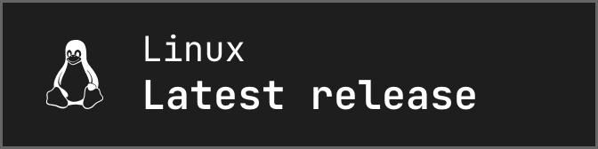
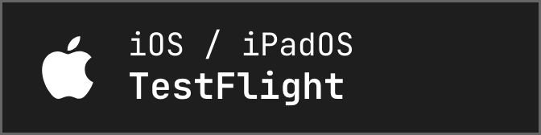
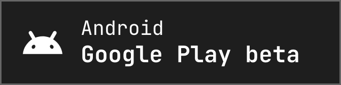

# Quickstart

Vis explores a project, changes code, and runs checks. On this page, you install Vis, run a first
task, and connect the desktop app or the phone app.

<nav class="quick-links" aria-label="Quickstart">
  <a href="#install">Install</a>
  <a href="#first-session">Try a task</a>
  <a href="#connect-an-app">Connect an app</a>
</nav>

## Install

### Install Vis where your work runs

Install Vis on the computer that holds your project. Native packages support macOS on Apple silicon
and Linux on x64 or ARM64. On Windows, use Linux in WSL2. For other platforms or a source build,
read [Runtime distributions](distributions.md).

The installer needs `curl` and `tar`. It does not need Java or Git. It writes to `~/.local/bin` and
can update your shell profile.
[Read the installer](https://github.com/Blockether/vis/releases/download/installer/install-vis-agent) before you run it.

```bash
curl -fsSL https://github.com/Blockether/vis/releases/download/installer/install-vis-agent | bash
```

The desktop app and the phone app connect to this engine. They do not run it. For a Python program,
`pip install vis-agent` is enough, because the [Python SDK](python-sdk.md#install-the-sdk) downloads
Vis on first use.

### Get the desktop app

Download Vis for Windows x64, universal macOS, or Linux x64 with the buttons below.
For Linux ARM64, [download the AppImage](https://github.com/Blockether/vis/releases/download/v0.5.32/vis-companion-0.5.32-linux-arm64.AppImage).
The [latest GitHub release](https://github.com/Blockether/vis/releases/latest) lists all packages.

<div class="store-links" aria-label="Download the desktop app">
<a class="store-windows" href="https://github.com/Blockether/vis/releases/download/v0.5.32/vis-companion-0.5.32-windows-x64.msi"></a>
<span aria-hidden="true">&nbsp;&nbsp;</span>
<a class="store-macos" href="https://github.com/Blockether/vis/releases/download/v0.5.32/vis-companion-0.5.32-macos-universal.dmg"></a>
<span aria-hidden="true">&nbsp;&nbsp;</span>
<a class="store-linux" href="https://github.com/Blockether/vis/releases/download/v0.5.32/vis-companion-0.5.32-linux-x64.AppImage"></a>
</div>

Install the package and open Vis. Then [connect the desktop app](#connect-the-desktop-app).
[Desktop setup](distributions.md#open-the-desktop-app) describes the installation and launcher
options.

<span id="get-the-phone-app"></span>

### iPhone, iPad, and Android

These apps are public betas. Install one, then [pair it](#pair-a-phone).

<div class="store-links" aria-label="Install the Companion app">
<a class="store-apple" href="https://testflight.apple.com/join/4anYT4Wk"></a>
<span aria-hidden="true">&nbsp;&nbsp;</span>
<a class="store-android" href="https://play.google.com/apps/testing/com.blockether.viscompanion"></a>
</div>

## First session

Choose a provider and a model before you send a task. A provider may need an account or an API key,
and it may charge for use. For a local model, use Ollama or LM Studio.
[Providers and models](configuration.md#providers-and-models) lists the options.

Vis can edit files and run commands. Start with a task that changes no files.

### In the terminal

Open a terminal in your project:

```bash
cd /path/to/project
vis-agent tui
```

Vis starts a local gateway if none runs.

1. Add a provider in the provider picker.
2. Follow its sign-in instructions.
3. Select a model.

Press **Enter** to send a message. [Keyboard shortcuts](keyboard-shortcuts.md) lists the key for a
new line and the other keys.

### In the desktop or phone app

[Connect the app](#connect-an-app). Then open your project, start a session, and choose a provider
and a model.

### Try a first task

Send this message:

> Explain how this project is organized and where its tests live. Don't change any files.

The answer describes the structure of your project and its tests. Open **Activities** to see the
searches that Vis ran and the files that Vis read.

Next, ask for a small change and the tests for it. Review the diff before you use the change.
To limit what Vis can access, read [Process jail and network policy](jail.md).

<span id="connecting-the-companion-app"></span>

## Connect an app

The desktop app and the phone app connect to a **gateway**, the Vis service on the computer that
holds your project. Your files and commands stay on that computer. The apps show the same sessions
as the terminal.

[Install Vis](#install) on that computer first. An app needs no separate Vis account.

### Connect the desktop app

On macOS and Linux, open the app from a terminal:

```bash
vis-agent desktop
```

The command opens the app. If no local gateway runs, the command starts one in the background. That
gateway runs while the app runs.

1. In **Add a machine**, enter `http://127.0.0.1:7890`.
2. Leave the bearer token empty for the default local gateway.

You add the machine only one time.

If you open the app another way, no gateway starts. Check for a gateway:

```bash
vis-agent gateway status
```

If none runs, start one:

```bash
vis-agent gateway start --host 127.0.0.1
```

This command runs the gateway in the foreground, so keep that terminal open.

If you turned on token authentication, enter the token. If you reuse a gateway that already runs,
use the address that `vis-agent gateway status` shows.

The app reaches a local WSL2 gateway through localhost forwarding. On an Intel Mac, use the
[JVM distribution](distributions.md#native-vs-jvm) or a gateway on another computer.

For a gateway on another computer, [pair the app](#pair-a-phone) and paste the pairing link.
`127.0.0.1` reaches only the device that you use.

### Pair a phone

Your phone needs an address that it can reach over your local network or a private VPN. It cannot
reach a gateway on `127.0.0.1`.

Keep token authentication on for remote access. A pairing link and a QR code each include the token.
Treat them as passwords, and do not share them in public. Use a trusted network, a VPN, or HTTPS
for remote connections.

On the computer that runs Vis, start a gateway for pairing:

```bash
vis-agent gateway start --require-token --pair
```

Without `--host`, the gateway listens on all network interfaces. The pairing link lists the
addresses of the computer. If the computer uses [Tailscale](gateway-service.md#access-from-anywhere-with-tailscale),
its Tailscale address comes first, so the phone also connects away from home. To listen on one
address only, add `--host` with that address.

Keep that terminal open. In **Add a machine**, scan the QR code or paste the pairing link. The app
then opens the projects and sessions of that computer.

If a gateway already runs, create a pairing link without a restart:

```bash
vis-agent gateway pair
```

A gateway that listens only on `127.0.0.1` needs a restart with an address that the phone can reach.
Check for active work before you stop the gateway.
[Stop or restart a gateway](gateway-service.md#stop-or-restart-a-gateway) has the steps.

<span id="access-from-anywhere-with-tailscale"></span>

For access away from home or a custom pairing address, read
[Remote connections](gateway-service.md#connect-from-another-machine).


## Gateway reference

<span id="starting-the-gateway"></span>
<span id="using-a-remote-gateway-from-the-cli"></span>
<span id="tokens-and-http-401"></span>
<span id="http-api"></span>
<span id="python-sdk"></span>
<span id="resource-limits"></span>

For remote connections, tokens, and service setup, read [Running a gateway](gateway-service.md). To
use Vis from your own code, read [Python SDK basics](python-sdk.md) or
[HTTP API basics](http-api.md).

## See also

- To find the page for your next task, read the [Overview](index.md).
- To continue, stop, or find your work, read [Sessions](sessions.md).
- To tell Vis how your codebase works, read [Project instructions](project-instructions.md).
